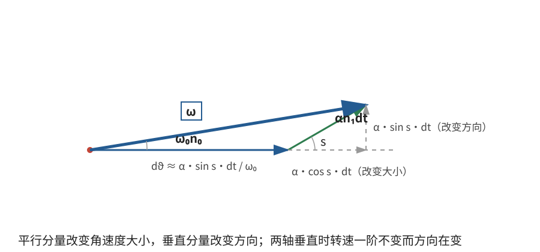
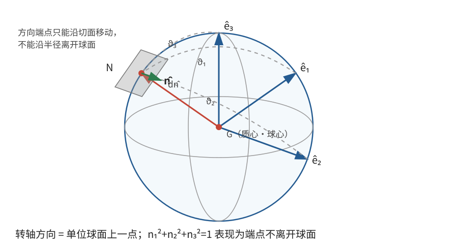

# 正文第10章：力引起的瞬时转轴变化

*Concerning the Momentary Change in the Axis of Rotation Produced by Forces*

> **选编说明**：本章依据欧拉原著正文第10章重写。保留两个转动叠加、转轴相对主轴的变化、非主轴转动自身的扰动、外加力与转动自身效应的合成，以及主轴在空间中的运动；省略重复的球面三角换算，改用方向余弦和一阶矢量展开。现代欧拉方程只用于核对和解释，不归作本章已经采用的紧凑形式。

## 本章导入：转动轴为什么会被“带偏”？

刚体已经绕通过质心的一条轴旋转，现在又受到外力作用。若这些力单独作用于静止刚体，会使它绕另一条轴开始转动，那么两种转动同时出现时，转轴和转速怎样改变？

更微妙的是：即使完全没有外力，只要初始转轴不是主轴，转动轴一般也会改变。各质量微元的向心加速度并不总能相互抵消，它们对质心的力矩会改变角动量的方向。

本章先处理一个可亲手算通的一阶近似，再把它用于主轴坐标和自由转动。

---

## 1. 两个转动叠加时，轴和转速怎样改变？

### 1.1 用一阶展开代替繁复的球面作图

设初始角速度大小为 $\omega_0>0$，方向沿单位矢量 $\hat{\mathbf n}_0$，所以初始角速度矢量为

$$
\boldsymbol\omega_0=\omega_0\hat{\mathbf n}_0。
$$

这里 $\boldsymbol\omega$ 表示**角速度**（angular velocity），初始转轴就是此刻的**瞬时转轴**（instantaneous axis of rotation）。它通过质心，但不需要在以后时刻保持不动。

设外力若单独作用于静止刚体，会产生沿另一单位方向 $\hat{\mathbf n}_1$ 的初始角加速度 $\boldsymbol\alpha=\alpha\hat{\mathbf n}_1$。两轴夹角为 $s$，即

$$
\hat{\mathbf n}_0\cdot\hat{\mathbf n}_1=\cos s。
$$

经过很短时间 $dt$，两种效应叠加为

$$
\boxed{\boldsymbol\omega
=\omega_0\hat{\mathbf n}_0+\alpha\hat{\mathbf n}_1\,dt+O(dt^2)}。
$$

这里 $O(dt^2)$ 表示在一阶计算中忽略的高阶小量。角速度的方向由合成矢量决定，而不是把两个转轴的几何方向直接平均。

### 1.2 角速度大小的一阶变化

沿原转轴方向投影，得

$$
\hat{\mathbf n}_0\cdot\boldsymbol\omega
=\omega_0+\alpha\cos s\,dt+O(dt^2)。
$$

垂直于原转轴的分量只影响方向的二阶大小修正，所以角速度大小的一阶改变量为

$$
\boxed{d\omega=\alpha\cos s\,dt}。
$$

若两轴同向，$s=0$，全部作用用于加速；若反向，$s=\pi$，则减速；若两轴垂直，$s=\pi/2$，角速度大小的一阶变化为零。

### 1.3 转轴方向的一阶变化

使转轴改变方向的是垂直于 $\hat{\mathbf n}_0$ 的角加速度分量，其大小为 $\alpha\sin s$。角速度矢量要在大小约为 $\omega_0$ 的原矢量上增加这个横向小量，因此转过的微小角度满足

$$
\boxed{d\vartheta=\frac{\alpha\sin s}{\omega_0}\,dt}。
$$

转向是从 $\hat{\mathbf n}_0$ 朝 $\hat{\mathbf n}_1$ 在垂直于原轴的投影方向偏转。

欧拉把从静止开始、在 $dt$ 内由外力产生的转角写为 $qdt^2$。现代写法中，这个角在一阶匀角加速度近似下是 $\frac12\alpha dt^2$，所以 $\alpha=2q$。于是上面两式正是原书的

$$
d\vartheta=\frac{2q\sin s}{\omega_0}\,dt,
\qquad
d\omega=2q\cos s\,dt。
$$

> **批注**：这些公式只保留一阶变化。两轴垂直时，说“转速不变”是指 $\dot\omega=0$ 这一瞬时结论，并不保证稍后仍无二阶变化。原书用球面上的两个小转动相互抵消来寻找瞬时静止轴，现代矢量展开给出同一结果，也避免了把有限转动的角直接当作矢量相加。

---

## 2. 怎样描述转轴相对主轴的变化？

### 2.1 方向余弦与单位球面

取刚体的三条**主轴**（principal axes）为坐标轴。瞬时转轴的单位方向 $\hat{\mathbf n}$ 在这组随体坐标轴上的分量为

$$
\hat{\mathbf n}=(n_1,n_2,n_3),
\qquad
n_i=\cos\vartheta_i，
$$

其中 $\vartheta_i$ 是转轴与第 $i$ 条主轴的夹角，$n_i$ 称为**方向余弦**（direction cosines）。它们满足

$$
\boxed{n_1^2+n_2^2+n_3^2=1}。
$$

对时间微分，得到转轴变化必须遵守的约束：

$$
\boxed{n_1\dot n_1+n_2\dot n_2+n_3\dot n_3=0}。
$$

这在几何上表示：方向矢量的端点始终在单位球面上，微小位移沿球面的切线，而不能沿半径离开球面。欧拉用三组球面弧长及其微分表达的就是这一约束。

若再给出角速度大小 $\omega$，则三个主轴分量直接写成

$$
\omega_i=\omega n_i。
$$

转轴和转速的瞬时变化，都由 $\omega_i$ 及其变化率完全确定。

### 2.2 主轴在空间中的运动

设三条主轴在空间的单位方向分别为 $\hat{\mathbf e}_1,\hat{\mathbf e}_2,\hat{\mathbf e}_3$。它们固连于刚体，所以每一条都随刚体以同一个角速度转动：

$$
\boxed{\frac{d\hat{\mathbf e}_i}{dt}
=\boldsymbol\omega\times\hat{\mathbf e}_i},
\qquad i=1,2,3。
$$

这就是原书最后一组空间位置方程的现代重述。已知初始主轴方向、初始角速度及其变化规律，就可以逐步积分出刚体取向。

必须区分两类运动：

- $\hat{\mathbf n}$ 在主轴坐标中的变化，说明瞬时转轴相对刚体怎样移动；
- $\hat{\mathbf e}_i$ 在空间中的变化，说明刚体本身怎样改变取向。

只看其中一类，不能得到完整的空间运动图像。

---

## 3. 非主轴转动为什么即使无外力也会变化？

### 3.1 转动自身的力矩不能漏掉

若初始转轴是主轴，无外力矩时角动量与角速度保持同方向，转动可以匀速持续。若初始转轴不是主轴，各质量微元所需的向心力对质心仍可能形成不平衡力矩。

欧拉把这种作用称为由运动自身、尤其离心作用产生的力。它们不是新增加的外力，也不能改变无外力刚体的总角动量；它们所揭示的是：要保持原来的转轴方向，本来就需要约束力矩。没有这种约束时，转轴便会改变。

因此，研究非主轴自由转动时，不能只把“外力为零”代入固定轴公式，还要考虑角动量方向的变化。

### 3.2 原书的角速度大小变化公式

设三个**主转动惯量**（principal moments of inertia）为 $I_1,I_2,I_3$，无外力矩，且 $\omega_i=\omega n_i$。欧拉由主轴坐标中的元素力计算得到：角速度大小的瞬时变化率为

$$
\boxed{
\dot\omega=
\frac{(I_1-I_2)(I_1-I_3)(I_2-I_3)}
{I_1I_2I_3}\,
\omega^2n_1n_2n_3}。
$$

这个式子把三个主轴置于同等地位。由此立即得到两个结论：

1. 若初始转轴为主轴，三个方向余弦中有两个为零，所以 $\dot\omega=0$；
2. 若任意两个主转动惯量相等，分子为零，所以角速度大小保持不变，即使转轴方向仍在变化。

第二个结论正是后面两主惯量相等刚体自由转动的起点。

> **批注：现代核对。** 在随体主轴坐标系中，现代**欧拉方程**（Euler's equations）把角动量变化压缩为
> $$
> I_1\dot\omega_1=(I_2-I_3)\omega_2\omega_3+\tau_1,
> $$
> 另外两个方程由循环置换得到。无外力矩时，将三个方程分别乘以 $\omega_1,\omega_2,\omega_3$ 并相加，再利用 $\dot\omega=(\omega_1\dot\omega_1+\omega_2\dot\omega_2+\omega_3\dot\omega_3)/\omega$，恰能得到上式。这里的矩阵和矢量记号是现代重述；本章原书采用的是元素力、力矩和球面几何。

---

## 4. 外力与转动自身的效应怎样合成？

### 4.1 先分开，再在一阶上相加

对于已经转动的刚体，可以按以下顺序处理：

1. 由质心运动定理
   $$
   M\mathbf a_G=\mathbf F
   $$
   求平动效应，其中 $\mathbf F$ 是外力合力，$\mathbf a_G$ 是质心加速度；
2. 由外力对质心的力矩，求这些力若作用于静止刚体时会产生的角加速度；
3. 单独计算现有非主轴转动自身引起的角速度变化；
4. 在一阶近似中，把两种转动变化相加，再与质心平动合成。

平动不会改变“各点相对于质心怎样转动”这一部分的计算。反过来，转动自身的元素力相互抵消合力，也不会额外产生质心平动。

### 4.2 从瞬时变化到完整运动

实际计算时，三个主轴分量及其力矩条件已经包含全部信息。方向余弦微分约束用于把转轴变化写回单位球面，$\dot{\hat{\mathbf e}}_i=\boldsymbol\omega\times\hat{\mathbf e}_i$ 则用于更新刚体在空间中的取向。

欧拉因此把问题归为：已知每一时刻的微小变化，再借积分求整个运动。后续章节按主转动惯量是否相等分类，是因为不同情形下这些积分和几何图像的复杂程度差别很大。

> **批注**：现代写法还会直接使用角动量 $\mathbf L_G$ 和能量。无外力矩时，$\mathbf L_G$ 在空间中守恒，转动动能也守恒；但这些守恒量并不意味着 $\boldsymbol\omega$ 在空间中恒定。把“角动量守恒”读成“角速度和转轴不变”，正是非主轴自由转动中最常见的误解之一。

---

## 本章小结

1. 初始转动与力所激发的转动可以按角速度矢量叠加；一阶上，轴向变化由横向角加速度决定，转速变化由纵向分量决定。
2. 原书的 $2q\sin s\,dt/\omega_0$ 和 $2q\cos s\,dt$ 分别对应现代写法中的轴转角与转速增量。
3. 方向余弦满足平方和为1及其微分约束；主轴在空间的取向则由 $\dot{\hat{\mathbf e}}_i=\boldsymbol\omega\times\hat{\mathbf e}_i$ 更新。
4. 非主轴转动即使没有外力也会改变，因为角动量方向一般不与原角速度方向重合。
5. 无外力矩时，角速度大小的变化率含因子 $(I_1-I_2)(I_1-I_3)(I_2-I_3)$；任意两个主转动惯量相等时，角速度大小不变。
6. 外力、转动自身效应和质心平动可分别求出一阶贡献再合成；从瞬时变化到完整运动还需要积分。

下一章先处理最简单的刚体：三个主转动惯量全部相等。此时任意过质心的轴都是主轴，自由转动具有最简洁的形式。

---

## 底本与现代参考

1. 欧拉原著正文第10章；Ian Bruce 英译见本地 [`english_translation/tmvol1ch10tr.txt`](english_translation/tmvol1ch10tr.txt)，原书图版及公式见同目录 PDF。
2. L. D. Landau and E. M. Lifshitz, *Mechanics*, 3rd ed.：角速度、角动量与自由转动方程的现代表述。
3. H. Goldstein, C. Poole and J. Safko, *Classical Mechanics*, 3rd ed.：主轴坐标、欧拉方程与刚体取向运动学的现代对照。

[上一章：正文第9章——刚体运动的初始产生](欧拉刚体运动理论_正文_第9章.md)

[下一章：正文第11章——三主惯量相等刚体的自由运动](欧拉刚体运动理论_正文_第11章.md)
