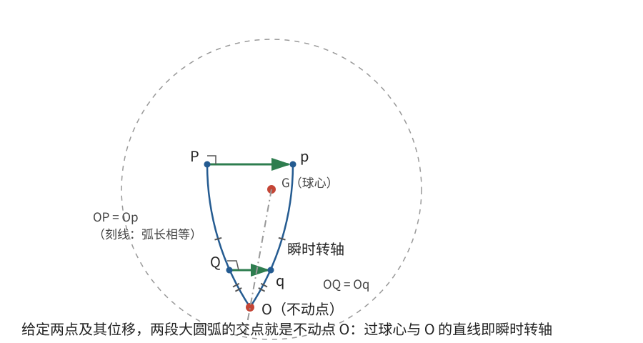

# 正文第11章：三主惯量相等刚体的自由运动

*Concerning the Free Motion of the Said Bodies with Equal Principal Axes, Acted on by No Forces*

> **选编说明**：本章依据欧拉原著正文第11章重写。保留三主惯量相等刚体的判据、一般刚体瞬时运动分解、由两点运动确定转轴的思想，以及此类刚体的自由运动；球面三角中的重复求值改用少量矢量关系说明。现代惯量张量与角动量表达式只用于核对，不改变欧拉从自由轴和几何运动学出发的论证顺序。

## 本章导入：所有方向“同样难转”的刚体

均匀球体绕过球心的任意直径转动，转动惯量都相同。具有这种性质的刚体，并不要求外形也是球：关键在于质量分布使三个主转动惯量相等。

本章先说明这种刚体的特殊之处，再证明一个适用于所有刚体的运动学结论：任一瞬时运动都可分解为质心平动和绕过质心某轴的转动。最后把两者结合，求无外力时的完整运动。

---

## 1. 三主惯量相等：不是只看外形

### 1.1 定义与坐标判据

若刚体对三条主轴的转动惯量彼此相等，欧拉称它为具有**三个相等主轴**（three equal principal axes）的刚体。为避免把“轴相等”误解为几何长度相等，这里称“**三主惯量相等**”。

设共同的转动惯量为 $I_0$。欧拉给出的坐标判据是：在以质心为原点的正交坐标系中，

$$
\int xy\,dm=\int xz\,dm=\int yz\,dm=0，
$$

并且

$$
\boxed{\int x^2\,dm=\int y^2\,dm=\int z^2\,dm=S}。
$$

这里用同一个 $S$ 表示三个相等的二阶质量矩。

为什么这两个条件与三主惯量相等有关？三条坐标轴的转动惯量分别是

$$
I_x=\int(y^2+z^2)\,dm,
\quad I_y=\int(x^2+z^2)\,dm,
\quad I_z=\int(x^2+y^2)\,dm。
$$

两两相等恰好要求 $x^2,y^2,z^2$ 的积分彼此相等；第一组条件则是主轴坐标中惯量积为零的要求。

### 1.2 为什么任意过质心的轴都有相同转动惯量？

任取单位方向 $\hat{\mathbf n}$。质量微元相对质心的位置为 $\mathbf r$，它到过质心、沿 $\hat{\mathbf n}$ 的轴的垂直距离平方为

$$
r^2-(\hat{\mathbf n}\cdot\mathbf r)^2。
$$

对上述判据使用现代分量展开，交叉项全部消失，因此

$$
\begin{aligned}
I_n
&=\int\left[r^2-(\hat{\mathbf n}\cdot\mathbf r)^2\right]dm\\
&=3S-S(n_1^2+n_2^2+n_3^2)=2S。
\end{aligned}
$$

由于 $\hat{\mathbf n}$ 是单位矢量，结果就是

$$
\boxed{I_n=I_0=2S}。
$$

若 $\hat{\mathbf n}_1,\hat{\mathbf n}_2$ 互相垂直，同理有

$$
\int(\hat{\mathbf n}_1\cdot\mathbf r)
(\hat{\mathbf n}_2\cdot\mathbf r)\,dm
=S\,\hat{\mathbf n}_1\cdot\hat{\mathbf n}_2=0。
$$

所以任意过质心的正交三轴都可作为主轴，任意过质心方向的转动惯量也都等于 $I_0$。

> **批注**：现代语言把 $\mathbf I_G=I_0\mathbf 1$ 称为**惯量张量**（inertia tensor）的各向同性。欧拉列出的是等价的积分判据。这里的“各向同性”只指转动惯量，不要求材料、密度或外形在所有方向相同。

### 1.3 哪些物体具有这种性质？

欧拉举出的例子包括均匀球体、五种正多面体，以及某些圆柱、圆锥和截锥。后三类必须选择适当尺寸和形状，使三个主转动惯量恰好相等；**并不是任意圆柱或圆锥都具有这种性质**。

即使是不均匀物体，也可能通过调整质量分布满足上述积分等式。判断依据是质量矩，而不是“看起来像不像球”。

---

## 2. 任意刚体的瞬时运动都能分解

### 2.1 欧拉怎样在球面上找到不动轴？

欧拉先提出一个对所有刚体都成立的定理：

> 任一时刻，刚体运动都由质心的**平动**（progressive motion）和绕过质心某轴的转动合成。

先在思维中减去质心速度，使质心暂时静止。以质心为球心作一个球面，把刚体上各点投影到球面上。设点 $P$ 在极短时间内移到 $p$。通过 $P$ 作一个垂直于小位移 $Pp$ 的大圆，并在其上另取点 $Q$，它同时移到 $q$。

刚性要求 $PQ=pq$。由于 $Pp$ 垂直于 $PQ$，在一阶近似下，$Qq$ 也必须垂直于 $PQ$，否则两点间距离就会改变。延长大圆弧 $PQ$ 和 $pq$，它们交于 $O$。由等距关系可得 $OP=Op$、$OQ=Oq$，所以 $O$ 在这一瞬时不动。

于是，通过质心和 $O$ 的直线就是此刻的转动轴。把先前减去的质心平动加回来，就得到一般运动的分解。

这个证明的关键不是球面本身，而是：**保持距离不变的连续运动，在每一瞬时都有一个转动轴。**

### 2.2 现代速度场写法

用现代矢量记号，设质心速度为 $\mathbf V_G$，点 $P$ 相对质心的位置为 $\boldsymbol\rho_P$，则该点速度写成

$$
\boxed{\mathbf v_P=\mathbf V_G+
\boldsymbol\omega\times\boldsymbol\rho_P}。
$$

其中 $\boldsymbol\omega$ 是此刻的角速度。公式中的第一项是共同平动，第二项是绕质心的瞬时转动。

“瞬时”二字不可省略：下一时刻 $\boldsymbol\omega$ 的大小和方向都可能改变，因此这条瞬时转轴不一定永远静止，也不一定固连于刚体。

> **批注**：多个转动同时发生时，瞬时角速度可以按矢量相加，合运动仍是绕一个瞬时轴的转动。有限转动则不能直接这样处理，其先后顺序会影响最终取向。欧拉的球面证明排除了“许多转动叠加后会变成另一种非转动运动”的疑虑，但没有使用后来的旋转群术语。

### 2.3 两点运动提供什么信息？

若质心已视为静止，刚体上两点 $P,Q$ 的位置差和速度差必须满足

$$
\frac{d}{dt}|\mathbf r_P-\mathbf r_Q|^2=0。
$$

展开得到

$$
\boxed{(\mathbf v_P-\mathbf v_Q)\cdot
(\mathbf r_P-\mathbf r_Q)=0}。
$$

这表示两点速度沿两点连线的分量相同，正是欧拉球面计算中“位移元在连线方向上的投影相等”的条件。

两个不互为对径点的点，其运动足以确定瞬时转轴和角速度；若两点互为对径点，它们速度相同，无法单独确定转轴。原书详细的球面三角公式就是在实现这一确定过程，这里不再重复展开。

---

## 3. 三主惯量相等刚体的自由运动

### 3.1 质心平动

刚体不受外力时，质心作匀速直线运动：

$$
\boxed{\mathbf R(t)=\mathbf R_0+\mathbf Vt}，
$$

其中 $\mathbf R_0$ 和 $\mathbf V$ 分别是初始质心位置和恒定质心速度。这一结论不依赖主惯量是否相等。

### 3.2 转动轴与角速度保持不变

三主惯量相等时，任何初始转轴都是主轴，因此第8章的自由轴结论可直接使用：无外力矩时，初始转动匀速持续，转轴方向不变。

用现代角动量作核对，因为

$$
\mathbf L_G=I_0\boldsymbol\omega，
$$

而自由刚体对质心的角动量在空间中守恒，所以

$$
\dot{\boldsymbol\omega}=\mathbf0。
$$

若质心无平动，转轴在空间中静止；若叠加质心平动，转轴随质心移动，但始终与自身平行。刚体绕该轴的转角为

$$
\theta(t)=\theta_0+\omega t。
$$

这就是欧拉对第一类刚体得到的完整答案：质心匀速直线运动，同时绕固定方向匀速转动。

### 3.3 两个补充结论

- 对一般刚体，若初始转动恰好绕某一主轴，也能得到同样的自由运动：质心匀速平动，主轴方向不变，转速恒定。
- 若外力的等效作用线通过质心，则对质心的外力矩为零。平动按
  $$
  M\mathbf a_G=\mathbf F
  $$
  改变，而上述匀速转动和转轴方向不受影响。此时质心不必再走直线，但转动仍然独立保持。

> **批注**：不能把这种独立性推广到任意作用线和任意初始转轴。力矩可以改变角速度大小和方向，非主轴自由转动也会改变瞬时轴。后续两章正是逐步取消“任意轴都是主轴”这一便利条件。

---

## 本章小结

1. 三主惯量相等的本质是三主转动惯量相等，不是外形必须为球；其积分判据为惯量积为零且三个坐标二阶质量矩相等。
2. 对这种刚体，任意过质心的轴都是主轴，任意方向的转动惯量均为 $I_0=2S$。
3. 任意刚体的瞬时运动都能分解为质心平动和绕过质心的瞬时转动；瞬时轴可以随时间改变。
4. 两点间距离不变要求相对速度在连线方向没有分量差；两个非对径点的运动可用于确定瞬时轴。
5. 无外力时，三主惯量相等刚体的质心匀速直线运动，转轴方向不变，角速度恒定。
6. 通过质心的等效力系只改变平动，不改变这种转动；任意力和非主轴转动则不能套用这一简化。

下一章保留两个相等的主转动惯量。此时转轴相对刚体可以移动，但角速度大小仍保持不变。

---

## 底本与现代参考

1. 欧拉原著正文第11章；Ian Bruce 英译见本地 [`english_translation/tmvol1ch11tr.txt`](english_translation/tmvol1ch11tr.txt)，原书图版及公式见同目录 PDF。
2. L. D. Landau and E. M. Lifshitz, *Mechanics*, 3rd ed.：刚体瞬时运动、惯量张量与角动量的现代表述。
3. H. Goldstein, C. Poole and J. Safko, *Classical Mechanics*, 3rd ed.：刚体运动分解和球对称惯量的现代对照。

[上一章：正文第10章——力引起的瞬时转轴变化](欧拉刚体运动理论_正文_第10章.md)

[下一章：正文第12章——两主惯量相等刚体的自由运动](欧拉刚体运动理论_正文_第12章.md)
