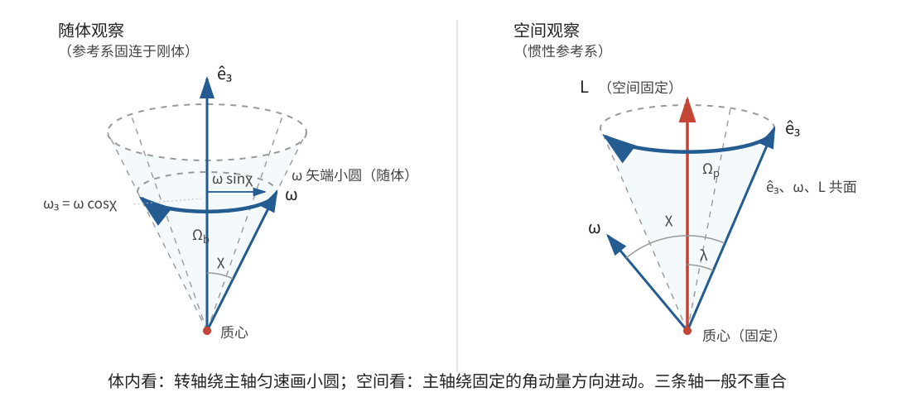

# 正文第12章：两主惯量相等刚体的自由运动

*Concerning the Free Motion of the Said Bodies with Two Equal Principal Axes, Acted on by No Forces*

> **选编说明**：本章依据欧拉原著正文第12章重写。保留特殊主轴、瞬时转轴在体内的匀速小圆运动、空间中的两个转动合成、可动轴与可变轴的区分，以及地球实际岁差不能由自由惯性运动解释的论证。省略一般固定点下的繁复球面积分，保留其最简特解并用角动量核对。现代欧拉方程与空间几何解释均明确标为重述或批注。

## 本章导入：转轴在物体内部也会“绕圈”吗？

三主惯量相等时，任何过质心的轴都是主轴，自由转动的轴保持不变。若只有两个主转动惯量相等，就会剩下一条与众不同的特殊主轴。

圆柱、圆锥和一般旋转体是常见例子。绕特殊主轴或绕与其垂直的轴转动时，自由转轴仍能保持不变；若初始转轴斜置于这两类方向之间，瞬时转轴就会在刚体内部绕特殊主轴移动。

本章要回答：它怎样移动？角速度是否改变？从空间看，刚体的特殊主轴又怎样运动？

---

## 1. 两个主惯量相等与特殊主轴

设刚体具有**两个相等主轴**（two equal principal axes），准确地说，是有两个主转动惯量相等。取第三条主轴为特殊方向 $\hat{\mathbf e}_3$，记：

- $A=I_\parallel$：绕特殊主轴的转动惯量；
- $B=I_\perp$：绕任意与特殊主轴垂直的轴的转动惯量；
- 本章设 $A\neq B$；$A=B$ 时回到上一章。

这里 $A,B$ 都含质量，不再沿用原书 $Maa,Mcc$ 的旧记号。

由于两个横向主惯量相等，横向平面内任意一对互相垂直的方向都可取作主轴。真正被唯一确定的是**特殊主轴**（singular principal axis）；其余两条轴可在横向平面内按方便选择。

均匀圆柱、圆锥和旋转体具有这种惯量结构，但不要求材料密度一定均匀。两个主惯量相等只限定了质量分布的积分性质。

> **批注**：现代几何语言中，惯量椭球是旋转椭球：一条特殊半轴与横向圆截面对应。它帮助说明为什么横向主轴的选取不唯一，但“旋转椭球”是后来的几何表达，不是本章推导所必须的工具。

---

## 2. 瞬时转轴在刚体内画出小圆

### 2.1 角速度大小和轴倾角保持不变

设初始角速度大小为 $\omega$，初始瞬时转轴与特殊主轴的夹角为 $\chi$。欧拉把第10章无外力公式用于两个主惯量相等的情形，首先得到

$$
\boxed{\dot\omega=0}。
$$

进一步计算方向余弦的变化可得：瞬时转轴与特殊主轴的角距离不变，

$$
\boxed{\dot\chi=0}。
$$

因此，瞬时转轴的端点在以特殊主轴为球心轴的小圆上运动。这里“小圆”是球面上的圆，不是特殊主轴周围一个普通平面圆的想当然投影；其角半径就是 $\chi$。

### 2.2 横向分量怎样匀速旋转？

把原书的方向余弦结果改写为现代主轴分量。令 $\hat{\mathbf e}_1,\hat{\mathbf e}_2$ 位于横向平面内，初始横向方位角为 $\varphi_0$。定义

$$
\boxed{\Omega_b=\frac{A-B}{B}\,\omega\cos\chi}。
$$

则任意时刻的角速度分量可以写成

$$
\boxed{
\begin{aligned}
\omega_1&=\omega\sin\chi\cos(\varphi_0+\Omega_bt),\\
\omega_2&=\omega\sin\chi\sin(\varphi_0+\Omega_bt),\\
\omega_3&=\omega\cos\chi。
\end{aligned}}
$$

这三式同时说明：

- $\omega_3$ 不变，所以轴倾角 $\chi$ 不变；
- 横向分量的大小 $\omega\sin\chi$ 不变，只以角速度 $\Omega_b$ 转动；
- 总角速度大小 $\omega$ 不变；
- 瞬时转轴在随体球面上以 $\Omega_b$ 匀速绕特殊主轴前进。

若 $A>B$，则 $\Omega_b$ 与 $\omega_3$ 同号；若 $A<B$，转向相反。绕行一周所需时间为

$$
\boxed{T_b=\frac{2\pi}{|\Omega_b|}}
$$

（仅当 $\Omega_b\neq0$）。

> **批注：现代核对。** 在 $I_1=I_2=B$、$I_3=A$ 的主轴坐标中，无外力矩的欧拉方程化为
> $$
> \dot\omega_3=0,\qquad
> \dot\omega_1=-\Omega_b\omega_2,\qquad
> \dot\omega_2=\Omega_b\omega_1。
> $$
> 对上述三角函数解逐式求导即可验证。旧稿在 $\Omega_bt$ 中漏写 $\omega$，会把有时间的量误当成角度；这里的量纲检查是必要的一步。

### 2.3 三种不绕行情形与原书的小圆弧长

瞬时转轴相对刚体不动的主要情形有：

1. $\chi=90^\circ$：初始转轴垂直于特殊主轴，$\Omega_b=0$；
2. $A=B$：回到三主惯量相等，$\Omega_b=0$；
3. $\chi=0$：初始转轴就是特殊主轴，横向分量为零，小圆退化为一点。

当 $0<\chi<90^\circ$ 且 $\Omega_b\neq0$ 时，单位球面上小圆弧的长度为

$$
\boxed{s_b=\sin\chi\,|\Omega_b|t
=\frac{|A-B|}{2B}\,\omega t\,|\sin2\chi|}。
$$

在其他量不变时，因子 $\sin2\chi$ 在 $\chi=45^\circ$ 处最大。这就是原书关于小圆弧长的结论；其中同样不能漏掉初始角速度 $\omega$。

---

## 3. 从空间看：特殊主轴也在进动

### 3.1 欧拉选择的特殊固定方向

欧拉随后选取一个特殊的空间固定点 $Z$，使计算取得最简特解。用现代物理语言，$Z$ 的方向正是对质心的**角动量**（angular momentum）$\mathbf L_G$ 的方向。无外力矩时，它在空间中保持不变。

在随体主轴坐标中，

$$
\mathbf L_G=(B\omega_1,B\omega_2,A\omega_3)。
$$

其大小为

$$
\boxed{L=\omega\sqrt{B^2\sin^2\chi+A^2\cos^2\chi}}，
$$

是常量。设特殊主轴与固定角动量方向的夹角为 $\lambda$，则

$$
\boxed{\tan\lambda=\frac{B}{A}\tan\chi}。
$$

这里先取 $0<\chi<\pi/2$，以避免主轴情形的退化。由于 $\chi$ 不变，$\lambda$ 也不变：特殊主轴围绕固定角动量方向作圆锥运动。这种运动称为空间**进动**（precession）。

### 3.2 进动和相对自转的两个角速度

令 $\hat{\mathbf L}=\mathbf L_G/L$。角动量与角速度之间满足

$$
\mathbf L_G=B\boldsymbol\omega+(A-B)\omega_3\hat{\mathbf e}_3。
$$

整理可得

$$
\boldsymbol\omega
=\frac{L}{B}\hat{\mathbf L}-\Omega_b\hat{\mathbf e}_3。
$$

所以，若把运动分解为“特殊主轴绕固定角动量方向的进动”和“刚体相对进动参考方向绕特殊主轴的自转”，两个角速度分别为

$$
\boxed{\Omega_p=\frac{L}{B}
=\frac{\omega\sin\chi}{\sin\lambda}}
$$

和

$$
\boxed{\Omega_s=-\Omega_b
=-\frac{A-B}{B}\,\omega\cos\chi}。
$$

第一式就是原书用球面角写出的空间进动速率。第二式的负号来自本文的右手转向约定；采用相反的自转正方向，就和原书一样把速率写为 $(A-B)\omega\cos\chi/B$。符号约定不影响物理图像：体内横向分量的转动，与空间分解中的相对自转，是同一运动的两种描述。

还要注意：特殊主轴、瞬时转轴和角动量轴是三条不同的线。无外力矩时，只有角动量轴必须在空间固定；另外两条一般都在运动。

> **批注**：上述空间分解也可由 $\dot{\hat{\mathbf e}}_3=\boldsymbol\omega\times\hat{\mathbf e}_3$ 核对。它说明“角速度在体内绕特殊主轴转”与“特殊主轴在空间绕角动量轴转”并不矛盾，因为前者看的是相对刚体的方向，后者看的是刚体自身的空间取向。

---

## 4. 可动轴、可变轴与机械图像

### 4.1 两种“轴在动”不是一回事

欧拉特意区分：

- **可变轴**（variable axis）：此刻的瞬时转轴。它在该瞬时相对空间静止，但下一刻可以换成刚体中的另一条物质直线；
- **可动轴**（mobile axis）：刚体中一条确定的物质轴，例如特殊主轴。它随刚体运动，在空间中一般不静止。

本章前面的 $\omega_1,\omega_2,\omega_3$ 描述可变轴相对刚体的改变；空间进动则描述可动轴怎样改变方向。把二者混为一条“正在进动的轴”，会丢失本章最重要的几何区分。

### 4.2 轴与环的直观模型

欧拉设想：让刚体绕穿过质心的特殊主轴安装在一根轴上，再把这根轴两端装进一个圆环；圆环自身又可绕外部两个固定枢轴转动。

- 圆环不动时，刚体只绕特殊主轴转动；
- 刚体不相对圆环转动时，圆环带动刚体绕外部固定轴转动；
- 两种转动同时发生，就形成前面的空间运动。

外部固定枢轴方向对应角动量方向，刚体内的轴对应可动的特殊主轴。这个模型只用于显示两种几何角色，不表示自由刚体真的受到这些机械约束。

---

## 5. 地球类比为什么不能直接当作岁差理论？

欧拉把这种两个转动的组合与地球自转、地轴在空间中的进动作比较，但随即指出速率次序不符：地球每日自转极快，而实际岁差极慢；在欧拉所比较的图像中，绕自身特殊轴的相对转动却比空间进动慢，两者的相对快慢相反。

因此，地球实际的**岁差**（precession of the equinoxes）不能用本章“无外力矩的对称刚体”直接解释，必须考虑外部作用力矩。欧拉据此把自由惯性运动与实际受迫天文现象区分开来。

> **批注**：现代引子：本章可作为自由进动或自由章动的入口，而日月引力矩驱动的岁差属于另一类问题。真实地球还可变形、具有内部流体和复杂质量分布，不能把理想刚体公式直接套到观测周期上。这里保留的是原书对模型边界的提醒，而不是把本章包装成已经完成的天文岁差理论。

---

## 6. 加入质心平动后的完整自由运动

若刚体还有质心平动，无外力时只需再叠加

$$
\mathbf R(t)=\mathbf R_0+\mathbf Vt。
$$

在随质心运动的参考中：

1. 若初始转轴与特殊主轴重合或与其垂直，瞬时轴保持原方向，刚体匀速转动；
2. 若初始转轴斜置，角速度大小不变，瞬时轴在体内以 $\Omega_b$ 绕特殊主轴运动；
3. 特殊主轴本身在空间以 $\Omega_p$ 绕固定角动量方向进动，刚体相对进动方向以 $\Omega_s$ 自转；
4. 把这些转动与质心匀速平动合成，就得到完整自由运动。

---

## 本章小结

1. 两个主惯量相等时，横向主轴可在平面内任选，只有特殊主轴被唯一确定。
2. 无外力矩时，角速度大小和瞬时轴对特殊主轴的倾角都不变，横向分量以 $\Omega_b=(A-B)\omega\cos\chi/B$ 匀速转动。
3. 瞬时转轴在体内画出小圆；相关角度和弧长公式必须包含初始角速度 $\omega$，不能只写时间 $t$。
4. 角动量方向在空间固定，特殊主轴以 $\Omega_p=L/B$ 绕它进动，刚体相对进动方向以 $\Omega_s=-\Omega_b$ 自转。
5. 可变轴是瞬时转轴，可动轴是刚体内确定的物质轴；两者分别描述相对刚体和相对空间的变化。
6. 自由惯性运动不能直接解释地球实际岁差；后者需要外部力矩。

下一章将取消主惯量相等的条件，讨论三个主转动惯量各不相同时更复杂的自由转动。

---

## 底本与现代参考

1. 欧拉原著正文第12章；Ian Bruce 英译见本地 [`english_translation/tmvol1ch12tr.txt`](english_translation/tmvol1ch12tr.txt)，原书图版及公式见同目录 PDF。
2. L. D. Landau and E. M. Lifshitz, *Mechanics*, 3rd ed.：对称刚体自由转动、角动量与进动的现代表述。
3. H. Goldstein, C. Poole and J. Safko, *Classical Mechanics*, 3rd ed.：对称重陀螺与自由对称陀螺的运动学和动力学对照。

[上一章：正文第11章——三主惯量相等刚体的自由运动](欧拉刚体运动理论_正文_第11章.md)

[下一章：正文第13章——三主惯量不等刚体的自由运动](欧拉刚体运动理论_正文_第13章.md)
