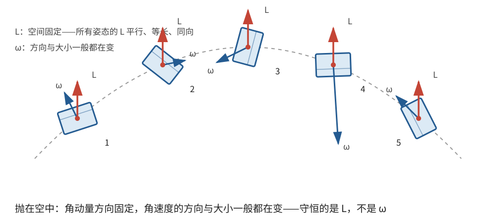
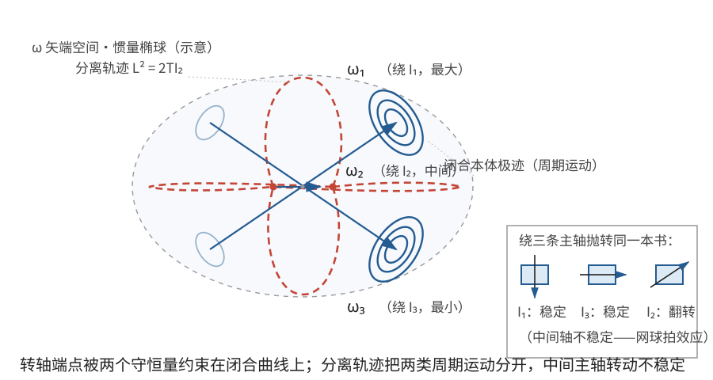

# 正文第13章：自由刚体运动

*Concerning the Free Motion of the Said Bodies with Three Unequal Principal Axes, and Acted on by No Forces*

> **选编说明**：本章依据欧拉原著正文第13章重写，保留三主转动惯量互不相等时的自由转动、两个守恒量、时间求积、主轴线特解和分离轨迹，并说明转轴相对物体与刚体相对空间这两个问题的区别。省略圆周摆类比的冗长参数换算和重复的球面三角展开，改用现代分量符号重述核心推导。

## 本章导入：没有外力，角速度为什么还会改变？

把一个形状不规则的物体抛到空中，忽略空气阻力。它的质心近似作抛物线运动，但物体的翻转通常并不规则：瞬时转轴会在物体内部改变方向，绕该轴的角速度大小也可能改变。

前两章已经讨论过球对称体和旋转对称体。本章考虑三个**主转动惯量**（principal moments of inertia）互不相等的刚体，并采用以下理想条件：

- 刚体不受外力，质心在惯性系中保持静止；
- 在刚体上取三个互相垂直的主轴，主转动惯量依次为 $I_1>I_2>I_3>0$；
- 初始角速度已知，研究角速度矢量在主轴坐标系中的变化。

“主轴不等”在这里指主转动惯量不等，而不是说三条几何轴的长度不同。若质心原本匀速运动，只需随质心作平移，以下转动结论不变。

---

## 1. 自由转动方程与两个守恒量

设角速度矢量为 $\boldsymbol\omega$，它在三个固连主轴上的分量是 $\omega_1,\omega_2,\omega_3$。无外力矩时，**自由转动**（free rotation）的欧拉方程为

$$
\boxed{
\begin{aligned}
I_1\dot\omega_1&=(I_2-I_3)\omega_2\omega_3,\\
I_2\dot\omega_2&=(I_3-I_1)\omega_3\omega_1,\\
I_3\dot\omega_3&=(I_1-I_2)\omega_1\omega_2.
\end{aligned}}
$$

这里的点号表示对时间求导。三个方程互相耦合：只要有两个分量不为零，第三个分量通常就会改变。

### 1.1 动能守恒

分别用 $\omega_1,\omega_2,\omega_3$ 乘三个方程，再相加。右边含有公共因子 $\omega_1\omega_2\omega_3$，其系数为

$$
(I_2-I_3)+(I_3-I_1)+(I_1-I_2)=0。
$$

所以

$$
\frac{d}{dt}\left[\frac12\left(I_1\omega_1^2+I_2\omega_2^2+I_3\omega_3^2\right)\right]=0。
$$

即转动动能

$$
\boxed{T=\frac12\left(I_1\omega_1^2+I_2\omega_2^2+I_3\omega_3^2\right)}
$$

保持不变。欧拉称动能的两倍 $2T$ 为“活力”（vis viva）。

### 1.2 角动量的大小守恒

关于质心的角动量分量为 $L_i=I_i\omega_i$。分别用 $I_1\omega_1,I_2\omega_2,I_3\omega_3$ 乘三个欧拉方程并相加，右边这次剩下的系数是

$$
I_1(I_2-I_3)+I_2(I_3-I_1)+I_3(I_1-I_2)=0。
$$

因此

$$
\boxed{L^2=I_1^2\omega_1^2+I_2^2\omega_2^2+I_3^2\omega_3^2}
$$

也是常量。这里的 $L=|\mathbf L|$。

在无外力、质心静止的条件下，角动量矢量 $\mathbf L$ 在惯性空间中保持不变；上面推出的 $L^2$ 守恒只用到它的大小。动能与角动量大小给出两个独立的标量约束，这正是后续求积的基础。

> **批注**：角动量守恒不等于角速度守恒。主轴坐标系随刚体转动，$\boldsymbol\omega$ 的三个分量可以改变，而 $I_1\omega_1,I_2\omega_2,I_3\omega_3$ 的组合仍保持恒定的总长度。只有球对称体等特殊情况，才可由 $\mathbf L$ 恒定直接推出 $\boldsymbol\omega$ 恒定。

---

## 2. 用转轴方向写出守恒条件

令

$$
\Omega=|\boldsymbol\omega|,\qquad
n_i=\frac{\omega_i}{\Omega}\quad(i=1,2,3)。
$$

$n_1,n_2,n_3$ 是**瞬时转轴**（instantaneous axis of rotation）相对三个主轴的**方向余弦**（direction cosines），满足

$$
n_1^2+n_2^2+n_3^2=1。
$$

欧拉用瞬时转轴与三个主轴的球面弧角来表示这些方向余弦；用 $n_i$ 写可以避免反复查球面三角公式。两个守恒条件变为

$$
\sum_{i=1}^3 I_i n_i^2=\frac{2T}{\Omega^2},
\qquad
\sum_{i=1}^3 I_i^2 n_i^2=\frac{L^2}{\Omega^2}。
$$

把它们与 $\sum n_i^2=1$ 联立，就得到三个关于 $n_i^2$ 的线性方程。由此可以在知道 $\Omega$ 后确定转轴方向；反过来，转轴方向也限制 $\Omega$ 能取什么值。

> **批注**：在 $\boldsymbol\omega$ 的三维空间中，$2T$ 为常数表示一个椭球面，$L^2$ 为常数表示另一个椭球面。实际运动必须位于两椭球的交线上。角速度端点相对刚体画出的曲线称为**本体极迹**（polhode）。普通的非退化交线是闭合曲线；下面还会遇到一条只在无限时间内趋近主轴的边界曲线。

---

## 3. 欧拉的时间求积

### 3.1 角速度大小怎样变化

由 $\Omega^2=\omega_1^2+\omega_2^2+\omega_3^2$ 和欧拉方程，

$$
\Omega\dot\Omega
=\omega_1\omega_2\omega_3
\left(\frac{I_2-I_3}{I_1}+\frac{I_3-I_1}{I_2}+\frac{I_1-I_2}{I_3}\right)。
$$

括号中的代数式可以化为

$$
\frac{(I_1-I_2)(I_1-I_3)(I_2-I_3)}{I_1I_2I_3}。
$$

若定义无量纲常数

$$
D=\frac{I_1I_2I_3}{(I_1-I_2)(I_1-I_3)(I_2-I_3)}>0,
$$

就有

$$
\boxed{\frac{\dot\Omega}{\Omega^2}=\frac{n_1n_2n_3}{D}}。
\tag{1}
$$

这直接说明：

- 若三个方向余弦同号且乘积为正，$\Omega$ 增大；乘积为负时，$\Omega$ 减小；
- 若某一角速度分量为零，此刻 $\dot\Omega=0$，但这不保证以后始终不变；
- 若转轴始终与某一主轴重合，则角速度保持恒定。

### 3.2 三个方向余弦的显式关系

欧拉把解写成特别紧凑的形式。定义三个正数

$$
\mathcal A=\frac{I_2I_3}{(I_1-I_2)(I_1-I_3)},\qquad
\mathcal B=\frac{I_1I_3}{(I_1-I_2)(I_2-I_3)},\qquad
\mathcal C=\frac{I_1I_2}{(I_1-I_3)(I_2-I_3)}。
$$

直接通分可得

$$
\mathcal A-\mathcal B+\mathcal C=1,
$$

以及本章会用到的两个恒等式

$$
\mathcal A I_1-\mathcal B I_2+\mathcal C I_3=0,
\qquad
\mathcal A I_1^2-\mathcal B I_2^2+\mathcal C I_3^2=0。
\tag{2}
$$

设初始角速度大小为 $\Omega_0>0$，初始方向余弦为 $n_{10},n_{20},n_{30}$。引入辅助变量

$$
\boxed{v=\frac{\Omega^2}{\Omega_0^2}-1},
\qquad \Omega=\Omega_0\sqrt{1+v}。
\tag{3}
$$

注意 $v$ 描述的是**角速度平方**的相对变化，不是 $\Omega/\Omega_0-1$。

解第2节的三个线性守恒方程，并把积分常数用初始值表示，得到

$$
\boxed{
\begin{aligned}
n_1^2&=\frac{n_{10}^2+\mathcal A v}{1+v},\\
n_2^2&=\frac{n_{20}^2-\mathcal B v}{1+v},\\
n_3^2&=\frac{n_{30}^2+\mathcal C v}{1+v}.
\end{aligned}}
\tag{4}
$$

把式(4)代回单位矢量、动能和角动量三个条件，并利用式(2)，三个条件都恒等成立。因此这些式子不是额外的三个守恒量，而是原来两个独立守恒量与初始条件的等价写法。

物理允许的 $v$ 必须同时满足

$$
1+v>0,\qquad n_{10}^2+\mathcal A v\ge0,\qquad
n_{20}^2-\mathcal B v\ge0,\qquad n_{30}^2+\mathcal C v\ge0。
$$

根式只给出 $n_i^2$；$n_i$ 的正负号要沿运动连续确定，越过零点后才可以变号。

### 3.3 时间积分为何通常不是初等积分

为简洁起见，定义

$$
P(v)=(n_{10}^2+\mathcal A v)(n_{20}^2-\mathcal B v)(n_{30}^2+\mathcal C v),
\qquad
s=\operatorname{sgn}(n_1n_2n_3)=\pm1。
$$

在 $n_1n_2n_3\ne0$ 的一个运动分支上，由式(4)有

$$
n_1n_2n_3=\frac{s\sqrt{P(v)}}{(1+v)^{3/2}}。
$$

另一方面，由式(3)，

$$
\frac{\dot\Omega}{\Omega^2}
=\frac{\dot v}{2\Omega_0(1+v)^{3/2}}。
$$

代入式(1)，得到

$$
\dot v=\frac{2\Omega_0s}{D}\sqrt{P(v)}。
$$

因此，在符号 $s$ 保持不变的每一段运动上，时间方程应写成

$$
\boxed{2\Omega_0\,dt=sD\,\frac{dv}{\sqrt{P(v)}}}。
\tag{5}
$$

若该分支从 $(t_*,v_*)$ 开始，则单调区间内的定积分为

$$
\boxed{t-t_*=\frac{sD}{2\Omega_0}\int_{v_*}^{v}\frac{du}{\sqrt{P(u)}}}。
$$

数值求积可先得到 $t(v)$，再反演得到 $v(t)$；到达某个 $n_i=0$ 的零点后，下一段运动须重新确定 $s$。根号内一般是 $v$ 的三次多项式，所以这一积分通常属于**椭圆积分**（elliptic integral）。求出 $v(t)$ 后，式(3)给出角速度大小，式(4)给出转轴相对主轴的方向。

在某些特殊初始条件下，三次多项式出现重根或某一因子恒为零，积分会退化为对数、反三角函数或双曲函数。这正是下面分离轨迹能够用较简单函数表示的原因。

> **批注**：欧拉把一般情形归结为“求积”，并尝试用圆锥曲线弧长辅助理解；他没有使用后来成熟的雅可比椭圆函数记号。现代教材通常用雅可比椭圆函数显式写出 $\omega_i(t)$。这里保留欧拉的时间积分，是因为它直接显示了困难来自何处，也避免用一套新的特殊函数遮住守恒量的作用。

---

## 4. 两类能直接看懂的运动

### 4.1 绕任一主轴的匀速转动

若初始时 $(\omega_1,\omega_2,\omega_3)=(\Omega_0,0,0)$，欧拉方程给出三个导数都为零，所以刚体一直以角速度 $\Omega_0$ 绕第一主轴转动。其余两个主轴同理。

这时不能简单把 $n_{20}=n_{30}=0$ 代入式(5)后随意约去零因子；直接看原微分方程最清楚。主轴特解也提醒我们：式(1)中的“某一余弦为零”只说明瞬时变化率为零，只有主轴特解才保证转轴永不改变。

### 4.2 通向中间主轴的分离轨迹

欧拉特别研究了一条初等可解的边界轨迹。现代守恒量语言把它写成

$$
\boxed{L^2=2TI_2}。
\tag{6}
$$

在这条轨迹上，刚体渐近地趋近绕中间主轴的转动，却需要无限长时间才能真正到达。这样的边界曲线称为**分离轨迹**（separatrix），它把围绕最大惯量主轴与围绕最小惯量主轴的两类周期运动分开。

可以写出一个显式解来核对这一结论。令 $\Omega_m$ 表示 $|\omega_2|$ 的渐近值，并定义正常数

$$
A_1=\Omega_m\sqrt{\frac{I_2(I_2-I_3)}{I_1(I_1-I_3)}},
\qquad
A_3=\Omega_m\sqrt{\frac{I_2(I_1-I_2)}{I_3(I_1-I_3)}},
$$

$$
\kappa=\Omega_m\sqrt{\frac{(I_1-I_2)(I_2-I_3)}{I_1I_3}}。
$$

取适当转向与时间原点，一组解为

$$
\boxed{
\omega_1=A_1\operatorname{sech}(\kappa t),\qquad
\omega_2=\Omega_m\tanh(\kappa t),\qquad
\omega_3=-A_3\operatorname{sech}(\kappa t)}。
\tag{7}
$$

其中 $\tanh x=(e^x-e^{-x})/(e^x+e^{-x})$，$\operatorname{sech}x=2/(e^x+e^{-x})$。直接求导可验证式(7)满足自由欧拉方程；直接平方相加可验证 $L^2=2TI_2$。当 $t\to\pm\infty$ 时，$\omega_1,\omega_3\to0$，而 $\omega_2\to\pm\Omega_m$，所以运动确实只渐近接近中间主轴。

> **批注**：分离轨迹不是普通周期轨道。一般初始条件若严格满足式(6)，才落在这条边界上；稍微偏离，就会进入两侧的周期轨道。欧拉在原章用指数与对数形式讨论了这一情形，式(7)是同一运动的现代紧凑写法，不应把双曲函数记号倒算成欧拉使用的工具。

---

## 5. 现代补充：主轴稳定性

原著本章的重点是求解运动，而不是系统建立稳定性理论。不过，用本章方程作小扰动分析，可以得到后来称为**中间轴定理**（intermediate axis theorem）的结果。

设刚体几乎以角速度 $\Omega$ 绕第一主轴转动，即 $\omega_1\approx\Omega$，而 $\omega_2,\omega_3$ 很小。忽略二阶小量，

$$
\dot\omega_2=\frac{I_3-I_1}{I_2}\Omega\omega_3,
\qquad
\dot\omega_3=\frac{I_1-I_2}{I_3}\Omega\omega_2。
$$

消去 $\omega_3$，得到

$$
\ddot\omega_2
=-\frac{(I_1-I_3)(I_1-I_2)}{I_2I_3}\Omega^2\omega_2。
\tag{8}
$$

系数为负，小扰动只作振荡。绕最小惯量轴 $I_3$ 的同样计算也得到振荡，因此最大、最小惯量轴的转动对小扰动稳定。

若改为绕中间轴 $I_2$ 转动，则

$$
\ddot\omega_1
=\frac{(I_1-I_2)(I_2-I_3)}{I_1I_3}\Omega^2\omega_1。
\tag{9}
$$

右端系数为正，一个小扰动会含有指数增长部分，因而绕中间轴的转动不稳定。这与分离轨迹恰好渐近通向中间轴的图像一致。

> **批注**：式(8)—(9)是现代线性化重述，不是欧拉在本章单列的稳定性定理。日常所说的“网球拍效应”就是它的一种表现。稳定性讨论的是受小扰动后的运动；精确的主轴转动本身当然仍是方程的匀速解，两者并不矛盾。

---

## 6. 知道转轴相对物体，还不等于知道空间姿态

式(3)—(5)解决的是 $\boldsymbol\omega$ 相对刚体主轴的变化。欧拉随后提出更困难的问题：经过时间 $t$，三个主轴在固定空间中的位置是什么？

这两个问题不能混为一谈。即使已经知道 $\omega_1(t),\omega_2(t),\omega_3(t)$，还必须把主轴坐标系的转动积分出来。若 $\mathbf e_1,\mathbf e_2,\mathbf e_3$ 是三个随刚体运动的主轴单位矢量，它们在惯性空间中的变化满足

$$
\boxed{\dot{\mathbf e}_i=\boldsymbol\omega\times\mathbf e_i,\qquad i=1,2,3。}
\tag{10}
$$

这是现代矢量记号下的姿态运动学方程。只有再把它们与初始姿态联立求解，才能确定刚体在空间中怎样翻转。欧拉在原章后段已经到达这一姿态方程组，但未能把三轴不等的一般情形全部积分到底。

> **批注**：现代处理常利用惯性空间中 $\mathbf L$ 固定这一事实来减少姿态计算，也可用旋转矩阵或四元数数值积分式(10)。这些是现代入口，不是本章原有工具。进一步学习可查阅 Goldstein 等刚体教材中的“force-free motion of a rigid body”和 Poinsot 几何表示。

---

## 本章小结

1. 三主转动惯量不等的刚体自由转动由三个耦合的欧拉方程决定；无外力矩并不意味着角速度恒定。
2. 动能 $T$ 和角动量大小 $L$ 提供两个独立守恒量。它们与 $n_1^2+n_2^2+n_3^2=1$ 一起，把转轴方向表示成 $\Omega$ 的函数。
3. 欧拉引入 $v=\Omega^2/\Omega_0^2-1$，把时间归结为三次多项式平方根分母的积分；一般情形是椭圆积分。
4. 三个主轴都允许精确匀速转动；$L^2=2TI_2$ 对应通向中间主轴的分离轨迹。
5. 现代小扰动分析表明，最大与最小惯量轴稳定，中间轴不稳定。
6. 转轴相对物体的轨迹与刚体相对空间的姿态是两个层次的问题，后者还需要积分主轴的运动学方程。

---

## 底本与现代参考

1. 欧拉原著正文第13章；Ian Bruce 英译见本地 [`english_translation/tmvol1ch13tr.txt`](english_translation/tmvol1ch13tr.txt)，公式与图版见同目录 [`tmvol1ch13tr.pdf`](english_translation/tmvol1ch13tr.pdf)。英译总目录：[17th Century Maths](https://www.17centurymaths.com/contents/mechanica3.html)。
2. H. Goldstein, C. Poole and J. Safko, *Classical Mechanics*, 3rd ed.：自由刚体、欧拉方程与 Poinsot 几何表示。
3. L. D. Landau and E. M. Lifshitz, *Mechanics*, 3rd ed.：自由转动、椭圆积分表示与主轴稳定性的现代表述。
4. Sebastià Xambó Descamps, [*Euler and the Dynamics of Rigid Bodies*](https://web.mat.upc.edu/sebastia.xambo/HistoricalEssays/Euler-RigidBody-x.pdf)：欧拉刚体运动理论的历史与现代对照。

[上一章：正文第12章——自由旋转的稳定性](欧拉刚体运动理论_正文_第12章.md)

[下一章：正文第14章——重陀螺](欧拉刚体运动理论_正文_第14章.md)
