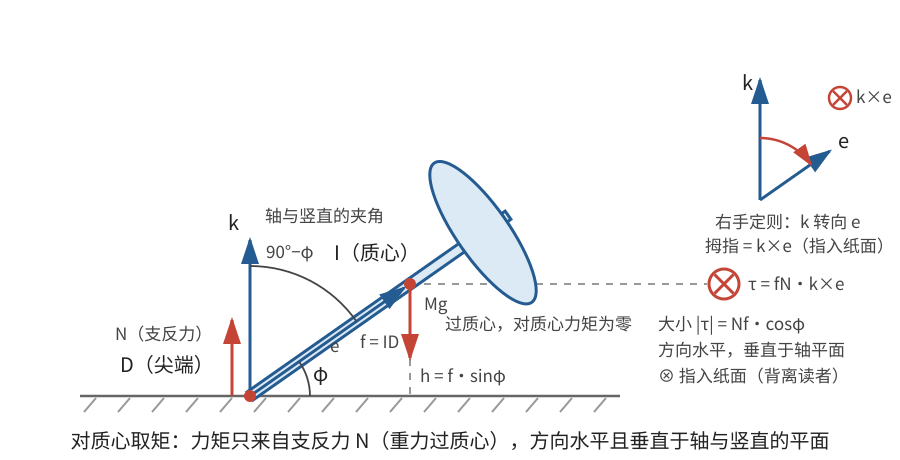
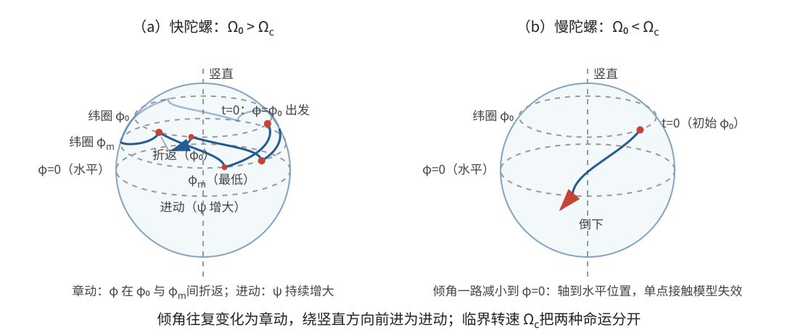

# 正文第14章：重陀螺

*Concerning the Motion of Spinning Tops on a Horizontal Plane, in Which All the Moments of Inertia Are Equal to Each Other*

> **选编说明**：本章依据欧拉原著正文第14章重写，保留陀螺模型、质心运动、尖端支反力、转轴变化，以及由倾斜初态出发的完整求解思路和临界转速。省略反复的球面三角换算，改用矢量、倾角和方位角重述；现代陀螺术语只用于解释本章结果，不把其他模型的公式混入正文。

## 本章导入：支点能滑动，陀螺为什么会重新抬起？

本章研究的**陀螺**（top）由刚性轴杆和刚体组成。轴杆通过质心，其下端缩成尖端 $D$，尖端始终在水平面上；质心 $I$ 到尖端的距离 $ID=f$。

欧拉作了一个很强但便于分析的理想化：

- 关于质心的三个主转动惯量全部相等，记共同值为 $I_0$；过质心的任意直线都可取作主轴；
- 水平面完全光滑，尖端可以滑动，没有摩擦力，也没有空气阻力；
- 只受重力与尖端的竖直支反力，陀螺始终只靠 $D$ 接触平面。

惯量球对称并不要求外形一定是球。它要求的是关于质心的转动惯量各向同性，因此本章的角动量可以简单写成 $\mathbf L=I_0\boldsymbol\omega$。

设陀螺轴从尖端指向质心的单位矢量为 $\mathbf e$，轴与水平面的夹角为 $\varphi$，$0<\varphi\le\pi/2$。质心高度就是

$$
\boxed{h=f\sin\varphi}。
$$

$\varphi$ 越小，陀螺越接近水平；$\varphi=\pi/2$ 表示竖直。这里的 $\mathbf e$ 是陀螺的几何轴，不一定等于瞬时角速度 $\boldsymbol\omega$ 的方向。

> **批注**：本章不是常见教材中“两个横向主转动惯量相等、轴向主转动惯量不同”的拉格朗日陀螺（Lagrange top），支点也不是固定不动的铰链。光滑支点允许水平滑动，会直接改变质心运动。套用其他陀螺模型的进动或稳定条件，必须先检查这些差别。

---

## 1. 质心运动与尖端支反力

设总质量为 $M$，重力加速度大小为 $g$，水平面对尖端的支反力大小为 $N$，竖直向上。重力大小为 $Mg$，方向竖直向下，作用在质心，对质心没有力矩；支反力作用在 $D$。

质心运动定理由外力合力决定：

$$
M\ddot{\mathbf R}=N\mathbf k-Mg\mathbf k,
$$

其中 $\mathbf R$ 是质心位置，$\mathbf k$ 是竖直向上的单位矢量。水平方向没有外力，所以

$$
\boxed{\ddot X=\ddot Y=0}。
$$

质心的水平速度保持不变；若初始没有水平速度，质心就始终在同一条竖直线上升降。竖直方向给出

$$
M\ddot h=N-Mg。
$$

又因为 $h=f\sin\varphi$，

$$
\dot h=f\cos\varphi\,\dot\varphi,
\qquad
\ddot h=f\left(\cos\varphi\,\ddot\varphi-\sin\varphi\,\dot\varphi^2\right)。
$$

所以支反力不是预先指定的常量，而必须满足

$$
\boxed{N=M\left[g+f\left(\cos\varphi\,\ddot\varphi-\sin\varphi\,\dot\varphi^2\right)\right]}。
\tag{1}
$$

这就是欧拉所说的“由尖端始终留在水平面上的条件确定压力”。在实际计算中，$N$ 要与转动方程联立求出；若出现 $N<0$，单侧接触模型已经失效，陀螺会离开平面，而不能把负压力当作真实的支持力。

支反力对质心的力臂矢量是 $-f\mathbf e$，故外力矩为

$$
\boldsymbol\tau=(-f\mathbf e)\times(N\mathbf k)
=fN\,\mathbf k\times\mathbf e。
\tag{2}
$$

其大小为

$$
|\boldsymbol\tau|=Nf\cos\varphi,
$$

方向水平，并垂直于陀螺轴与竖直线所成的平面。

---

## 2. 支反力怎样改变转动

由于 $I_0$ 对任意过质心的轴都相同，角动量方程在本章化为

$$
\boxed{I_0\dot{\boldsymbol\omega}=fN\,\mathbf k\times\mathbf e}。
\tag{3}
$$

若倾斜的陀螺最初静止，式(2)中的力矩会使它开始倾倒；若它本来就在转动，同一个力矩会改变原有角速度的大小和方向。欧拉用球面几何把这个变化分解为“转轴移动”和“角速度增减”，式(3)是同一内容的现代矢量重述。严格竖直且静止的陀螺则因力矩为零而保持静止，留到第5.3节单独说明。

几何轴随刚体转动，满足运动学关系

$$
\boxed{\dot{\mathbf e}=\boldsymbol\omega\times\mathbf e}。
\tag{4}
$$

式(3)决定角速度怎样受力改变，式(4)决定陀螺轴怎样随转动改变。两者联立，才构成陀螺转动问题。

> **批注**：不能由式(2)的力矩大小直接写出 $\ddot\varphi=\tau/I_0$。$\varphi$ 只描述几何轴在一个竖直平面内的倾角，而力矩通常还改变这个平面的方位；角速度也未必沿 $\mathbf e$。把多维转动误当成绕固定水平轴的转动，会漏掉进动。

---

## 3. 两个特别有用的不变量

### 3.1 角速度沿陀螺轴的分量不变

由式(3)，$\dot{\boldsymbol\omega}$ 与 $\mathbf e$ 垂直，所以 $\mathbf e\cdot\dot{\boldsymbol\omega}=0$。再由式(4)，

$$
\frac{d}{dt}(\boldsymbol\omega\cdot\mathbf e)
=\dot{\boldsymbol\omega}\cdot\mathbf e
+\boldsymbol\omega\cdot(\boldsymbol\omega\times\mathbf e)=0。
$$

因此

$$
\boxed{s\equiv\boldsymbol\omega\cdot\mathbf e=\text{常量}}。
\tag{5}
$$

若初始时陀螺绕自身几何轴以角速度 $\Omega_0$ 转动，即 $\boldsymbol\omega_0=\Omega_0\mathbf e_0$，那么 $s=\Omega_0$。

设后来瞬时角速度大小为 $\Omega$，它与几何轴的夹角为 $\chi$，则式(5)也可写成

$$
\Omega\cos\chi=\Omega_0。
$$

这正是欧拉由转轴变化公式积分得到的关系：瞬时转轴离几何轴越远，$|\boldsymbol\omega|$ 越大，但其沿几何轴的投影始终不变。

### 3.2 角速度的竖直分量不变

式(2)中的力矩 $\mathbf k\times\mathbf e$ 没有竖直分量，因此

$$
I_0\dot\omega_z=\boldsymbol\tau\cdot\mathbf k=0。
$$

于是

$$
\boxed{j\equiv\omega_z=\text{常量}}。
\tag{6}
$$

对于上述倾斜自转初态 $\boldsymbol\omega_0=\Omega_0\mathbf e_0$，有

$$
j=\Omega_0\sin\varphi_0,
$$

其中 $\varphi_0$ 是初始倾角。

> **批注**：式(5)与式(6)分别来自力矩垂直于陀螺轴、力矩没有竖直分量。它们不是任意陀螺都自动具有的守恒量，而是本章力系和惯量假设的结果。用现代语言说，后者也就是关于质心的角动量竖直分量守恒。

---

## 4. 从初始自转到倾角方程

### 4.1 倾角、方位角与角速度

设陀螺轴的方位角为 $\psi$，即包含 $\mathbf e$ 和竖直线的平面绕竖直方向转过的角度。取

$$
\mathbf e=(\cos\varphi\cos\psi,\cos\varphi\sin\psi,\sin\varphi)。
$$

再取两个与 $\mathbf e$ 垂直的单位方向：$\mathbf q$ 沿 $\varphi$ 增大方向，$\mathbf v$ 沿 $\psi$ 增大方向。它们的分量为

$$
\mathbf q=(-\sin\varphi\cos\psi,-\sin\varphi\sin\psi,\cos\varphi),
\qquad
\mathbf v=(-\sin\psi,\cos\psi,0)。
$$

直接求导得到

$$
\dot{\mathbf e}=\dot\varphi\,\mathbf q+\cos\varphi\,\dot\psi\,\mathbf v。
$$

又有 $\mathbf q\times\mathbf e=\mathbf v$、$\mathbf v\times\mathbf e=-\mathbf q$。将这些关系与式(4)比较，可把角速度写成

$$
\boxed{\boldsymbol\omega=s\mathbf e+\cos\varphi\,\dot\psi\,\mathbf q-\dot\varphi\,\mathbf v}。
\tag{7}
$$

由此得到两个后面要用的分量式：

$$
\omega_z=s\sin\varphi+\cos^2\varphi\,\dot\psi,
\qquad
\omega^2=s^2+\dot\varphi^2+\cos^2\varphi\,\dot\psi^2。
$$

代入 $s=\Omega_0$ 和 $j=\Omega_0\sin\varphi_0$，就得到方位角变化率

$$
\boxed{\dot\psi=\Omega_0\frac{\sin\varphi_0-\sin\varphi}{\cos^2\varphi}}。
\tag{8}
$$

所以只要倾角从 $\varphi_0$ 减小，陀螺轴的竖直平面就开始转动。这就是**进动**（precession）；倾角自身的往复变化称为**章动**（nutation）。本章先由守恒式得到式(8)，而不是先假定一个匀速进动。

### 4.2 能量守恒

尖端 $D$ 始终留在水平面上，其速度沿水平面；支反力竖直，因而支反力不做功。没有摩擦和空气阻力，总机械能守恒：

$$
\frac12I_0\omega^2+\frac12M|\dot{\mathbf R}|^2+Mgh=\text{常量}。
$$

水平质心动能和轴向自转部分 $\tfrac12I_0s^2$ 都是常量，可以从等式两边删去。再用 $\dot h=f\cos\varphi\,\dot\varphi$ 和式(7)—(8)，得到只含倾角的有效能量方程：

$$
\boxed{
\frac12\left(I_0+Mf^2\cos^2\varphi\right)\dot\varphi^2
+\frac{I_0\Omega_0^2}{2}\frac{(\sin\varphi_0-\sin\varphi)^2}{\cos^2\varphi}
+Mgf(\sin\varphi-\sin\varphi_0)=0}。
\tag{9}
$$

这里已经代入初始条件 $\varphi=\varphi_0$、$\dot\varphi=0$、$\dot\psi=0$，所以右端的能量常数为零。式(9)把复杂的陀螺运动压缩成一个倾角问题：求出 $\varphi(t)$ 后，式(8)给出 $\psi(t)$，式(1)再给出支反力 $N(t)$。

> **批注**：式(9)是本章核心结果。第一项含 $\dot\varphi^2$，可看作倾角运动的动能；后两项共同决定允许的倾角范围。$I_0+Mf^2\cos^2\varphi$ 中出现 $Mf^2\cos^2\varphi$，是因为质心随倾角改变而升降，不能把平动部分遗漏。

---

## 5. 倾倒、回升与临界转速

### 5.1 倾角不会超过初始值

式(9)前两项非负，所以必须有

$$
Mgf(\sin\varphi-\sin\varphi_0)\le0。
$$

在本章 $0<\varphi\le\pi/2$ 的范围内，这意味着

$$
\boxed{\varphi\le\varphi_0}。
\tag{10}
$$

因此，从“倾斜放置、只绕自身轴自转”的初态出发，陀螺先向更低倾角运动，不会先变得比初始更竖直。

### 5.2 什么条件下会重新抬起？

在倾角的另一个转向点 $\varphi_m$，有 $\dot\varphi=0$。除去 $\varphi=\varphi_0$ 这个初始转向点，式(9)给出

$$
\boxed{I_0\Omega_0^2(\sin\varphi_0-\sin\varphi_m)=2Mgf\cos^2\varphi_m}。
\tag{11}
$$

若陀螺恰好把到达水平位置 $\varphi=0$ 作为转向点，式(11)化为

$$
I_0\Omega_0^2\sin\varphi_0=2Mgf。
$$

由此定义临界初转速

$$
\boxed{\Omega_c=\sqrt{\frac{2Mgf}{I_0\sin\varphi_0}}}。
\tag{12}
$$

- 若 $\Omega_0<\Omega_c$，在到达水平位置时，式(9)仍允许非零的向下倾角速度，理想点接触模型会走向倾倒；实际物体还可能先因机身碰地或 $N<0$ 而离开本章模型。
- 若 $\Omega_0>\Omega_c$，陀螺会在到达水平前遇到一个较低的转向角 $\varphi_m>0$，随后重新抬起，返回 $\varphi_0$，形成章动。

令 $s_m=\sin\varphi_m$，式(11)是关于 $s_m$ 的二次方程。适用于 $0<s_m<\sin\varphi_0$ 的根为

$$
\boxed{
\sin\varphi_m=
\frac{I_0\Omega_0^2-\sqrt{I_0^2\Omega_0^4-8I_0Mgf\,\Omega_0^2\sin\varphi_0+16M^2g^2f^2}}{4Mgf}}。
\tag{13}
$$

这里取减号；另一个根不在所讨论的物理区间内。临界情形下式(13)给出 $s_m=0$，与式(12)一致。

若 $\Omega_0$ 很大，转向点只比初始位置略低。由式(11)作小量近似，

$$
\boxed{\sin\varphi_0-\sin\varphi_m\simeq\frac{2Mgf\cos^2\varphi_0}{I_0\Omega_0^2}}。
\tag{14}
$$

自转越快，章动幅度越小。在一个近似对称的小幅章动周期内，倾角偏离量的平均值约为振幅的一半，即

$$
\overline{\sin\varphi_0-\sin\varphi}
\simeq\frac12(\sin\varphi_0-\sin\varphi_m),
\qquad \cos^2\varphi\simeq\cos^2\varphi_0。
$$

将式(14)代入式(8)，振幅关系中的因子 $2$ 与平均产生的 $1/2$ 相消：

$$
\overline{\dot\psi}
\simeq\frac{\Omega_0}{2\cos^2\varphi_0}(\sin\varphi_0-\sin\varphi_m)
\simeq\frac{Mgf}{I_0\Omega_0},
$$

它与初转速成反比。这个近似只适用于本章模型和上述小幅、快速自转条件，不是任意陀螺的普遍公式。

### 5.3 精确竖直初态要单独看

若初始轴严格竖直，$\varphi_0=\pi/2$，且 $\boldsymbol\omega_0=\Omega_0\mathbf k$，则

$$
N=Mg,\qquad \boldsymbol\tau=\mathbf0,\qquad
\boldsymbol\omega=\Omega_0\mathbf k。
$$

陀螺可以一直保持竖直匀速自转，质心水平速度也保持不变。这个精确解对任意 $\Omega_0$ 都成立，不能说成“只有超过式(12)的临界速度才能竖直旋转”。式(12)讨论的是**倾斜初态以后是否会到达水平位置**，两者不是同一个命题。

> **批注**：真实陀螺的自转会因摩擦和空气阻力逐渐减慢，所以最终常会倾倒；本章的无耗散模型则允许倾角周期性地下降、回升。欧拉也用这一差别说明，为什么理想计算不能完全复现日常经验。进一步学习时，可比较固定支点、横向与轴向惯量不同的重对称陀螺，其守恒量和稳定条件会有新的结构。

---

## 本章小结

1. 本章陀螺关于质心的三个主转动惯量全相等，尖端在光滑水平面上滑动；它不是一般重对称陀螺模型。
2. 质心水平速度恒定，竖直加速度由 $N-Mg$ 决定；支反力 $N$ 必须由接触约束和倾角运动共同确定。
3. 支反力力矩使 $I_0\dot{\boldsymbol\omega}=fN\mathbf k\times\mathbf e$，同时 $\dot{\mathbf e}=\boldsymbol\omega\times\mathbf e$ 描述几何轴的变化。
4. 对本章倾斜自转初态，$\boldsymbol\omega\cdot\mathbf e=\Omega_0$ 与 $\omega_z=\Omega_0\sin\varphi_0$ 保持不变，并由此得到进动公式。
5. 机械能守恒给出倾角方程。陀螺不会先超过初始倾角；当 $\Omega_0>\Omega_c$ 时，它会在水平位置以前转向并重新抬起。
6. 严格竖直自转是任意初转速都允许的精确解，不应与倾斜初态的临界转速混为一谈。

---

## 底本与现代参考

1. 欧拉原著正文第14章；Ian Bruce 英译见本地 [`english_translation/tmvol1ch14tr.txt`](english_translation/tmvol1ch14tr.txt)，公式与图版见同目录 [`tmvol1ch14tr.pdf`](english_translation/tmvol1ch14tr.pdf)。英译总目录：[17th Century Maths](https://www.17centurymaths.com/contents/mechanica3.html)。
2. H. Goldstein, C. Poole and J. Safko, *Classical Mechanics*, 3rd ed.：重对称陀螺、进动、章动与守恒量；用于对照不同支点和惯量假设下的模型。
3. L. D. Landau and E. M. Lifshitz, *Mechanics*, 3rd ed.：重对称陀螺与快速陀螺近似的现代表述。
4. Sebastià Xambó Descamps, [*Euler and the Dynamics of Rigid Bodies*](https://web.mat.upc.edu/sebastia.xambo/HistoricalEssays/Euler-RigidBody-x.pdf)：欧拉刚体运动理论的历史与现代对照。

[上一章：正文第13章——自由刚体运动](欧拉刚体运动理论_正文_第13章.md)

[下一章：正文第15章——任意力作用下刚体的一般运动](欧拉刚体运动理论_正文_第15章.md)
