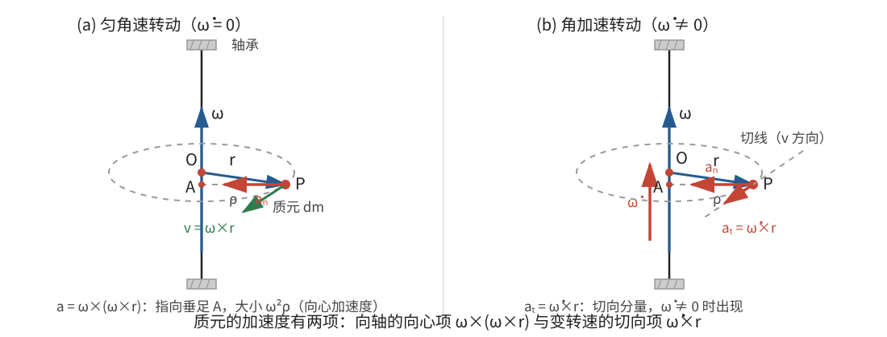
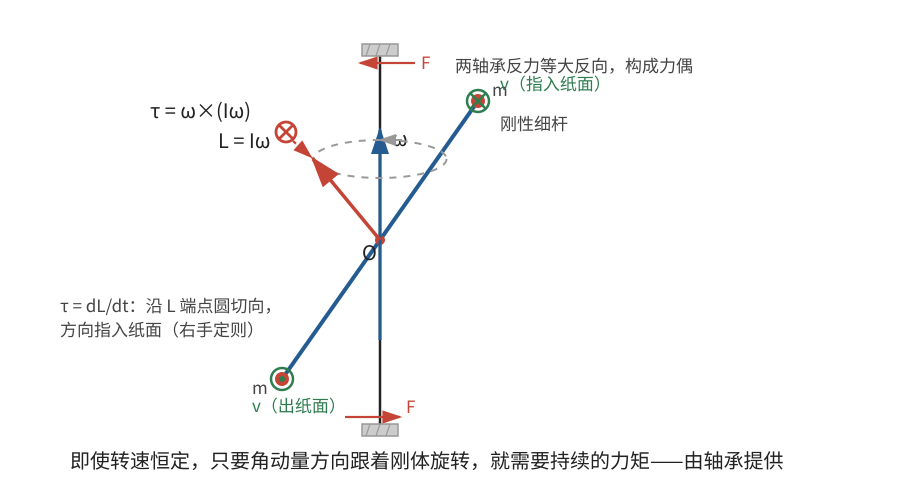

# 正文第15章：任意力作用下刚体的一般运动

*Concerning the Free Motion of Rigid Bodies Acted on by Any Forces*

> **选编说明**：本章依据欧拉原著正文第15章重写，保留“先求产生指定运动变化所需的力，再反求力的效应”的论证路线，以及质元速度、加速度、力矩积分、欧拉转动方程、能量关系、静止起转、平动—转动分解和空间姿态方程。省略重复的球面三角与微分展开，改用现代矢量和主轴分量重述。标题中的“自由”在原著中指运动不受预先约束，并不指不受力。

## 本章导入：一个刚体需要多少个运动方程？

力作用在一个质点上，只要知道质点速度怎样改变，就能描述力的瞬时效应。刚体不同：力既可以改变质心的运动，也可以改变刚体的转动。

欧拉把瞬时变化分成四项：

1. 质心速度大小的变化；
2. 质心运动方向的变化；
3. 角速度大小的变化；
4. 瞬时转轴方向的变化。

前两项合起来就是质心速度矢量 $\mathbf V$ 的三个分量变化，后两项合起来就是角速度矢量 $\boldsymbol\omega$ 的三个分量变化。因此，需要三组平动方程和三组转动方程。

这里要区分两个“六”：刚体的位置与取向共有六个自由度；在已知位置和取向后，瞬时运动状态还要由 $\mathbf V$ 和 $\boldsymbol\omega$ 的六个速度分量描述。因此，无约束刚体的完整状态是十二维：六个位形坐标加六个速度分量。

欧拉的推导采用一个逆问题：先假定 $\mathbf V,\boldsymbol\omega$ 的变化已经指定，计算每个质量微元需要怎样的合力；再把所有微元的力与力矩积分起来。最后把已知外力代入，就能反求运动变化。

---

## 1. 质元速度：从转动到三个分量

先在随质心平移、但不随刚体转动的参考系中研究转动。设质心为原点，质量微元 $dm$ 的位置为 $\mathbf r$。若刚体角速度为 $\boldsymbol\omega$，该微元由转动产生的速度为

$$
\boxed{\mathbf v=\boldsymbol\omega\times\mathbf r}。
\tag{1}
$$

**一个可立即核对的分量例子。** 若 $\boldsymbol\omega=(0,0,\Omega)$，微元位于 $\mathbf r=(r,0,0)$，则

$$
\mathbf v=(0,0,\Omega)\times(r,0,0)=(0,\Omega r,0)。
$$

它垂直于转轴和位置矢量，速率是“角速度 × 到转轴的距离”。

在固连于刚体的三个主轴上，取

$$
\mathbf r=(x,y,z),\qquad
\boldsymbol\omega=(\omega_1,\omega_2,\omega_3)。
$$

式(1)的分量为

$$
\boxed{
\begin{aligned}
v_1&=\omega_2z-\omega_3y,\\
v_2&=\omega_3x-\omega_1z,\\
v_3&=\omega_1y-\omega_2x。
\end{aligned}}
\tag{2}
$$

欧拉通过球面三角得到了这些分量。它们今天可以缩写成矢量叉积，但欧拉本人并没有使用现代矢量记号；把式(2)说成现代叉积的“分量对应”与宣称他已经建立矢量分析，是两回事。

在主轴坐标系中，$x,y,z$ 对同一个固连质元是常量；对同一时刻的不同质元，它们则是积分变量。这个区别在后面的力矩积分中很重要。

---

## 2. 质元加速度：为什么有两项？

设刚体的角速度发生变化。定义角加速度分量 $\dot\omega_i=d\omega_i/dt$。在主轴坐标系里，位置 $\mathbf r$ 不变，角速度变化首先贡献

$$
\dot{\boldsymbol\omega}\times\mathbf r。
$$

但仅此还不够。即使 $\dot{\boldsymbol\omega}=\mathbf0$，一个质元也在作圆周运动，仍有指向转轴的向心加速度。速度 $\mathbf v$ 的方向随刚体转动，所以还必须有 $\boldsymbol\omega\times\mathbf v$ 一项。

以下沿用欧拉的转动推导，暂时令质心保持静止。因此，式(3)既是质元相对质心的加速度，也是此时质元的全部惯性加速度；一般平动情形将在第6节再补回 $\ddot{\mathbf R}$。用瞬时主轴方向分解，有

$$
\boxed{
\mathbf a
=\dot{\boldsymbol\omega}\times\mathbf r
+\boldsymbol\omega\times(\boldsymbol\omega\times\mathbf r)
=\dot{\boldsymbol\omega}\times\mathbf r+\boldsymbol\omega\times\mathbf v}。
\tag{3}
$$

这里 $\dot{\boldsymbol\omega}$ 表示三个主轴分量的普通时间导数。因为 $\boldsymbol\omega\times\boldsymbol\omega=\mathbf0$，角加速度在主轴系与惯性系中的瞬时分量相同；速度则不同，绝不能只写 $\dot{\mathbf v}$ 而漏掉 $\boldsymbol\omega\times\mathbf v$。

第一分量的展开式是

$$
\boxed{
a_1=\dot\omega_2z-\dot\omega_3y
+\omega_1\omega_2y+\omega_1\omega_3z
-(\omega_2^2+\omega_3^2)x}，
\tag{4}
$$

其余两个分量由指标循环 $1\to2\to3\to1$、$x\to y\to z\to x$ 得到。式(4)中，含 $\dot\omega_i$ 的项来自角加速度，二次项包含向心加速度以及转轴不在主轴上时出现的耦合。

> **批注**：式(3)是旋转坐标系中求导的标准例子。对任意矢量 $\mathbf b$，都有“惯性导数 = 主轴系分量导数 + $\boldsymbol\omega\times\mathbf b$”。旧稿若把质元在固连系中的位置说成随时间变化，或把这里直接解释成科里奥利力，都会混淆参考系；本章质元相对刚体不动，式(3)中没有 $2\boldsymbol\omega\times\mathbf v_{\mathrm{相对}}$ 这种相对运动项。

---

## 3. 从质元力到总力矩

### 3.1 元素力与等效力系

对质量微元 $dm$ 使用牛顿第二定律。它所需的合力为

$$
d\mathbf T=\mathbf a\,dm。
\tag{5}
$$

欧拉称其为**元素力**（elementary force）：它是产生实际加速度所需的净力，不必等于该微元实际受到的外力，也不等同于内部联结力。

若质心暂时视为静止，全部元素力的矢量和为零，因为加速度对 $\mathbf r$ 是线性的，而质心定义给出

$$
\int\mathbf r\,dm=\mathbf0。
$$

不过，各质元的元素力可以产生力矩。对质心取矩，微元贡献为

$$
d\boldsymbol\tau=\mathbf r\times d\mathbf T
=\mathbf r\times\mathbf a\,dm。
\tag{6}
$$

具有相同总力矩的外力系，对绕质心的转动产生相同效应；若还要保持质心不动，可像欧拉那样在质心补上等大反向的力，使合力为零。对三个互相垂直方向的力矩都相同，才足以保证力系的转动效果相同。

### 3.2 主轴坐标系中的积分

关于质心的总外力矩为

$$
\boldsymbol\tau=\int\mathbf r\times\mathbf a\,dm。
$$

将式(3)代入，可以分成两部分：

$$
\boldsymbol\tau
=\int\mathbf r\times(\dot{\boldsymbol\omega}\times\mathbf r)\,dm
+\int\mathbf r\times(\boldsymbol\omega\times\mathbf v)\,dm。
\tag{7}
$$

在三个主轴上，惯量积为零：

$$
\int xy\,dm=\int yz\,dm=\int zx\,dm=0，
$$

主转动惯量则为

$$
I_1=\int(y^2+z^2)\,dm,\qquad
I_2=\int(z^2+x^2)\,dm,\qquad
I_3=\int(x^2+y^2)\,dm。
$$

先积分式(7)的第一项。取第一分量，利用上述定义，得到

$$
\int[\mathbf r\times(\dot{\boldsymbol\omega}\times\mathbf r)]_1\,dm
=I_1\dot\omega_1。
$$

其余分量同理。第二部分用 $\mathbf v=\boldsymbol\omega\times\mathbf r$ 展开，仍以第一分量为

$$
\int(y a_{3,\omega}-z a_{2,\omega})\,dm
=(I_3-I_2)\omega_2\omega_3，
$$

其中 $\mathbf a_\omega=\boldsymbol\omega\times\mathbf v$ 表示式(3)的第二部分。交叉坐标项都因主轴条件积分为零，剩下的坐标平方项恰好合成 $I_3-I_2$。

于是得到

$$
\boxed{\tau_1=I_1\dot\omega_1+(I_3-I_2)\omega_2\omega_3}。
$$

循环写出其余两式，就是**欧拉转动方程**（Euler's equations of motion）：

$$
\boxed{
\begin{aligned}
I_1\dot\omega_1-(I_2-I_3)\omega_2\omega_3&=\tau_1,\\
I_2\dot\omega_2-(I_3-I_1)\omega_3\omega_1&=\tau_2,\\
I_3\dot\omega_3-(I_1-I_2)\omega_1\omega_2&=\tau_3。
\end{aligned}}
\tag{8}
$$

这里的 $\tau_1,\tau_2,\tau_3$ 是外力对质心的力矩在三个固连主轴上的分量。方程成立不要求刚体自由、无约束；约束力也计入外力与外力矩。若改对惯性空间中的固定点取矩，则只有在该点固定于刚体且满足相应角动量条件时，才能直接套用同一形式，不能不加说明地更换取矩点。

> **批注**：式(8)中的二次项不是额外外力，也不是凭经验补上的“修正”。它们来自质量微元速度的旋转，以及主轴坐标系本身随刚体转动。欧拉由质元力矩积分得到这些项，式(8)正是原章末尾用 $x,y,z$ 表示角速度分量后得到的紧凑公式。

---

## 4. 用角动量检查同一结果

关于质心的角动量是

$$
\mathbf L=\int\mathbf r\times\mathbf v\,dm。
$$

在主轴坐标系中，由式(2)和主转动惯量定义，

$$
\boxed{\mathbf L=(I_1\omega_1,I_2\omega_2,I_3\omega_3)}。
\tag{9}
$$

惯性空间中的**角动量定理**（angular momentum principle）为

$$
\left(\frac{d\mathbf L}{dt}\right)_{\!空间}=\boldsymbol\tau。
$$

但主轴坐标系在转动，所以

$$
\left(\frac{d\mathbf L}{dt}\right)_{\!空间}
=\left(\frac{d\mathbf L}{dt}\right)_{\!主轴}+\boldsymbol\omega\times\mathbf L。
$$

由于 $I_i$ 在固连主轴上是常量，

$$
\left(\frac{d\mathbf L}{dt}\right)_{\!主轴}
=(I_1\dot\omega_1,I_2\dot\omega_2,I_3\dot\omega_3)。
$$

把 $\boldsymbol\omega\times\mathbf L$ 展开，立即再次得到式(8)。若用 $\mathbf I=\operatorname{diag}(I_1,I_2,I_3)$ 简记主轴惯量矩阵，还可以写成

$$
\boxed{\mathbf I\dot{\boldsymbol\omega}
+\boldsymbol\omega\times(\mathbf I\boldsymbol\omega)=\boldsymbol\tau}。
\tag{10}
$$

式(10)是现代矩阵—矢量缩写；式(8)才是便于逐项计算的形式。

---

## 5. 三个直接推论

### 5.1 非主轴上的匀速转动也需要力矩

若刚体绕空间中一条固定轴匀速转动，并且该轴在刚体上的方向不变，则 $\dot\omega_1=\dot\omega_2=\dot\omega_3=0$。式(8)给出

$$
\boxed{\boldsymbol\tau=\boldsymbol\omega\times(\mathbf I\boldsymbol\omega)}。
\tag{11}
$$

只要 $\boldsymbol\omega$ 不是主轴方向，且主转动惯量不全相等，这个叉积一般不为零。

物理原因是：角速度矢量在惯性空间中可以保持不变，角动量 $\mathbf I\boldsymbol\omega$ 却随刚体转动。要不断改变角动量的方向，就需要外力矩。例如斜插在转轴上的哑铃，即使转速恒定，轴承也要提供周期性变化的约束力矩。

### 5.2 从静止开始，初始转轴不必沿力矩方向

若 $\boldsymbol\omega=\mathbf0$，式(8)退化为

$$
I_i\dot\omega_i=\tau_i。
$$

所以初始角加速度分量为

$$
\boxed{\dot\omega_i=\frac{\tau_i}{I_i}}。
\tag{12}
$$

在无穷小时间内，刚开始形成的角速度与角加速度同向，因此初始转轴的方向余弦正比于

$$
\frac{\tau_1}{I_1}:\frac{\tau_2}{I_2}:\frac{\tau_3}{I_3}。
$$

**例。** 取 $I_1=3I,\ I_2=2I,\ I_3=I$，并令 $\boldsymbol\tau=(\tau,\tau,0)$。力矩与第一、第二主轴各成 $45^\circ$，但

$$
\dot{\boldsymbol\omega}=\left(\frac{\tau}{3I},\frac{\tau}{2I},0\right)。
$$

初始转轴与第一主轴的夹角为 $\arctan(3/2)\approx56.3^\circ$，比力矩方向更靠近转动惯量较小的第二主轴。若 $\boldsymbol\tau$ 沿主轴，或其所有非零分量所对应的主转动惯量相同，初始转轴才与力矩同向；一般情况下两者不同向。

### 5.3 力矩的功率等于转动动能变化率

转动动能为

$$
T_{\mathrm{转}}=\frac12\left(I_1\omega_1^2+I_2\omega_2^2+I_3\omega_3^2\right)。
$$

对时间求导，再代入式(8)：

$$
\begin{aligned}
\dot T_{\mathrm{转}}
&=I_1\omega_1\dot\omega_1+I_2\omega_2\dot\omega_2+I_3\omega_3\dot\omega_3\\
&=\tau_1\omega_1+\tau_2\omega_2+\tau_3\omega_3。
\end{aligned}
$$

二次耦合项全部抵消，得到**转动动能定理**（work–energy theorem for rotation）：

$$
\boxed{\frac{dT_{\mathrm{转}}}{dt}=\boldsymbol\tau\cdot\boldsymbol\omega},
\qquad
T_{\mathrm{转}}(t)-T_{\mathrm{转}}(0)=\int_0^t\boldsymbol\tau\cdot\boldsymbol\omega\,dt。
\tag{13}
$$

若 $\boldsymbol\tau=\mathbf0$，转动动能守恒，惯性空间中的角动量矢量也守恒；这就是前面自由转动章节的出发点。这里并不表示三个固连主轴分量 $I_i\omega_i$ 各自不变。若只有外力合力为零而力矩不为零，质心可以不动，转动动能却仍可能改变。

> **批注**：原章的“活力”（vis viva）是 $2T_{\mathrm{转}}$，旧单位中还带有 $2g$ 的比例因子。式(13)采用现代力和能量单位，右端明确是功率，并保留积分下限所需的初始动能，避免把不定积分误写成任意时刻都等于零。

---

## 6. 平动与转动：方程分开，运动未必独立

现在把质心平动补回来。设质心位置为 $\mathbf R$，总质量为 $M$，全部外力合力为 $\mathbf F_{\mathrm{外}}$，则

$$
\boxed{M\ddot{\mathbf R}=\mathbf F_{\mathrm{外}}}。
\tag{14}
$$

刚体上任一点的位置和速度分别为

$$
\mathbf r_P=\mathbf R+\mathbf r,\qquad
\mathbf v_P=\mathbf V+\boldsymbol\omega\times\mathbf r。
$$

因此，平动与转动可以在方程结构上分开处理：

- 式(14)由外力合力决定质心运动；
- 式(8)由外力对质心的力矩决定绕质心的转动。

总机械能的变化率也相应写成

$$
\boxed{\frac{d}{dt}\left(\frac12M V^2+T_{\mathrm{转}}\right)
=\mathbf F_{\mathrm{外}}\cdot\mathbf V+\boldsymbol\tau\cdot\boldsymbol\omega}。
\tag{15}
$$

但是，“分别列方程”不等于“总能互不相干地求解”。外力和力矩可能同时依赖 $\mathbf R,\mathbf V$、刚体姿态与 $\boldsymbol\omega$。例如非均匀场中的合力可能随取向改变，空气阻力也可能同时依赖平动和转动。此时式(8)与式(14)仍然成立，却必须联立求解。

> **批注**：质心分解消除了质元方程中不必要的混合项，并不保证外力问题一定解耦。把它概括成“转动只影响力矩、平动只影响力”的单向关系，会漏掉许多实际耦合。

---

## 7. 从角速度到空间姿态

式(8)给出角速度在固连主轴上的分量，却还没有直接给出刚体在空间中的取向。若三个主轴单位矢量为 $\mathbf e_1,\mathbf e_2,\mathbf e_3$，它们在惯性空间中满足

$$
\boxed{\dot{\mathbf e}_i=\boldsymbol\omega\times\mathbf e_i,\qquad i=1,2,3。}
\tag{16}
$$

把式(8)与式(16)联立，并从初始姿态和初始角速度出发积分，才能得到主轴在任意时刻的空间方向。若力矩依赖姿态，$\tau_i$ 本身也是 $\mathbf e_1,\mathbf e_2,\mathbf e_3$ 的函数，动力学与姿态运动学不能先后孤立处理。

若刚体受到平面接触、固定点或碰撞等约束，未知约束力也要先写入外力和外力矩，再由约束条件确定。欧拉在本章末尾正是这样把一般自由运动推广到受约束问题。

> **批注**：现代计算常把三个主轴矢量组成旋转矩阵，或用四元数积分姿态；这些工具能避免某些角度坐标的奇点，但属于现代数值与表示方法，不是欧拉原章使用的工具。学习入口是刚体教材中的“rotating frames”“attitude kinematics”和“Euler equations”。

---

## 本章小结

1. 刚体的瞬时运动由质心速度与角速度共同描述；完整状态还包括质心位置和空间姿态。
2. 质元速度是 $\mathbf v=\boldsymbol\omega\times\mathbf r$，加速度是 $\dot{\boldsymbol\omega}\times\mathbf r+\boldsymbol\omega\times\mathbf v$，第二项不可遗漏。
3. 对元素力取矩并积分，利用主轴上惯量积为零，得到 $I_i\dot\omega_i$ 与角速度二次耦合项共同构成的欧拉转动方程。
4. 同一方程也可由 $\mathbf L=\mathbf I\boldsymbol\omega$ 和旋转坐标系求导公式验证。
5. 非主轴匀速转动通常需要外力矩；从静止起转时，初始转轴沿 $(\tau_1/I_1,\tau_2/I_2,\tau_3/I_3)$，不必沿力矩方向。
6. 转动功率满足 $\dot T_{\mathrm{转}}=\boldsymbol\tau\cdot\boldsymbol\omega$；平动与转动方程可以分开写出，但外力和姿态依赖可能使它们必须联立求解。

---

## 底本与现代参考

1. 欧拉原著正文第15章；Ian Bruce 英译见本地 [`english_translation/tmvol1ch15tr.txt`](english_translation/tmvol1ch15tr.txt)，公式与图版见同目录 [`tmvol1ch15tr.pdf`](english_translation/tmvol1ch15tr.pdf)。英译总目录：[17th Century Maths](https://www.17centurymaths.com/contents/mechanica3.html)。
2. H. Goldstein, C. Poole and J. Safko, *Classical Mechanics*, 3rd ed.：旋转坐标系、欧拉方程、角动量与刚体姿态运动学。
3. L. D. Landau and E. M. Lifshitz, *Mechanics*, 3rd ed.：刚体角动量、欧拉方程与能量关系的现代表述。
4. Sebastià Xambó Descamps, [*Euler and the Dynamics of Rigid Bodies*](https://web.mat.upc.edu/sebastia.xambo/HistoricalEssays/Euler-RigidBody-x.pdf)：欧拉推导路线及其与现代刚体动力学的对照。

[上一章：正文第14章——重陀螺](欧拉刚体运动理论_正文_第14章.md)

[下一章：正文第16章——天体的旋转运动](欧拉刚体运动理论_正文_第16章.md)
