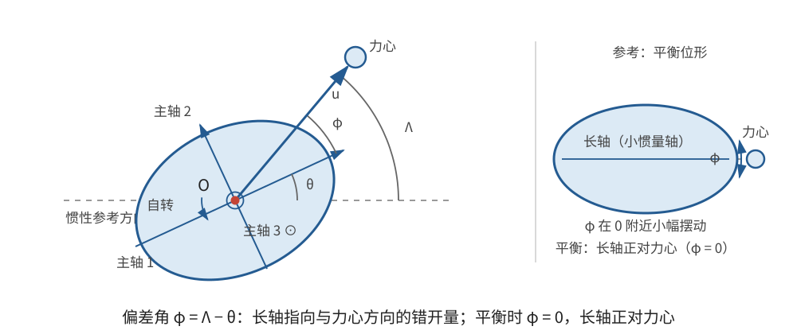
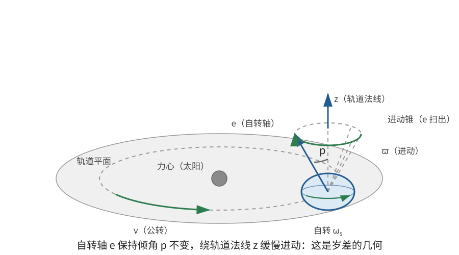

# 正文第16章：天体的旋转运动

*Concerning the Rotational or Turning Motions of Celestial Bodies*

> **选编说明**：本章依据欧拉原著正文第16章重写，保留远距中心引力力矩、力心位于主轴平面时的转动、均匀公转下的天平动、非公转均匀引起的天平动，以及旋转对称天体的轴进动与周期扰动。省略质心受力的二阶展开和冗长球面三角，改用现代主轴分量与角度符号。现代术语用于辨析机制，不把后续完整的天体力学理论倒算成本章已经完成的结论。

## 本章导入：同一天的自转与公转，为什么仍能看到“摇摆”？

月球近似总以同一面朝向地球，但从地球上仍能观察到月面边缘略有变化。这里至少有两种不同原因：

- 天体自身的取向在平衡方向附近振荡；
- 天体自转很均匀，公转方向却不均匀变化，使两者不能始终精确对齐。

欧拉先求中心引力对一般刚体的力矩，再分别研究这两种运动，最后把力矩用于旋转对称天体的轴扰动。阅读时应始终把**天平动**（libration）、**岁差**（precession）和**章动**（nutation）分开：它们不是同一个现象的不同名称。

---

## 1. 远距中心引力对天体的力矩

### 1.1 从质量微元到主轴分量

设天体质量微元 $dm$ 的位置为 $\mathbf r$，原点取在天体质心。力心 $F$ 的位置为

$$
\mathbf s=s\mathbf u,
$$

其中 $s$ 是力心到质心的距离，$\mathbf u$ 是指向力心的单位矢量。令 $\mu$ 表示力心的引力参数；对质量为 $M_*$ 的球对称中心天体，$\mu=GM_*$，其中 $G$ 为引力常量。微元所受引力为

$$
d\mathbf F=\mu\,dm\,\frac{\mathbf s-\mathbf r}{|\mathbf s-\mathbf r|^3}。
$$

对质心取矩：

$$
d\boldsymbol\tau=\mathbf r\times d\mathbf F
=\mu\,dm\,\frac{\mathbf r\times\mathbf s}{|\mathbf s-\mathbf r|^3}。
$$

在天体尺寸远小于 $s$ 时，

$$
\frac1{|\mathbf s-\mathbf r|^3}
=\frac1{s^3}\left(1+\frac{3\mathbf r\cdot\mathbf u}{s}+O\!\left(\frac{r^2}{s^2}\right)\right)。
$$

零阶项积分后含 $\int\mathbf r\,dm=\mathbf0$，所以首个非零项为

$$
\boxed{\boldsymbol\tau\simeq
\frac{3\mu}{s^3}\int(\mathbf r\cdot\mathbf u)(\mathbf r\times\mathbf u)\,dm}。
\tag{1}
$$

这是一种**潮汐力矩**（tidal torque）：它来自天体各处引力方向和大小不同，而不是平均引力本身。

### 1.2 主轴公式

在三个固连主轴上，令 $\mathbf u=(u_1,u_2,u_3)$，主转动惯量为 $I_1,I_2,I_3$。利用质心条件与主轴上的惯量积为零，式(1)化为

$$
\boxed{
\begin{aligned}
\tau_1&=\frac{3\mu}{s^3}(I_3-I_2)u_2u_3,\\
\tau_2&=\frac{3\mu}{s^3}(I_1-I_3)u_3u_1,\\
\tau_3&=\frac{3\mu}{s^3}(I_2-I_1)u_1u_2。
\end{aligned}}
\tag{2}
$$

也可缩写成

$$
\boldsymbol\tau\simeq\frac{3\mu}{s^3}\,\mathbf u\times(\mathbf I\mathbf u)。
$$

力矩与 $s^{-3}$ 成正比：平均引力随 $s^{-2}$ 变化，而产生力矩的引力梯度再多一个 $s^{-1}$。式(2)只保留 $r/s$ 的首个非零阶，不是任意距离下的精确公式。

### 1.3 两个容易误读的推论

**三个主转动惯量相等，不等于几何球体。** 若非球形天体恰好有 $I_1=I_2=I_3$，式(2)仍给出零力矩。因此在本章近似阶数内，只能直接推出“引力对质心的力矩为零”，不能反推天体是球，也不能据此排除一切与姿态有关的轨道效应或几何天平动。

**力心位于两个主轴的平面内，绕第三轴的力矩可以非零。** 若 $\mathbf u$ 位于第一、第二主轴平面内，则 $u_3=0$，于是

$$
\tau_1=\tau_2=0,\qquad
\tau_3=\frac{3\mu}{s^3}(I_2-I_1)u_1u_2。
$$

只要 $I_1\ne I_2$ 且 $u_1u_2\ne0$，就有绕第三主轴的力矩。从静止释放时，初始角加速度沿第三主轴；若力心始终留在该平面、天体又精确绕第三轴转动，运动会保持平面转动。旧稿把“前两个力矩为零”误写成“绕第三轴力矩为零”，正好颠倒了结论。

> **批注**：式(2)与牛顿引力下的外部引力场是否可等效为质点，是两个不同问题。这里计算的是中心天体对延展天体各部分的合力矩；三个主转动惯量相等只保证本章一阶潮汐力矩消失，并不证明物体具有球形质量分布。

---

## 2. 均匀公转下的物理天平动

### 2.1 偏差角方程

设力心始终在第一、第二主轴平面内，以固定距离 $s$ 和恒定角速度 $\nu$ 绕质心运动，其方向角为 $\Lambda=\nu t$。天体绕第三主轴转动，第一主轴在惯性空间中的方向角为 $\theta$，所以 $\dot\theta$ 是天体自转角速度。

定义力心方向相对第一主轴的偏差角

$$
\varphi=\Lambda-\theta。
$$

此时 $u_1=\cos\varphi,\ u_2=\sin\varphi,\ u_3=0$，式(2)给出

$$
\tau_3=\frac{3\mu}{2s^3}(I_2-I_1)\sin2\varphi。
$$

由 $I_3\ddot\theta=\tau_3$ 和 $\ddot\varphi=-\ddot\theta$，得到

$$
\boxed{\ddot\varphi+N\sin2\varphi=0},
\qquad
N=\frac{3\mu(I_2-I_1)}{I_3s^3}。
\tag{3}
$$

$N$ 的量纲为时间负二次方。式(3)与摆方程相似，但稳定平衡位置取决于 $N$ 的符号。

### 2.2 哪个主轴应朝向力心？

若 $I_2>I_1$，则 $N>0$，$\varphi=0$ 附近满足

$$
\ddot\varphi+2N\varphi\simeq0,
$$

所以第一主轴朝向力心是稳定平衡。此时 $I_1$ 是两个平面内主转动惯量中较小的一个。

若 $I_2<I_1$，则 $N<0$，$\varphi=0$ 不稳定；改看 $\varphi=\pi/2$，即第二主轴朝向力心，可得到恢复振荡。因此，稳定方向的统一说法是：

> **平面内主转动惯量较小的主轴朝向力心。**

对细长椭球，沿长轴的转动惯量通常较小，所以长轴倾向朝向力心。这里讨论的是本章理想模型的力矩平衡，不是物体外形任意变化时都适用的普遍外形定律。

在稳定方向上，小幅振荡角频率与周期为

$$
\boxed{\omega_{\mathrm{lib}}=\sqrt{2|N|}},
\qquad
\boxed{T_{\mathrm{lib}}=\frac{2\pi}{\sqrt{2|N|}}}。
\tag{4}
$$

若 $I_2>I_1$ 且平衡取 $\varphi=0$，也可写

$$
T_{\mathrm{lib}}
=2\pi\sqrt{\frac{I_3s^3}{6\mu(I_2-I_1)}}。
$$

### 2.3 角速度差多大仍能保持有界振荡？

以 $I_2>I_1$ 为例。将式(3)乘以 $\dot\varphi$ 并积分：

$$
\boxed{\dot\varphi^2-N\cos2\varphi=C}。
\tag{5}
$$

设初始 $\varphi=0$，自转与公转的角速度差为

$$
\delta_0=\dot\varphi_0=\nu-\dot\theta_0。
$$

则 $C=\delta_0^2-N$。若运动在到达分离边界 $\varphi=\pm\pi/2$ 前转向，必须有

$$
\boxed{\delta_0^2<2N},
\qquad\text{即}\qquad
\boxed{|\nu-\dot\theta_0|<\sqrt{2N}}。
\tag{6}
$$

注意右端是 $\sqrt{2N}$，不是 $2N$；只有这样才与左侧角速度差具有相同量纲。转向角满足

$$
\cos2\varphi_m=1-\frac{\delta_0^2}{N}。
$$

在小角近似下，$|\varphi_m|\simeq|\delta_0|/\sqrt{2N}$。若 $\delta_0^2\ge2N$，偏差角可以越过分离边界，运动不再只是围绕同一面的小振荡。

当 $\varphi$ 恒为零且 $\dot\theta=\nu$ 时，同一主轴始终朝向力心，这是严格的同步解。若初速略有偏差而满足式(6)，则出现围绕同步方向的**物理天平动**（physical libration）。

> **批注**：现代常把自转周期与公转周期相同称为**潮汐锁定**（tidal locking）或同步自转。式(3)能说明同步方向为何稳定，却没有摩擦或耗散，不能解释初始非同步天体怎样逐渐失去能量而被锁定。欧拉在本章讨论的是同步解和振荡条件，不是完整的潮汐锁定形成机制。

---

## 3. 公转不均匀造成的光学天平动

### 3.1 Problem 94 的强迫项

均匀圆轨道模型不能解释所有天平动。欧拉接着令力心的真实方向角为

$$
\boxed{\Lambda(t)=\nu t+\varepsilon\sin At}，
\tag{7}
$$

其中 $\nu t$ 是平均方向角，$\varepsilon\sin At$ 表示公转不均匀造成的周期性修正，$A$ 是该修正的角频率。力心距离也可以在平均距离附近变化；先忽略距离变化对系数的小修正。

仍有 $\varphi=\Lambda-\theta$。由于现在 $\ddot\Lambda=-\varepsilon A^2\sin(At)$，式(3)变为

$$
\ddot\varphi+N\sin2\varphi=\ddot\Lambda
=-\varepsilon A^2\sin(At)。
$$

若 $\varphi$ 很小且 $N>0$，线性化为

$$
\boxed{\ddot\varphi+2N\varphi=-\varepsilon A^2\sin(At)}。
\tag{8}
$$

取一个与公转修正同频率的特解 $\varphi_p=m\sin(At)$，得到

$$
\boxed{m=\frac{\varepsilon A^2}{A^2-2N}}。
\tag{9}
$$

完整的小角解还包括自由振荡：

$$
\varphi=C\sin(\sqrt{2N}\,t+\eta)
+\frac{\varepsilon A^2}{A^2-2N}\sin(At)。
$$

式(9)要求 $A^2\ne2N$；接近共振时，小振幅近似可能失效。若再保留距离变化，会出现更高阶修正和额外谐波，但不改变下面的核心结论。

### 3.2 主转动惯量全相等也有天平动

若 $I_1=I_2$，则 $N=0$，本章近似引力力矩为零。式(8)退化为

$$
\ddot\varphi=\ddot\Lambda。
$$

若初始 $\varphi=0$ 且 $\dot\theta=\nu$，积分得到

$$
\boxed{\varphi=\Lambda-\nu t=\varepsilon\sin(At)}。
\tag{10}
$$

即使三个主转动惯量全部相等，只要初始自转均匀而公转方向按式(7)不均匀变化，仍然会出现偏差角振荡。这就是**光学天平动**（optical libration）的核心几何思想：它不是非球形引力力矩所必需，也不要求自转在每个瞬间都跟随变化的公转角速度。

因此，不能把月球天平动全部归因于非球形，也不能把它全部归结为“同步自转仍然发生振荡”。同步指的是平均周期关系；公转速度不均匀仍能使真实方向与均匀自转方向周期错开。

> **批注**：在现代月球问题中，轨道偏心率造成的经度光学天平动尤其重要；转轴倾角和观察位置还会带来其他几何效应。式(7)—(10)只保留欧拉原问题中的单平面、单谐波模型，不是完整的现代月球星历。物理天平动与光学天平动可以同时存在，二者不是互相排斥的解释。

---

## 4. 旋转对称天体的岁差与章动

### 4.1 近主轴转动下的力矩

现在设 $I_2=I_3=I_\perp$，天体以较快速度 $\omega_s$ 接近第一主轴旋转，第一主轴单位矢量为 $\mathbf e$。由式(2)，

$$
\boldsymbol\tau
=\frac{3\mu(I_1-I_\perp)}{s^3}
(\mathbf u\cdot\mathbf e)(\mathbf u\times\mathbf e)。
\tag{11}
$$

若横向角速度分量很小，则 $\mathbf L\simeq I_1\omega_s\mathbf e$，力矩主要改变主轴方向，而自转速率在一阶近似下变化很小。欧拉由原章 Problem 95 的近主轴方程推进到 Problem 96，得到主轴的慢速平均运动与叠加其上的周期扰动。

### 4.2 平均进动率的现代核对

令力心在轨道平面内以角速度 $\nu$ 均匀运动，轨道法向为 $\mathbf z$，主轴与 $\mathbf z$ 的夹角为 $p$。在 $p$、$s$ 和 $\omega_s$ 近似不变的快速自转极限下，对一个公转周期平均，有

$$
\left\langle(\mathbf u\cdot\mathbf e)(\mathbf u\times\mathbf e)\right\rangle
=-\frac{\cos p}{2}\,\mathbf z\times\mathbf e。
$$

代入 $\dot{\mathbf e}\simeq\boldsymbol\tau/(I_1\omega_s)$，得到主轴绕轨道法向的平均进动率大小

$$
\boxed{
\varpi\simeq
\frac{3\mu(I_1-I_\perp)}{2I_1\omega_s s^3}\cos p}。
\tag{12}
$$

方向由惯量差、旋转方向和力矩符号共同决定。式(12)是原章慢变方程的现代平均写法，适用于单一圆形轨道力心和近主轴快速自转，不是直接代入任意真实行星轨道的精密公式。

对扁球形的地球，$I_1>I_\perp$。太阳和月球的引力力矩共同驱动地轴的长期进动；实际计算要分别处理两者的轨道、距离和倾角。

### 4.3 周期扰动为何对应章动

欧拉的原章解不仅有慢速项，还包含依赖力心相对位置二倍角的周期项，以及与自身运动状态有关的振荡项。用现代术语说：

- **岁差**是主轴方向的长期、平均进动；
- **章动**是叠加在岁差上的较小周期变化，包括主轴倾角和进动速率的振荡。

式(11)是两者的共同力学入口，但“存在引力力矩”本身不等于已经完成真实地球岁差—章动模型。还需要规定轨道、初态和时间尺度，并区分受迫项与自由运动项。

> **批注**：不要把第2节的同步天平动、第3节的光学天平动和本节的地轴岁差混为一谈。前两者主要研究轨道平面内的相对朝向，本节研究自转轴相对空间方向的缓慢改变。现代完整理论还涉及非球形轨道、多个摄动体和更精细的地球模型，均超出本章范围。

---

## 本章小结

1. 远距中心引力的首个非零力矩为 $\boldsymbol\tau\simeq3\mu\,s^{-3}\mathbf u\times(\mathbf I\mathbf u)$，属于潮汐力矩。
2. 三个主转动惯量相等并不意味着几何球体，只直接保证本章近似力矩为零；力心在两主轴平面内时，第三轴力矩可以非零。
3. 均匀公转下，偏差角满足 $\ddot\varphi+N\sin2\varphi=0$。稳定时，平面内较小主转动惯量轴朝向力心，小振周期为 $2\pi/\sqrt{2|N|}$。
4. 从对齐状态出发，保持有界物理天平动的初速差条件是 $|\nu-\dot\theta_0|<\sqrt{2N}$。
5. 公转不均匀可作为强迫项产生光学天平动；即使 $I_1=I_2=I_3$，这种几何效应仍存在。
6. 对旋转对称天体，引力力矩产生平均岁差和周期性章动。现代潮汐锁定形成机制、完整月球理论和精密地轴模型均需另行补充。

---

## 底本与现代参考

1. 欧拉原著正文第16章；Ian Bruce 英译见本地 [`english_translation/tmvol1ch16tr.txt`](english_translation/tmvol1ch16tr.txt)，公式与图版见同目录 [`tmvol1ch16tr.pdf`](english_translation/tmvol1ch16tr.pdf)。英译总目录：[17th Century Maths](https://www.17centurymaths.com/contents/mechanica3.html)。
2. H. Goldstein, C. Poole and J. Safko, *Classical Mechanics*, 3rd ed.：重对称陀螺、引力力矩与进动的现代对照。
3. L. D. Landau and E. M. Lifshitz, *Mechanics*, 3rd ed.：转动刚体在外场中的运动与近主轴近似。
4. Sebastià Xambó Descamps, [*Euler and the Dynamics of Rigid Bodies*](https://web.mat.upc.edu/sebastia.xambo/HistoricalEssays/Euler-RigidBody-x.pdf)：欧拉刚体运动理论的历史与现代对照。

[上一章：正文第15章——任意力作用下刚体的一般运动](欧拉刚体运动理论_正文_第15章.md)

[下一章：正文第17章——陀螺运动详论](欧拉刚体运动理论_正文_第17章.md)
