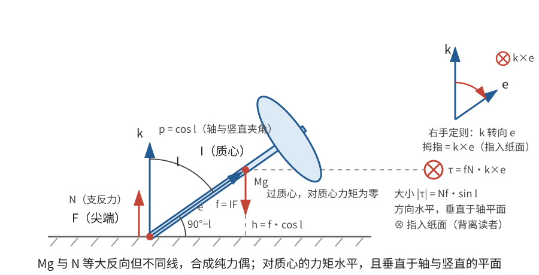
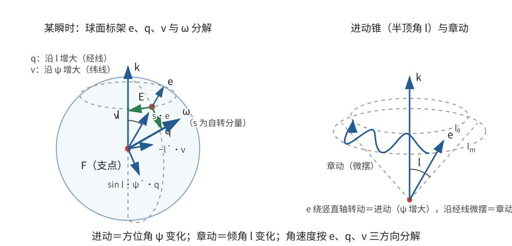
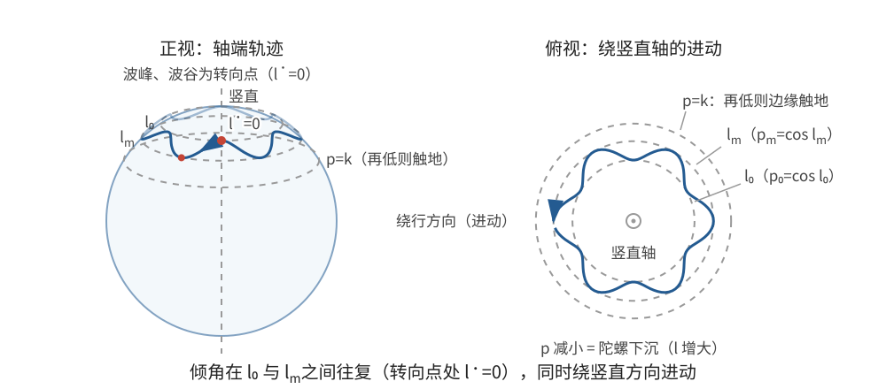

# 正文第17章：陀螺运动详论

*A Fuller Explanation of the Motion of Tops on a Horizontal Plane without Friction*

> **选编说明**：本章依据欧拉原著正文第17章重写，保留轴对称陀螺、尖端支反力、三个运动积分、倾角求积、初始绕轴自转、几何倾倒极限、快陀螺近似和竖直初态小扰动。省略重复的球面三角、积分常数换算和旧制数值例题，改用现代惯量与角度符号。矢量分解是现代重述，不冒充欧拉原有记号。

## 本章导入：轴向与横向惯量不再相同

第14章假设三个主转动惯量全部相等。本章放宽为：陀螺轴 $AF$ 是从尖端 $F$ 通过质心 $I$ 的主轴，绕该轴的转动惯量为 $I_s$，绕任意垂直于该轴的主轴的转动惯量都为 $I$。这就是轴对称的**重陀螺**（heavy symmetric top）。

仍需给定：

- 总质量 $M$ 与重力加速度大小 $g$；
- 尖端到质心的距离 $IF=f$；
- 轴向主转动惯量 $I_s$ 与横向主转动惯量 $I$；
- 光滑水平面上的竖直支反力 $N$，忽略摩擦与空气阻力。

陀螺轴不必是几何旋转体的对称轴，但质量分布必须具有上述惯量对称性。物体外形还规定一个最大允许倾角：超过它，陀螺的其他部分会碰到平面，本章的单点接触模型随即失效。

---

## 1. 支反力、质心与力矩

令 $\mathbf e$ 为从尖端指向质心的单位矢量，$l$ 为陀螺轴与竖直方向的夹角，$\mathbf k$ 为竖直向上的单位矢量。定义

$$
p=\cos l=\mathbf e\cdot\mathbf k。
$$

质心高度为 $h=fp$，所以

$$
M\ddot h=N-Mg
\quad\Longrightarrow\quad
\boxed{N=M(g+f\ddot p)}。
\tag{1}
$$

水平方向没有外力，质心水平速度保持不变。若计算给出 $N<0$，说明单侧点接触已经失效，不能把负支反力当作真实支持力。

重力对质心没有力矩。支反力对质心的力矩为

$$
\boxed{\boldsymbol\tau=(-f\mathbf e)\times N\mathbf k
=fN\,\mathbf k\times\mathbf e}。
\tag{2}
$$

其大小为 $Nf\sin l$，方向垂直于陀螺轴和竖直线所成的平面。陀螺轴与角速度满足运动学关系

$$
\dot{\mathbf e}=\boldsymbol\omega\times\mathbf e。
\tag{3}
$$

式(1)—(3)与欧拉转动方程联立，就构成完整模型。

---

## 2. 三个运动积分

### 2.1 轴向自转分量

由于 $\boldsymbol\tau\cdot\mathbf e=0$，而 $\dot{\mathbf e}=\boldsymbol\omega\times\mathbf e$，

$$
\frac{d}{dt}(\boldsymbol\omega\cdot\mathbf e)
=\dot{\boldsymbol\omega}\cdot\mathbf e
+\boldsymbol\omega\cdot(\boldsymbol\omega\times\mathbf e)=0。
$$

这里 $\dot{\boldsymbol\omega}\cdot\mathbf e$ 为零，是因为轴向惯量对应的欧拉方程右端无力矩、横向惯量又相等。因此

$$
\boxed{s\equiv\boldsymbol\omega\cdot\mathbf e=\text{常量}}。
\tag{4}
$$

$s$ 是角速度沿陀螺几何轴的分量，不一定等于总角速度大小。

### 2.2 竖直角动量分量

式(2)的力矩没有竖直分量，所以关于质心的角动量竖直分量守恒。记其常值为 $J$：

$$
\boxed{J=L_z=\text{常量}}。
\tag{5}
$$

重力只改变质心竖直运动，对质心无力矩；支反力虽有力矩，但力矩沿水平方向。

### 2.3 机械能

尖端速度沿水平面，竖直支反力不做功。无摩擦、无空气阻力时，

$$
\boxed{T_{\mathrm{转}}+T_{\mathrm{质心}}+Mgfp=\text{常量}}。
\tag{6}
$$

水平质心动能不变，可以从能量式两边删去。式(4)—(6)就是欧拉在原章 Problem 99 中得到的三个积分的现代表达。

---

## 3. 用倾角写出运动

### 3.1 角速度分解

设陀螺轴的方位角为 $\psi$，并取

$$
\mathbf e=(\sin l\cos\psi,\sin l\sin\psi,\cos l)。
$$

令 $\mathbf q$ 沿 $l$ 增大方向，$\mathbf v$ 沿 $\psi$ 增大方向：

$$
\mathbf q=(\cos l\cos\psi,\cos l\sin\psi,-\sin l),
\qquad
\mathbf v=(-\sin\psi,\cos\psi,0)。
$$

直接求导得

$$
\dot{\mathbf e}=\dot l\,\mathbf q+\sin l\,\dot\psi\,\mathbf v。
$$

与式(3)比较，角速度可写成

$$
\boxed{\boldsymbol\omega=s\mathbf e+\sin l\,\dot\psi\,\mathbf q-\dot l\,\mathbf v}。
\tag{7}
$$

因此

$$
\omega_z=s p-\sin^2l\,\dot\psi,
\qquad
\omega^2=s^2+\dot l^2+\sin^2l\,\dot\psi^2。
$$

角动量为 $\mathbf L=I\boldsymbol\omega+(I_s-I)s\mathbf e$，所以

$$
J=I_s s p-I(1-p^2)\dot\psi。
$$

解出**进动**（precession）角速度：

$$
\boxed{\dot\psi=\frac{I_s s p-J}{I(1-p^2)}}。
\tag{8}
$$

### 3.2 倾角能量方程

把式(7)—(8)代入能量积分。转动部分为

$$
T_{\mathrm{转}}=\frac12I_s s^2+\frac12I\left(\dot l^2+\sin^2l\,\dot\psi^2\right),
$$

竖直质心部分为 $\tfrac12Mf^2\dot p^2$。删去不变的 $\tfrac12I_s s^2$ 与水平质心动能，并利用 $\dot l^2=\dot p^2/(1-p^2)$，得到

$$
\boxed{
\frac12\left(\frac{I}{1-p^2}+Mf^2\right)\dot p^2
+\frac{(I_s s p-J)^2}{2I(1-p^2)}+Mgfp=\text{常量}}。
\tag{9}
$$

倾角自身的往复变化称为**章动**（nutation）。式(9)决定 $p(t)$，式(8)再决定 $\psi(t)$，式(1)最后给出支反力。一般倾角求积包含有理函数平方根，这正是欧拉将时间化为单次求积的现代形式。

---

## 4. 初始只绕陀螺轴自转

### 4.1 转向点

设初始倾角为 $l_0$，$p_0=\cos l_0>0$，角速度为 $\boldsymbol\omega_0=\Omega_0\mathbf e_0$。则

$$
s=\Omega_0,\qquad J=I_s\Omega_0p_0,\qquad \dot\psi_0=0,\qquad \dot p_0=0。
$$

式(9)化为

$$
\boxed{
\frac12\left(\frac{I}{1-p^2}+Mf^2\right)\dot p^2
+\frac{I_s^2\Omega_0^2(p-p_0)^2}{2I(1-p^2)}
+Mgf(p-p_0)=0}。
\tag{10}
$$

前两项非负，所以 $p\le p_0$：陀螺先增大倾角，不会先变得比初始更直立。

在另一个转向点 $p_m<p_0$，有 $\dot p=0$。除去初始根 $p=p_0$，得到

$$
\boxed{I_s^2\Omega_0^2(p_0-p_m)=2MgfI(1-p_m^2)}。
\tag{11}
$$

这是关于 $p_m$ 的二次方程。到达水平位置 $p=0$ 的临界初转速为

$$
\boxed{\Omega_c=\frac{1}{I_s}\sqrt{\frac{2MgfI}{p_0}}}。
\tag{12}
$$

若 $\Omega_0>\Omega_c$，运动会在 $p>0$ 处转向并重新抬起；若 $\Omega_0<\Omega_c$，理想模型会继续趋向水平，实际物体通常更早就因接触条件改变而倾倒。

### 4.2 外形给出的更早接触极限

设陀螺轴与水平面的最小允许夹角为 $\angle IFk$，记

$$
k=\sin(\angle IFk)。
$$

因为 $l$ 从竖直方向计量，这对应 $p$ 不得小于 $k$。要求转向点在机身碰地之前，即 $p_m>k$。临界情形 $p_m=k$ 代入式(11)，得到

$$
\boxed{\Omega_0>\Omega_{c,k}
=\frac{1}{I_s}\sqrt{\frac{2MgfI(1-k^2)}{p_0-k}}}。
\tag{13}
$$

这里不能漏掉 $1-k^2$。式(13)只是保持本章单点接触运动的条件；还必须同时满足 $N\ge0$。

### 4.3 快陀螺近似

若 $\Omega_0$ 很大，$p_m$ 接近 $p_0$。由式(11)，领先近似为

$$
\boxed{p_0-p_m\simeq\frac{2MgfI(1-p_0^2)}{I_s^2\Omega_0^2}}。
\tag{14}
$$

若 $l_0$ 不接近零，倾角增量近似为

$$
\boxed{l_m-l_0\simeq\frac{2MgfI\sin l_0}{I_s^2\Omega_0^2}}。
$$

在一个近似对称的小幅章动周期内，$p-p_0$ 的平均值约为最低值的一半。由式(8)，平均进动率大小为

$$
\boxed{|\overline{\dot\psi}|\simeq\frac{Mgf}{I_s\Omega_0}}。
\tag{15}
$$

关键是分母中的 $I_s$：平均进动由**轴向**转动惯量和自转共同控制，而不是横向惯量 $I$。自转越快，章动幅度按 $\Omega_0^{-2}$ 减小，平均进动按 $\Omega_0^{-1}$ 减慢。

---

## 5. 竖直初态与“休止陀螺”

### 5.1 竖直自转的稳定条件

若 $l_0=0$、$p_0=1$，式(10)有因子 $1-p^2$，需要直接在竖直位置附近展开。令 $l$ 很小，保留到 $l^2$：

$$
\frac12I\dot l^2+
\left(\frac{I_s^2\Omega_0^2}{8I}-\frac{Mgf}{2}\right)l^2
=\text{常量}。
$$

所以小倾角满足

$$
\boxed{I\ddot l+
\left(\frac{I_s^2\Omega_0^2}{4I}-Mgf\right)l=0}。
\tag{16}
$$

竖直快速自转对小扰动稳定的条件是

$$
\boxed{I_s^2\Omega_0^2>4MgfI}。
\tag{17}
$$

满足式(17)的竖直旋转陀螺常称**休止陀螺**（sleeping top）。稳定时的章动角频率为

$$
\boxed{\omega_n=\frac{\sqrt{I_s^2\Omega_0^2-4MgfI}}{2I}}。
\tag{18}
$$

精确竖直自转仍是方程的解；式(17)判断的是受小扰动后是否只作小振荡，不是说低于此值时竖直解不存在。

### 5.2 初始角速度偏离陀螺轴

设初始陀螺轴竖直，但初始角速度大小为 $\Omega$，与轴向夹角为 $\alpha$。则

$$
s=\Omega\cos\alpha,
\qquad |\boldsymbol\omega_\perp|=\Omega\sin\alpha。
$$

由一般倾角能量方程，在 $p=0$ 的临界转向条件可推出：要不落到水平位置，首先需

$$
I_s\cos\alpha>I\sin\alpha,
$$

并且

$$
\boxed{\Omega^2>
\frac{2MgfI}{I_s^2\cos^2\alpha-I^2\sin^2\alpha}}。
\tag{19}
$$

若 $\alpha$ 很小且满足强自转条件，则竖直附近的进动近似为

$$
\boxed{\dot\psi\simeq-\frac{I_s\Omega\cos\alpha}{2I}}。
\tag{20}
$$

定义

$$
\kappa=\frac{\sqrt{I_s^2\Omega^2\cos^2\alpha-4MgfI}}{2I},
$$

小倾角解可写成

$$
\boxed{l(t)\simeq\frac{\Omega\sin\alpha}{\kappa}\sin(\kappa t)}。
\tag{21}
$$

式(21)保留初始横向角速度 $\Omega\sin\alpha$，不能在振幅分子中漏掉 $\Omega$。它对应原章 Problem 103 的小扰动解；进动与章动具有不同时间尺度。

> **批注**：原章反复提醒，真实摩擦会持续消耗能量并产生水平力，使陀螺轨迹弯曲、转速下降，最终破坏上述无耗散运动。本章的“无限持续”“周期性回升”都只属于理想模型，不能直接套到真实陀螺的长期行为。

---

## 本章小结

1. 本章陀螺具有轴向惯量 $I_s$ 和两个相等横向惯量 $I$，尖端可在光滑水平面上滑动。
2. 支反力满足 $N=M(g+f\ddot p)$，力矩为 $fN\mathbf k\times\mathbf e$；质心水平速度保持不变。
3. 轴向自转分量 $s$、竖直角动量 $J$ 和机械能给出三个运动积分，可将进动和章动化为单个倾角求积。
4. 初始纯轴向自转的转向点满足式(11)；考虑机身几何接触极限时，临界式必须包含 $1-k^2$。
5. 快陀螺的平均进动率约为 $Mgf/(I_s\Omega_0)$，由轴向惯量决定。
6. 竖直自转的小扰动稳定条件为 $I_s^2\Omega_0^2>4MgfI$；角速度偏离轴向时，还需保留初始横向角速度。

---

## 底本与现代参考

1. 欧拉原著正文第17章；Ian Bruce 英译见本地 [`english_translation/tmvol1ch17tr.txt`](english_translation/tmvol1ch17tr.txt)，公式与图版见同目录 [`tmvol1ch17tr.pdf`](english_translation/tmvol1ch17tr.pdf)。英译总目录：[17th Century Maths](https://www.17centurymaths.com/contents/mechanica3.html)。
2. H. Goldstein, C. Poole and J. Safko, *Classical Mechanics*, 3rd ed.：重对称陀螺、进动、章动与休止陀螺的现代表述。
3. L. D. Landau and E. M. Lifshitz, *Mechanics*, 3rd ed.：对称陀螺守恒量、有效能量和快陀螺近似。
4. Sebastià Xambó Descamps, [*Euler and the Dynamics of Rigid Bodies*](https://web.mat.upc.edu/sebastia.xambo/HistoricalEssays/Euler-RigidBody-x.pdf)：欧拉刚体运动理论的历史与现代对照。

[上一章：正文第16章——天体的旋转运动](欧拉刚体运动理论_正文_第16章.md)

[下一章：正文第18章——球体的运动](欧拉刚体运动理论_正文_第18章.md)
