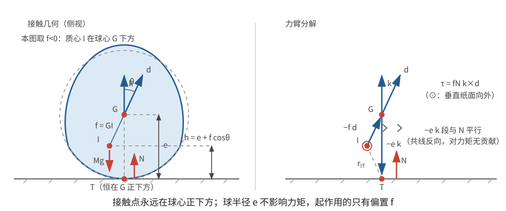

# 正文第18章：球底物体在水平面上的运动

*Concerning the Motion of Bodies with a Spherical Base on a Horizontal Plane*

> **选编说明**：本章依据欧拉原著正文第18章重写，保留球底接触、支反力与质心运动、稳定和不稳定平衡、球半径从力矩中消去、轴对称物体与上一章的对应，以及一般惯量物体的小幅蹒跚运动。省略重复的球面三角与积分常数展开，改用矢量几何和现代小振动记号；一般特征方程是现代重述，不冒充欧拉原有矩阵工具。

## 本章导入：球底与尖端为何有相同的转动方程？

本章研究底部为球面或球面一部分的刚体。球底球心为 $G$，半径为 $e$，物体与水平面保持单点切触，平面光滑，没有摩擦和空气阻力。理想模型中并不是一块球面区域承受分布压力，而是每一时刻只有一个接触点承受竖直支反力。

质心 $I$ 不一定与 $G$ 重合。取物体固连的特殊轴单位矢量 $\mathbf d$，在参考平衡位置竖直向上，并令

$$
\mathbf r_{GI}=f\mathbf d。
$$

$f$ 是带符号的距离：$f>0$ 表示质心沿 $\mathbf d$ 位于 $G$ 的上方，$f<0$ 表示质心位于另一侧。设 $\theta$ 是 $\mathbf d$ 与竖直方向的夹角，则

$$
\boxed{h=e+f\cos\theta}
\tag{1}
$$

是质心高度。球心高度始终为 $e$，所以 $e$ 只改变高度的加法常量，不改变势能差。

---

## 1. 支反力与平衡稳定性

设支反力大小为 $N$，竖直向上，总质量为 $M$。水平方向没有外力，质心水平速度保持不变。竖直方向有

$$
N-Mg=M\ddot h,
$$

因此

$$
\boxed{N=M\left[g+f\left(\cos\theta\,\ddot\theta
-\sin\theta\,\dot\theta^2\right)\right]}。
\tag{2}
$$

若出现 $N<0$，单侧接触已经失效，不能继续解释为负压力。

### 1.1 用质心高度判断稳定方向

在只改变 $\theta$ 的缓慢静力比较中，重力势能为

$$
V=Mgh=Mg(e+f\cos\theta)。
$$

平衡位置满足 $\sin\theta=0$，在本参考轴上即 $\theta=0$ 或 $\pi$。在 $\theta=0$ 附近，

$$
V\simeq Mg(e+f)-\frac12Mgf\,\theta^2。
$$

- 若 $f<0$，二阶项为正，质心高度在平衡处最低，是**稳定平衡**（stable equilibrium）；
- 若 $f>0$，二阶项为负，质心高度在平衡处最高，是**不稳定平衡**（unstable equilibrium）；
- 若 $f=0$，质心与球心重合，高度不随姿态改变，各方向均为中性平衡。

另一端的平衡把 $f$ 的符号对调。对球底物体而言，直线 $GI$ 与球面的两个交点提供两个候选平衡方向；稳定与否最终由“质心是否处于最低位置”判断，而不能只背某一端的名称。

> **批注**：这里讨论的是无耗散理想模型。真实物体受摩擦和空气阻力后，小振荡会衰减；不稳定方向也不会表现为长期周期运动。现代“翻倒陀螺”（tippy top）等问题还涉及更具体的质量分布与接触条件，不能仅凭本章模型就宣称所有翻转现象已经得到解释。

---

## 2. 球半径为什么从力矩中消失？

设瞬时接触点为 $T$。由于球面与水平面相切，$T$ 位于球心正下方：

$$
\mathbf R_T=\mathbf R_G-e\mathbf k,
$$

其中 $\mathbf k$ 是竖直向上的单位矢量。质心位置为 $\mathbf R_I=\mathbf R_G+f\mathbf d$，所以从质心指向接触点的力臂为

$$
\mathbf r_{IT}=-f\mathbf d-e\mathbf k。
$$

支反力 $N\mathbf k$ 对质心的力矩为

$$
\boldsymbol\tau
=(-f\mathbf d-e\mathbf k)\times N\mathbf k
=fN\mathbf k\times\mathbf d。
$$

即

$$
\boxed{\boldsymbol\tau=fN\,\mathbf k\times\mathbf d}。
\tag{3}
$$

含 $e$ 的项因 $\mathbf k\times\mathbf k=\mathbf0$ 而消去。力矩大小为 $|f|N\sin\theta$，与球半径无关。

这并不表示接触几何对一切运动都无关紧要。球半径决定接触点与球心的位置、物体何时发生其他部位碰撞以及模型能否保持；但只要单点球面切触成立，关于质心的支反力力矩就只含 $f$。

对稳定平衡 $f<0$，式(3)在小倾角下指向使 $\theta$ 减小的方向；对 $f>0$，同一倾角下力矩倾向增大偏离，与第1节的高度判据一致。

---

## 3. 轴对称球底物体与第17章的关系

现在进一步设特殊轴 $\mathbf d$ 是主轴，绕该轴的转动惯量为 $I_s$，绕任意横向主轴的转动惯量为 $I$。令 $p=\cos\theta$，则支反力也可写成

$$
\boxed{N=M(g+f\ddot p)}。
\tag{4}
$$

式(3)与第17章尖端陀螺的力矩形式完全相同，只需把 $f$ 改为本章的带符号质心—球心距离。因此，同样的推导给出三个运动积分：

- 轴向角速度分量 $s=\boldsymbol\omega\cdot\mathbf d$ 不变；
- 关于质心的角动量竖直分量 $J=L_z$ 不变；
- 机械能不变，水平质心动能仍可删去。

角速度分解与进动公式仍是

$$
\boldsymbol\omega=s\mathbf d+\sin\theta\,\dot\psi\,\mathbf q-\dot\theta\,\mathbf v,
$$

$$
\boxed{\dot\psi=\frac{I_s s p-J}{I(1-p^2)}}，
\tag{5}
$$

倾角能量方程仍是

$$
\boxed{
\frac12\left(\frac{I}{1-p^2}+Mf^2\right)\dot p^2
+\frac{(I_s s p-J)^2}{2I(1-p^2)}+Mgfp=\text{常量}}。
\tag{6}
$$

因此，第17章的求积方法在本章继续成立；但是 $f$ 的符号改变后，势能项与稳定方向也改变，不能把尖端陀螺的“向下倾倒”结论不加转换地套到稳定球底上。

### 3.1 稳定平衡附近从静止释放

取 $f=-a<0$，其中 $a=|f|$。若初始角速度为零，则 $s=J=0$，方位角不发生变化，运动保持在初始竖直平面内。物体不会获得绕竖直轴的自转，而是获得绕水平轴的摆动角速度。

在 $\theta$ 很小时，$1-p\simeq\theta^2/2$，竖直质心速度对动能的贡献是更高阶小量，式(6)化为

$$
\frac12I\dot\theta^2+\frac12Mga\,\theta^2
=\frac12Mga\,\theta_0^2,
$$

其中 $\theta_0$ 是初始小倾角。于是

$$
\boxed{I\ddot\theta+Mga\,\theta=0}。
\tag{7}
$$

角频率、周期与解为

$$
\boxed{\omega_0=\sqrt{\frac{Mga}{I}},
\qquad T=2\pi\sqrt{\frac{I}{Mga}},
\qquad \theta=\theta_0\cos(\omega_0t)}。
\tag{8}
$$

这相当于摆长

$$
\ell=\frac{I}{Ma}
$$

的单摆小振动。小角度下周期与振幅无关，是线性化的一般性质，不是说大角度摆动也严格等时。

---

## 4. 一般惯量物体的小幅蹒跚运动

若特殊轴不是主轴，或三个主转动惯量不等，小偏离一般不再只有一个频率。欧拉称其为**蹒跚运动**（stumbling motion）。用现代小振动语言，可以保留其两个非零特征频率的核心结果，而不展开冗长的方向余弦代数。

### 4.1 二阶特征方程

在稳定平衡处，取竖直方向为第三空间坐标。令 $\boldsymbol\varepsilon$ 是绕质心的微小角位移矢量，$\boldsymbol\omega\simeq\dot{\boldsymbol\varepsilon}$。记平衡姿态下的惯量矩阵为 $\mathbf I_0$，并定义单位质量惯量矩阵

$$
\mathbf K=\frac1M\mathbf I_0。
$$

竖直质心加速度对动能的贡献仍是高阶小量，所以小振动能的首项为 $\tfrac12\dot{\boldsymbol\varepsilon}^{T}\mathbf I_0\dot{\boldsymbol\varepsilon}$。恢复势能的二阶项为 $\tfrac12Mga(\varepsilon_1^2+\varepsilon_2^2)$。

令 $\mathbf P_h=\operatorname{diag}(1,1,0)$ 表示投影到水平两个方向，则线性化方程为

$$
\boxed{\mathbf K\ddot{\boldsymbol\varepsilon}
+ga\,\mathbf P_h\boldsymbol\varepsilon=\mathbf0}。
\tag{9}
$$

设某一振动模式 $\boldsymbol\varepsilon=\boldsymbol\varepsilon_0\cos(\omega t+\eta)$，并令 $\lambda=\omega^2/(ga)$，得到广义特征方程

$$
\boxed{\det(\lambda\mathbf K-\mathbf P_h)=0}。
\tag{10}
$$

由于 $\mathbf P_h$ 只保留两个水平方向，零根对应绕竖直方向的自由转动；另外两个正根 $\lambda_1,\lambda_2$ 给出

$$
\boxed{\omega_j=\sqrt{ga\lambda_j}},
\qquad
\boxed{\ell_j=\frac1{\lambda_j}},\qquad j=1,2。
\tag{11}
$$

$\ell_j$ 是与第 $j$ 个模式具有相同周期的等效单摆长度。一般小振运动是这两个模式的叠加；从静止释放时，各模式分别出现正弦或余弦项，振幅与相位由初始姿态和初始角速度决定。

> **批注**：式(10)的矩阵形式是现代表达。欧拉在原章 Problem 108—110 中用主轴方向余弦展开同一特征问题，并得到两个频率及其组合解。矩阵使“为什么通常有两个非零频率”更清楚，但并不意味着欧拉已经使用矩阵或现代小振动教材的术语体系。

### 4.2 两个横向惯量相等时

若一个主轴与平衡特殊轴的夹角为 $\delta$，绕该主轴的单位质量惯量为 $k_s=I_s/M$，任意横向主轴的单位质量惯量为 $k=I/M$，则两个非零根可写成

$$
\boxed{\lambda_1=\frac1k},
\qquad
\boxed{\lambda_2=\frac{k_s\cos^2\delta+k\sin^2\delta}{k_s k}}。
\tag{12}
$$

所以

$$
\boxed{\omega_1=\sqrt{\frac{Mga}{I}},
\qquad
\omega_2=\sqrt{Mga\frac{I_s\cos^2\delta+I\sin^2\delta}{I_sI}}}。
\tag{13}
$$

对应的等效摆长为

$$
\ell_1=\frac{I}{M},
\qquad
\ell_2=\frac{I_sI}{M\left(I_s\cos^2\delta+I\sin^2\delta\right)}。
$$

当 $\delta=0$ 时，两个频率重合，并回到轴对称特殊轴的结果；当 $\delta=\pi/2$ 时，第二模式直接由 $I_s$ 控制。这两个极限可用来检查式(12)—(13)没有混淆轴向与横向惯量。

---

## 本章小结

1. 球底与水平面保持单点切触，质心高度为 $h=e+f\cos\theta$，支反力由竖直质心加速度决定。
2. 稳定与否由质心高度判断：$f<0$ 的参考平衡稳定，$f>0$ 不稳定，$f=0$ 为中性平衡。
3. 接触力矩为 $\boldsymbol\tau=fN\mathbf k\times\mathbf d$，球半径 $e$ 严格消去，但接触模型的几何适用范围仍与 $e$ 有关。
4. 轴对称球底物体与第17章共用三个运动积分和倾角方程；改变 $f$ 的符号会改变稳定方向。
5. 稳定轴对称球底从静止小偏离时，角频率为 $\sqrt{Mga/I}$，等效摆长为 $I/(Ma)$。
6. 一般惯量物体的小幅蹒跚运动含两个非零特征频率，可由 $\det(\lambda\mathbf K-\mathbf P_h)=0$ 统一求得。

---

## 底本与现代参考

1. 欧拉原著正文第18章；Ian Bruce 英译见本地 [`english_translation/tmvol1ch18tr.txt`](english_translation/tmvol1ch18tr.txt)，公式与图版见同目录 [`tmvol1ch18tr.pdf`](english_translation/tmvol1ch18tr.pdf)。英译总目录：[17th Century Maths](https://www.17centurymaths.com/contents/mechanica3.html)。
2. H. Goldstein, C. Poole and J. Safko, *Classical Mechanics*, 3rd ed.：刚体小振动、特征频率与陀螺运动的现代对照。
3. L. D. Landau and E. M. Lifshitz, *Mechanics*, 3rd ed.：小振动、平衡稳定性与刚体转动的现代表述。
4. Sebastià Xambó Descamps, [*Euler and the Dynamics of Rigid Bodies*](https://web.mat.upc.edu/sebastia.xambo/HistoricalEssays/Euler-RigidBody-x.pdf)：欧拉刚体运动理论的历史与现代对照。

[上一章：正文第17章——陀螺运动详论](欧拉刚体运动理论_正文_第17章.md)

[下一章：正文第19章——圆柱体在平面上的运动](欧拉刚体运动理论_正文_第19章.md)
