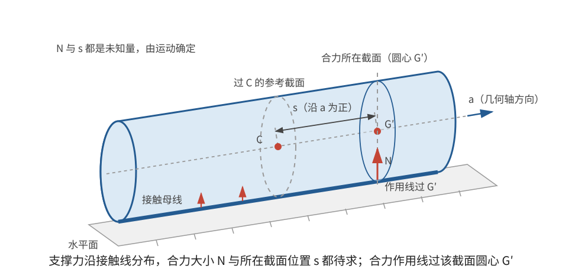
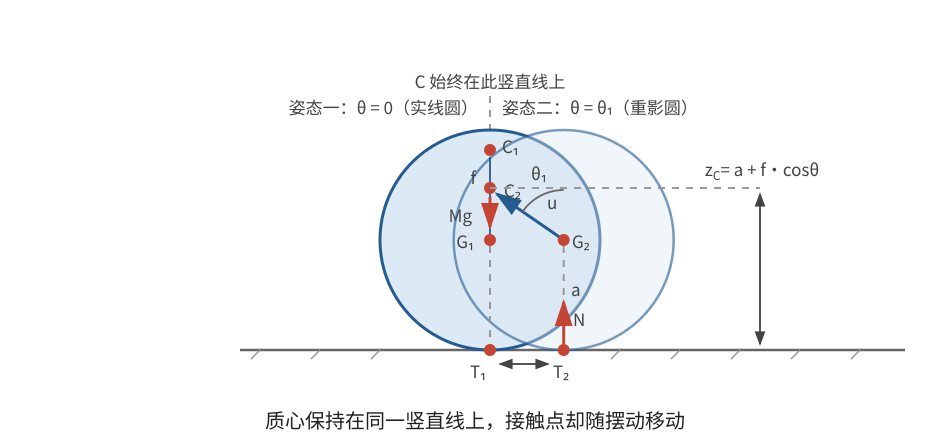

# 正文第19章：圆柱体在水平面上的运动

*Concerning the Motion of Cylindrical Bodies upon a Horizontal Plane*

> **选编说明**：本章依据欧拉原著正文第19章重写。保留线接触、质心运动、支撑力力矩、两个首次积分、微小振荡和一般降维的主线；球面三角中的重复展开改用矢量说明，旧单位统一换算为现代单位。这里始终采用**无摩擦、持续接触**的理想模型，不把无滑动滚动当作额外假设。

## 本章导入：圆柱为什么既能滚动，又能摇晃？

把一根圆柱形圆木横放在水平桌面上，它的一条母线与桌面接触。若圆木的密度均匀，质心就在几何轴上；若一侧嵌有重物，质心便偏离几何轴，圆木会像摇椅一样摆动。

后一种情形比尖端陀螺多出一个困难：陀螺的支撑力通过已知尖端，而圆柱的支撑力分布在接触线上。其合力不仅大小未知，作用在哪一个横截面内也未知。欧拉正是从这两个未知量入手，建立圆柱运动方程。

---

## 1. 线接触与两类轴

### 1.1 支撑力的合力通过哪个截面？

圆柱与水平面沿一条平行于几何轴的直线接触。无摩擦时，平面只能提供竖直向上的**法向力**（normal force）。这些彼此平行的力可以合成一个竖直力 $N$。

在合力的作用点作一个垂直于圆柱长度方向的截面。由于接触点与截面圆心的连线竖直，合力的作用线必通过这个圆心。因此，描述支撑作用需要两个量：

- 合力大小 $N$；
- 合力所在截面到质心截面的有向距离 $s$。

二者都不能在列出运动方程前任意指定，而要随运动一起求出。

> **批注**：这里的“通过截面圆心”不是说支撑力作用于圆心。实际作用力仍在接触线上；只是说它的竖直作用线经过该圆心。沿同一作用线移动力的作用点，不改变它对质心的力矩。

### 1.2 几何轴不必是主轴

欧拉区分了两种轴：

- **几何轴**（geometrical axis）：各圆形横截面的圆心连线，在本章模型中始终水平；
- **机械轴**（mechanical axis）：欧拉在这里指通过质心的惯性主轴，即**主轴**（principal axis），由质量分布决定，不必与几何轴重合。

若质量均匀，质心在几何轴上，纵向几何轴也是主轴；若质量分布偏心，两者可以不同。后文用 $I_1,I_2,I_3$ 表示对三条主轴的转动惯量，用 $\omega_1,\omega_2,\omega_3$ 表示角速度在这些随体主轴上的分量。

> **批注**：本章也不要求整个物体都是完整圆柱。只要实际支撑处具有圆柱面，例如摆体两端装有圆柱形轴颈，同一分析就适用。若只研究微小摆动，甚至只需接触附近的局部形状是圆柱面。

---

## 2. 质心的运动与平衡位置

### 2.1 质心高度决定支撑力

在通过质心 $C$、且垂直于几何轴的截面内，设圆心为 $G$，半径为 $a$。令

$$
CG=f,
$$

其中 $f$ 是有符号距离：在选定的零角度位置，若 $C$ 位于 $G$ 上方，则 $f>0$；若位于下方，则 $f<0$。用 $\mathbf u(\theta)$ 表示从 $G$ 指向 $C$ 的单位矢量，$\theta$ 是它相对竖直方向的偏角，于是质心高度为

$$
\boxed{z_C=a+f\cos\theta}。
$$

竖直方向只有重力 $Mg$ 与支撑力 $N$。取向上为正，质心运动方程给出

$$
M\ddot z_C=N-Mg,
$$

所以

$$
\boxed{N=M\left[g+f\frac{d^2}{dt^2}(\cos\theta)\right]}
$$

或写成

$$
\boxed{N=Mg+M\ddot z_C}。
$$

若质心没有竖直加速度，$N=Mg$；若质心向下加速，$N<Mg$。公式还必须满足 $N\ge 0$。若计算要求 $N<0$，平面不可能向下拉住物体，持续接触假设已经失效。

水平方向没有外力，因此质心的水平速度保持不变；若初始水平速度为零，质心就始终留在同一条竖直线上。接触点则会随圆柱摆动而改变水平位置。

> **批注**：欧拉原文用同一个 $M$ 表示质量与重量，并把现代重力加速度 $g$ 写成 $2g$。因此，原文的 $4fg$ 在本章现代公式中对应 $2fg$。这里不再沿用把质量与重量同名的旧约定。

### 2.2 稳定平衡与不稳定平衡

质心高度直接给出重力势能

$$
U=Mg z_C=Mg(a+f\cos\theta)。
$$

平衡要求连线 $GC$ 处于竖直方向。只要 $f\ne0$，就有质心在圆心正下方和正上方两种位置：

- 质心在下方时，微小偏离会升高质心，势能取极小值，是**稳定平衡**（stable equilibrium）；
- 质心在上方时，微小偏离会降低质心，势能取极大值，是**不稳定平衡**（unstable equilibrium）。

若 $f=0$，质心就在几何轴上，理想光滑平面上的各个角度都是中性平衡位置。

---

## 3. 支撑力怎样改变转动？

在支撑力的竖直作用线上取一点 $H$，并使它与相应截面的圆心同高。令 $\mathbf a$ 为沿圆柱纵向的单位矢量。由于 $\mathbf u$ 是从 $G$ 指向 $C$，有

$$
\mathbf r_{GC}=f\mathbf u,\qquad
\mathbf r_{CG}=-f\mathbf u,\qquad
\mathbf r_{GH}=s\mathbf a。
$$

因此，从质心指向 $H$ 的矢量是

$$
\boxed{\mathbf r_{CH}=\mathbf r_{CG}+\mathbf r_{GH}
=-f\mathbf u+s\mathbf a}。
$$

重力作用于质心，对质心没有力矩；支撑力对质心的力矩因此是

$$
\boxed{\boldsymbol\tau_C
=(-f\mathbf u+s\mathbf a)\times N\hat{\mathbf k}}，
$$

其中 $\hat{\mathbf k}$ 是竖直向上的单位矢量。作用点若在作用线上再上下移动，只会给 $\mathbf r_{CH}$ 增加竖直分量；该分量与竖直力的叉积为零，所以力矩不变。

这个简洁表达式包含了本章的主要困难：$N$ 由质心竖直加速度决定，$s$ 由转动方程决定，而转动又反过来影响二者。

> **批注**：上面的叉积是现代重述，不是欧拉原有的记号。欧拉把 $\mathbf r_{CH}$ 和 $N\hat{\mathbf k}$ 分解到三条主轴上，逐分量写出力矩。现代形式则把随体主轴中的转动方程写为
> $$
> \dot{\mathbf L}_C+\boldsymbol\omega\times\mathbf L_C
> =\boldsymbol\tau_C,
> \qquad
> \mathbf L_C=(I_1\omega_1,I_2\omega_2,I_3\omega_3)。
> $$
> 它与前章的欧拉旋转方程相同，本章的新内容只在力矩含有未知的 $N$ 和 $s$。

---

## 4. 两个首次积分

欧拉没有直接硬解全部分量方程，而是先找出两个**首次积分**（first integrals）。用现代语言说，它们分别表示能量守恒和角动量竖直分量守恒；下面的积分推导仍以欧拉所得关系为依据。

### 4.1 能量积分

质心水平速度不变，竖直速度为

$$
\dot z_C=-f\sin\theta\,\dot\theta。
$$

圆柱与平面保持接触时，接触处物质点的竖直速度为零，而支撑力又竖直，所以支撑力不做功。重力势能与动能之和因此守恒：

$$
\boxed{
\begin{aligned}
E={}&\frac12M V_{\mathrm h}^2
+\frac12Mf^2\sin^2\theta\,\dot\theta^2\\
&+\frac12\left(I_1\omega_1^2+I_2\omega_2^2+I_3\omega_3^2\right)
+Mg(a+f\cos\theta),
\end{aligned}}
$$

其中 $V_{\mathrm h}$ 是恒定的质心水平速率。第一项与半径项 $Mga$ 都是常数，可以在需要时并入 $E$。

这也核对了欧拉原来的积分

$$
\sum_{i=1}^3\frac{I_i}{M}\omega_i^2
=\mathcal C-2gf\cos\theta-f^2\sin^2\theta\,\dot\theta^2,
$$

其中 $\mathcal C$ 是由初始条件确定的常数。末项来自质心竖直动能，不能与转动动能一起省略。

### 4.2 竖直角动量积分

重力和支撑力都竖直，对任意竖直轴的力矩均为零，所以角动量的竖直分量守恒：

$$
\boxed{L_z=\text{常量}}。
$$

若竖直方向在三条随体主轴上的方向余弦为 $n_1,n_2,n_3$，则

$$
\boxed{L_z=I_1\omega_1n_1+I_2\omega_2n_2+I_3\omega_3n_3}。
$$

这些方向余弦随姿态变化，因此 $L_z$ 守恒并不表示任何一个 $\omega_i$ 单独不变，更不表示整个角动量矢量在空间中的方向不变。

---

## 5. 一个可算通的情形：从静止开始的平面倾倒

设**过质心且平行于几何轴的纵向轴**也是主轴，并设初始条件使运动始终在一个竖直平面内进行。偏心的质心并不在几何轴上，因此这里说的是与几何轴平行的随体主轴。绕这条纵向水平主轴的转动惯量记为 $I$，则能量积分化为

$$
\frac12\left(I+Mf^2\sin^2\theta\right)\dot\theta^2
+Mgf\cos\theta=\text{常量}。
$$

取 $f>0$，圆柱从偏角 $\theta_0$ 处由静止释放，并限定

$$
0<\theta_0<\frac{\pi}{2}。
$$

由初始条件确定常数后，

$$
\boxed{
\left(I+Mf^2\sin^2\theta\right)\dot\theta^2
=2Mgf(\cos\theta_0-\cos\theta)}。
$$

于是，在 $\theta$ 增大的阶段，

$$
\boxed{
t=\int_{\theta_0}^{\theta}
\sqrt{\frac{I+Mf^2\sin^2\vartheta}
{2Mgf(\cos\theta_0-\cos\vartheta)}}\,d\vartheta}。
$$

只要运动持续接触，圆柱就可以在有限时间内达到 $\theta=\pi/2$。若初始恰好处于 $\theta_0=0$ 的不稳定平衡，积分在起点附近发散；理想模型中它不会自行偏离该位置，不能据此说“一般倾倒都需要无限时间”。$\theta_0=\pi/2$ 则是初始已经到达终点的平凡情形。若 $f<0$，质心初始位于下方附近，释放后得到的是稳定平衡附近的摆动，而不是同意义的倾倒。

> **批注**：欧拉还讨论了初始具有绕竖直方向转动的特殊情形。在相应的主轴对称条件下，物体可以一直保持这种运动；有限偏角只能在无限时间内渐近达到。这个结论依赖特殊初始条件，不能与上面的非零偏角释放混为一谈。

---

## 6. 稳定平衡附近的微小振荡

现在令质心在圆心下方，并记质心到圆心的正距离为 $d=|f|$。只保留偏角和角速度的一阶小量时，$N=Mg+O(\theta^2)$，支撑力与重力合成恢复力矩。

### 6.1 纵轴为主轴的平面摆动

仍设纵向轴为主轴，其转动惯量为 $I$。微小振荡方程为

$$
I\ddot\theta=-Mgd\,\theta,
$$

所以

$$
\boxed{\Omega=\sqrt{\frac{Mgd}{I}}},
\qquad
\boxed{T_{\mathrm{osc}}=2\pi\sqrt{\frac{I}{Mgd}}}。
$$

若从 $\theta=\theta_0$ 处由静止释放，则

$$
\theta(t)=\theta_0\cos(\Omega t)。
$$

这与摆长为

$$
\boxed{\ell=\frac{I}{Md}}
$$

的单摆具有相同周期。圆柱半径 $a$ 只决定质心的基准高度，不出现在一阶恢复力矩和转动惯量 $I$ 之外，因此不直接进入这个周期公式。

### 6.2 一般主轴方向下的等效摆长

欧拉还给出不必平面摆动时的一阶结果。为避免原书球面几何记号含混，先用本章的矢量重新界定各角。

把通过 $G,C$ 的随体直线称为**中央参考线**，其正向取第2节的 $\mathbf u$，即从 $G$ 指向 $C$。因此 $\theta$ 就是 $\mathbf u$ 与竖直向上方向 $\hat{\mathbf k}$ 的夹角：在 $f>0$ 的上方平衡位置 $\mathbf u=\hat{\mathbf k}$，在 $f<0$ 的下方稳定平衡位置 $\mathbf u=-\hat{\mathbf k}$。中央参考线与 $\hat{\mathbf k}$ 所在的平面称为中央竖直平面；它相对某个固定竖直平面的方位角记为 $\zeta$。过 $C$ 且平行于几何轴的单位方向 $\mathbf a$ 是纵向参考方向，与第3节力矩式中的方向一致。

令第 $i$ 条随体主轴的单位矢量为 $\mathbf e_i$。固定角 $\alpha_i$ 是中央参考线正方向与该主轴正方向的夹角：

$$
\boxed{\cos\alpha_i=\mathbf u\cdot\mathbf e_i},
\qquad 0\le\alpha_i\le\pi。
$$

再定义两个垂直于中央参考线的投影

$$
\hat{\mathbf k}_{\perp}
=\hat{\mathbf k}-(\hat{\mathbf k}\cdot\mathbf u)\mathbf u,
\qquad
\mathbf e_{i\perp}
=\mathbf e_i-(\mathbf e_i\cdot\mathbf u)\mathbf u。
$$

$\eta_i$ 是绕 $\mathbf u$、从中央竖直平面 $\operatorname{span}(\mathbf u,\hat{\mathbf k})$ 转向主轴平面 $\operatorname{span}(\mathbf u,\mathbf e_i)$ 的有向二面角。具体地，

$$
\cos\eta_i=
\frac{\hat{\mathbf k}_{\perp}\cdot\mathbf e_{i\perp}}
{|\hat{\mathbf k}_{\perp}|\,|\mathbf e_{i\perp}|},
\qquad
\sin\eta_i=
\frac{\mathbf u\cdot(\hat{\mathbf k}_{\perp}\times\mathbf e_{i\perp})}
{|\hat{\mathbf k}_{\perp}|\,|\mathbf e_{i\perp}|}。
$$

这分别对应原书中球面角 $ZLA,ZLB,ZLC$ 与弧 $LA,LB,LC$。若中央参考线与竖直方向或某一主轴重合，分母为零，此时按邻近位置的连续极限取值。$\alpha_i,\eta_i$ 都是描述质量分布相对圆柱几何方位的固定角，不是新的运动变量；纵向参考方向则用来保持退化位置处的方向约定连续。

令 $k_i^2=I_i/M$。等效单摆长度为

$$
\boxed{
\ell=
\frac{
k_1^2k_2^2\cos^2\eta_3\sin^2\alpha_3
+k_1^2k_3^2\cos^2\eta_2\sin^2\alpha_2
+k_2^2k_3^2\cos^2\eta_1\sin^2\alpha_1
}{
d\left(k_1^2\cos^2\alpha_1+k_2^2\cos^2\alpha_2
+k_3^2\cos^2\alpha_3\right)
}}。
$$

它满足 $\Omega^2=g/\ell$。在上一小节的纵轴主轴情形中，取

$$
\alpha_1=90^\circ,\qquad \eta_1=90^\circ,
\qquad \eta_2=180^\circ,\qquad \eta_3=0,
$$

此特例的第一条主轴就是第6.1节的纵向主轴，故 $I=I_1=Mk_1^2$。分子与分母中的公共因子相消，就回到 $\ell=I/(Md)$。三个正弦因子必须分别对应 $\alpha_1,\alpha_2,\alpha_3$，不能误写成同一个角。

> **批注**：一般公式中的 $\alpha_i,\eta_i$ 不是三个新的运动变量，而是质量分布相对圆柱几何形状的固定方位。若只关心平面摇摆，使用上一小节的公式即可；一般式的重要性在于显示主轴方向怎样改变有效惯量。

### 6.3 自由搁置与固定轴为什么周期不同？

回到第6.1节的平面摆动情形。若把几何轴固定，物体只能绕该轴转动。由平行轴定理，对固定轴的转动惯量为 $I+Md^2$，故

$$
\ell_{\mathrm{fixed}}=\frac{I+Md^2}{Md}
=\frac{I}{Md}+d。
$$

而圆柱自由搁置在光滑水平面上时，质心没有水平加速度，接触点可以移动；对质心取矩得到的微小转动惯量仍是 $I$，所以

$$
\ell_{\mathrm{free}}=\frac{I}{Md}
<\ell_{\mathrm{fixed}}。
$$

因此自由搁置时振荡更快。差别来自**约束不同**，不是平动“吸收了动能”而使惯量神秘减小：固定轴约束使质心必须沿圆弧运动，自由搁置则允许轴线和接触点作不同的水平运动。

> **批注**：欧拉指出，微小摩擦可能使实际运动偏离上述自由解。现代处理不能笼统地把“有一点摩擦”等同于固定轴，而要检查静摩擦是否足以维持无滑动，并重新求解约束力。附录正是从这种摩擦问题继续展开。

---

## 7. 一般运动怎样降维？

对任意主轴方向，欧拉最后把运动化为逐次积分。这里只保留能看清结构的现代重述。

令 $\theta$ 为中央参考线的偏角，$\zeta$ 为它绕竖直方向的方位角，并引入

$$
r=-\dot\theta,\qquad u=-\dot\zeta。
$$

能量与竖直角动量两个积分，可以把 $r,u$ 同 $\theta,\zeta$ 联系起来。令 $\Lambda=L_z/M$，$\mathcal C$ 为第4节能量积分中的常数，并沿用第6节的固定角 $\alpha_i,\eta_i$ 和 $k_i^2=I_i/M$。先定义六组常数

$$
\begin{aligned}
A_0&=\sum_i k_i^2\cos^2\alpha_i, &
B_0&=\sum_i k_i^2\cos\eta_i\sin\alpha_i\cos\alpha_i,\\
C_0&=\sum_i k_i^2\cos^2\eta_i\sin^2\alpha_i, &
D_0&=\sum_i k_i^2\sin\eta_i\sin\alpha_i\cos\alpha_i,\\
E_0&=\sum_i k_i^2\sin\eta_i\cos\eta_i\sin^2\alpha_i, &
F_0&=\sum_i k_i^2\sin^2\eta_i\sin^2\alpha_i。
\end{aligned}
$$

再令

$$
\begin{aligned}
Q(\zeta)&=A_0\cos^2\zeta+2B_0\sin\zeta\cos\zeta+C_0\sin^2\zeta,\\
K(\zeta)&=D_0\cos\zeta+E_0\sin\zeta,\\
H(\theta,\zeta)&=F_0+f^2\sin^2\theta。
\end{aligned}
$$

这样，$Q$ 是转动惯量的方向组合，$K$ 来自角动量投影，$H$ 则再加入质心竖直运动的贡献。为便于书写，以下省略 $Q,K,H$ 的自变量。两个首次积分先写成

$$
\Lambda=rK+uQ,
$$

$$
W\equiv\mathcal C-2gf\cos\theta
=Hr^2+2Kru+Qu^2。
$$

第一式就是竖直角动量积分，立即给出

$$
\boxed{u=\frac{\Lambda-rK}{Q}}。
$$

再把它代入第二式，读者可以自行核对：

$$
W=\frac{\Lambda^2}{Q}
+\left(H-\frac{K^2}{Q}\right)r^2。
$$

移项并整理，得到

$$
\boxed{
r^2=
\frac{\Lambda^2-Q(\zeta)\left(\mathcal C-2gf\cos\theta\right)}
{K(\zeta)^2-Q(\zeta)H(\theta,\zeta)}}。
$$

因而问题化为

$$
\boxed{dt=-\frac{d\theta}{r}},
\qquad
\boxed{\frac{d\zeta}{d\theta}=\frac{u}{r}}。
$$

先由第二式配合 $r,u$ 的表达式求轨迹，再由第一式求时间。$r$ 的正负号要由初始条件和所处运动阶段确定；只知道 $r^2$ 并不能决定积分沿哪个方向前进，$r=0$ 的转向点也需单独处理。求出姿态后，$N$ 和 $s$ 可由原运动方程恢复。这里的“解决”是化为积分与微分方程，并不保证存在初等函数形式的显式解，更不能笼统称为已经化成单变量椭圆积分。

> **批注**：上面的 $A_0$ 至 $F_0$ 就是原书球面三角常数的现代写法；这里省略的只是将它们逐项代回后的机械展开。现代引子：这种“先利用守恒量消元，再把时间留到最后积分”的做法，是分析力学中约化运动方程的早期实例。现代教材通常用广义坐标、拉格朗日方程或哈密顿方程继续发展这一思路，但这些体系不能倒算成本章已经使用的工具。

---

## 本章小结

1. 无摩擦圆柱的支撑力合力竖直，其作用线通过某一横截面的圆心；$N$ 与该截面的位置 $s$ 都要由运动确定。
2. 质心高度 $z_C=a+f\cos\theta$ 给出 $N=M(g+\ddot z_C)$；无水平外力时，质心水平速度恒定。
3. 质心在几何轴下方对应稳定平衡，在上方对应不稳定平衡。
4. 支撑位矢为 $\mathbf r_{CH}=-f\mathbf u+s\mathbf a$，对质心的力矩为 $(-f\mathbf u+s\mathbf a)\times N\hat{\mathbf k}$；重力对质心无力矩。
5. 能量与竖直角动量提供两个首次积分。能量式必须包含质心竖直动能。
6. 稳定平衡附近的小振荡具有单摆形式；纵轴为主轴时 $\ell=I/(Md)$，自由搁置比固定同一条几何轴时振荡更快。
7. 一般运动可借助两个积分降维，但化为积分不等于求得初等显式解。

---

## 底本与现代参考

1. 欧拉原著正文第19章；Ian Bruce 英译见本地 [`english_translation/tmvol1ch19tr.txt`](english_translation/tmvol1ch19tr.txt)，公式与图117—124见同目录 PDF。
2. H. Goldstein, C. Poole and J. Safko, *Classical Mechanics*, 3rd ed.，刚体运动与欧拉方程相关章节：用于矢量、主轴和首次积分的现代对照。
3. L. D. Landau and E. M. Lifshitz, *Mechanics*, 3rd ed.，刚体运动与运动积分相关章节：用于能量和角动量表述的对照。

[上一章：正文第18章——球体的运动](欧拉刚体运动理论_正文_第18章.md)

[下一章：附录第1章——一般摩擦](欧拉刚体运动理论_附录_第1章.md)
