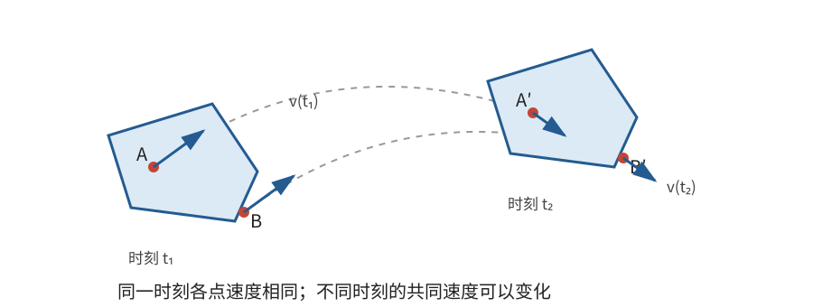
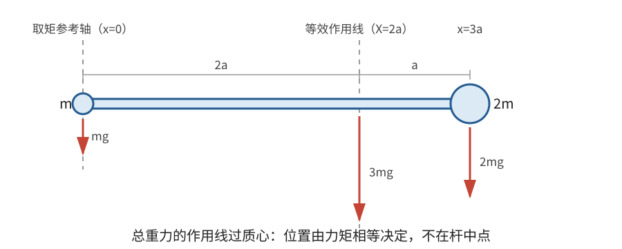

# 正文第1章：刚体的平移运动

*Concerning the Progressive Motion of Rigid Bodies*

> **选编说明**：本章依据欧拉原著正文第1章重写，保留四条定义、两条定理和四个问题的主要思路；省略旧单位下重复的代数换算，用现代符号重述，并按理解顺序合并部分内容。

## 本章导入：物体上各点走相同的路吗？

把一本书放在桌面上，保持书的方向不变，将它从一处移到另一处。书上各点的轨迹形状相同，可以通过平移彼此重合；任意时刻各点的速度也相同，这就是**平移**。

如果把书绕桌面上的某一点转过一定角度，书的运动就不再是纯平移。即使书的质量中心走了同样的路线，书上其他点的运动也已经不同。

本章要回答四个问题：

1. 什么样的物体可以看作刚体？
2. 什么运动叫作平移？
3. 为什么在某些条件下，可以把整个刚体当作位于质心的一个质点？
4. 外力使整个刚体加速时，刚体内部为什么还要存在联结力？

---

## 1. 刚体：距离不变的理想模型

欧拉把刚体定义为：形状不发生变化，或者说，任意两个部分之间的距离保持不变的物体。

若 $P,Q$ 是刚体上的任意两点，它们的位置矢量分别为 $\mathbf r_P(t)$ 和 $\mathbf r_Q(t)$，那么

$$
\left|\mathbf r_P(t)-\mathbf r_Q(t)\right|=\text{常量}。
$$

这里的“刚体”是一种相对于研究条件的理想化。钢块在很大的力下也会变形，橡皮在很小的力下也可能几乎不变形。只要形变对所研究的运动影响足够小，就可以把物体当作刚体。

欧拉还指出，三个不共线点的位置基本足以确定整个刚体的位置与取向。

> **批注**：严格地说，仅根据距离还可能剩下一个镜像位置；在实际连续运动中，刚体不会凭空翻成自己的镜像，因此这个二重性通常可以排除。用现代语言说，自由刚体有六个自由度：三个描述质心位置，三个描述空间取向。欧拉在本章没有用“六自由度”这个术语，但他关于三个不共线点的讨论已经包含了这一构造。后面会看到，真正困难的不是数出这六个变量，而是写出它们怎样随力改变。

---

## 2. 平移：所有点具有相同速度

欧拉定义平移为：在任意时刻，刚体上各点都以相等的速率沿彼此平行的方向运动。用矢量表示，就是

$$
\mathbf v_P(t)=\mathbf V(t)\qquad\text{对刚体上每一点 }P\text{ 都成立}。
$$

这说明各点的加速度也相同。若取质心或刚体上的任一参考点，把它的坐标记为 $\mathbf R(t)$，则刚体上点 $P$ 的位置可以写成

$$
\mathbf r_P(t)=\mathbf R(t)+\mathbf b_P,
$$

其中 $\mathbf b_P$ 是从参考点指向 $P$ 的固定矢量。在平移中，$\mathbf b_P$ 的大小和方向都不随时间改变。

因此，平移有两个等价特征：

- 各点在同一时刻具有相同的速度；
- 刚体上任意一条连线的方向保持不变。

**平移不一定是直线运动。** 摩天轮座舱若始终保持地板水平，它沿圆周运动时仍可近似看作平移；书本沿曲线移动时，只要不转动，也仍是平移。平移只排除转动，并不要求轨迹笔直。

> **批注**：欧拉用月球说明这一点。月球总以近似相同的一面朝向地球，因此它绕地球运动时也在改变自身各条连线的空间方向，不是纯平移。这个例子很有启发性：沿圆周“公转”并不自动意味着物体自身在“自转”，是否转动要看物体固连的方向怎样变化。

---

## 3. 不受外界扰动的平移

**定理**：刚体一旦获得平移运动，若不受外界原因扰动，就会以恒定速度沿固定方向继续运动。

欧拉的论证很直观。把刚体分成许多很小的部分。平移时，各部分的速度相同；如果每一部分都按惯性保持自己的运动，它们之间的距离自然不会改变，也不需要额外的力来维持这种排列。

反过来，如果刚体各部分的速度不同，而又要让每一部分都独自沿直线匀速前进，它们很快就会分开。此时，保持刚体形状的内部联结就必须发挥作用。

这里给出的是质点惯性原理对纯平移刚体的直接推广。更一般的“质心惯性运动”将在后面用质心和动量来表述。

---

## 4. 按质量分配的平行力

现在考虑一种特殊的力场：作用在每个质量微元上的力，都与该微元的质量成正比，而且方向相同。

若每单位质量所受的力对应加速度 $\mathbf a$，则质量微元 $dm$ 所受的力为

$$
d\mathbf F=\mathbf a\,dm。
$$

这种力分配恰好与共同加速度所需的质量分配一致，因此每个微元都可以具有相同的加速度 $\mathbf a$，不需要内部联结再协调各部分的运动；一般情形下的内部作用留到第7节讨论。只要刚体最初处于静止或纯平移状态，各点就会继续保持相同速度，刚体的取向不会改变。

地面附近的均匀重力场是最熟悉的例子：

$$
d\mathbf F=\mathbf g\,dm。
$$

若一个物体开始自由下落时没有转动，那么它的各部分都以 $\mathbf g$ 加速，物体不会因理想均匀重力而开始旋转。

这里有两个不可缺少的条件：

1. 力必须按质量分配；
2. 各力的方向必须彼此平行。

地球对很大物体的真实引力并不严格满足这两个条件：不同位置的重力大小略有差异，方向也分别指向地心。本章采用的是小范围内的均匀重力近似。

> **批注**：这条定理解释了“为什么自由下落的物体不会仅因重力而翻倒”。关键不是重力作用在哪一个点上，而是重力对每一部分都提供近似相同的加速度。现代引子：在非均匀引力场中，不同部分的加速度不再相同，会产生**潮汐力**；对延展天体，这还可能引起形变和转动。

---

## 5. 从等效力系到质心

### 5.1 合力相同还不够

把作用在整个物体上的一组力换成一个力时，合力相同还不够：同样大小、同样方向的力，如果作用线不同，产生的转动效果也不同。**作用线**就是沿力的方向、通过作用点的直线。

在杠杆情形中，力矩可以用“力的大小 × 力臂”来理解。要使一个力与原来的力系等效，除了合力相同，还必须保持力矩相同。

仍考虑按质量分配的平行力：

$$
d\mathbf F=\lambda\,\hat{\mathbf e}\,dm,
$$

其中 $\hat{\mathbf e}$ 是共同的单位方向，$\lambda$ 表示共同的力与质量之比。总力为

$$
\mathbf F=\lambda M\hat{\mathbf e},\qquad M=\int dm。
$$

下面先算一个具体例子，看看力矩相等怎样确定等效作用线的位置。

### 5.2 两质点例子：用一次取矩找到质心

一根轻杆上有两个质点：质量 $m$ 的质点位于 $x=0$，质量 $2m$ 的质点位于 $x=3a$。均匀重力场中，它们的重力分别为 $mg$ 和 $2mg$，总重力为 $3mg$。

设总重力的等效作用线通过 $x=X$。对左端取力矩，位于左端的质点没有力矩，另一个质点的力矩必须与总重力的力矩相同：

$$
2mg\cdot3a=3mg\cdot X。
$$

约去 $3mg$，得到

$$
\boxed{X=2a}。
$$

这就是两个质点的质心位置。它离较大质量更近，而且不是由“总重量相同”单独决定的，而是由**力矩也相同**决定的。

### 5.3 从取矩到一般定义

把同样的取矩计算推广到全部质量微元。把每个微元看成一个小质点：若力都沿竖直方向，$x$ 是微元到竖直取矩轴的水平有向距离，那么它的力矩为 $x\,dF$，总力矩就是 $\int x\,dF$。设等效合力的相应坐标为 $X$，由力矩相等得到

$$
X\int dF=\int x\,dF,
\qquad
X=\frac{\int x\,dF}{\int dF}。
$$

由于 $dF=\lambda\,dm$，共同的 $\lambda$ 可以约去：

$$
X=\frac{\lambda\int x\,dm}{\lambda M}
=\frac1M\int x\,dm。
$$

一次取矩确定的是等效作用线在一个横向坐标上的位置；沿作用线移动合力，并不改变力矩。让共同力方向分别取三个坐标方向，重复上述论证，所得等效作用线共同通过同一点，于是得到质心的位置矢量：

$$
\boxed{\mathbf R=\frac1M\int\mathbf r\,dm}。
$$

对离散的质点系，积分写成求和：

$$
\boxed{\mathbf R=\frac{1}{M}\sum_i m_i\mathbf r_i},\qquad M=\sum_i m_i。
$$

质心因此是位置的**质量加权平均**。质量越大的部分，对质心位置的影响越大。欧拉由力矩相等找到了这个特殊点，并称之为质量中心或惯量中心。

若把坐标原点移到质心，则按定义有

$$
\sum_i m_i(\mathbf r_i-\mathbf R)=\mathbf 0。
$$

这表示以质心为基准，各部分的质量加权位移相互抵消，并不是说质心两侧的质量或体积一定相等。

### 5.4 质心不一定等于重心

在均匀重力场中，质心与重心重合；在非均匀重力场中，重力与质量的分配关系随位置改变，两者不必重合。质心只由质量分布决定，重力则是外部作用。

质心处也不一定有实际物质。均匀圆环的质心在圆心，而圆心位于空处。

> **批注**：欧拉特意优先使用“质量中心或惯量中心”，而不是只称“重心”。这个命名选择抓住了问题的本质：质心不是重力创造出来的点，而是物体质量分布本身决定的几何点。现代教材通常先定义质心，再在均匀重力场中推出它与重心重合。

---

## 6. 什么时候刚体可以当成一个质点？

欧拉讨论的结论是：

> 若刚体最初静止或作纯平移，并且外力合力的等效作用线始终通过质心，那么刚体保持平移；其质心运动等同于全部质量集中在质心、全部外力合力作用于该点的质点运动。

此时，质心位置 $\mathbf R(t)$ 满足

$$
\boxed{M\frac{d^2\mathbf R}{dt^2}=\mathbf F_{\mathrm{外}}}。
$$

在刚体保持平移的前提下，其他点与质心保持固定的相对位置，所以只要知道 $\mathbf R(t)$，整个刚体的位置和每一时刻的速度也就知道了。

要使整个刚体继续保持纯平移，而不是仅有质心遵循上式，需要两个条件：

- 初始运动没有转动；
- 外力系不产生改变转动的效果，即其等效作用线通过质心。

例如，在桌面上的书的中心推，书可以只改变平移状态；在书角推，书除了整体移动，还会改变取向。后一种情况下，质心仍然遵循上面的运动方程，但仅靠这个方程无法说明书怎样转动。

**例：恒力作用下的平移。** 若质量为 $M$ 的刚体从静止开始，受到大小和方向都不变、作用线通过质心的力 $F$，则加速度为 $a=F/M$。经过时间 $t$，

$$
v=\frac{F}{M}t,\qquad x=\frac12\frac{F}{M}t^2。
$$

这就是欧拉在本章最后讨论的恒力平移情形。

> **批注**：上述两个条件限制的是“保持纯平移”，不是质心方程本身的成立范围。现代力学中有一个更一般的质心运动定理：无论刚体是否转动，都有 $M\ddot{\mathbf R}=\mathbf F_{\mathrm{外}}$。它来自总动量 $\mathbf P=M\mathbf V$ 与 $\dot{\mathbf P}=\mathbf F_{\mathrm{外}}$。欧拉本章着重证明的是纯平移情形；把一般形式直接归作本章原命题，会扩大他在这里实际讨论的范围。现代引子：质心定理只描述整体平动，不能决定刚体怎样转动；转动还需要角动量方程。

---

## 7. 元素力与内部联结力

### 7.1 元素力不是另一组真实外力

前面讨论的是整个刚体怎样运动。欧拉接着问：为了保持刚体不变形，物体内部的联结必须承受什么？

他定义**元素力**为：分别作用于各质量微元、能够使它们产生实际运动所需的力。

若某质量微元 $dm$ 的实际加速度为 $\mathbf a$，其元素力就是

$$
d\mathbf T=\mathbf a\,dm。
$$

在纯平移中，所有微元的 $\mathbf a$ 相同，所以元素力恰好按质量分配。元素力描述的是“产生实际加速度所需要的结果”，它不一定是外界实际施加在该微元上的力，也不等于内部联结力。

### 7.2 实际外力与元素力之差由内部作用补偿

对一个质量微元使用牛顿第二定律：

$$
d\mathbf F_{\mathrm{外}}+d\mathbf N=dm\,\mathbf a=d\mathbf T,
$$

其中 $d\mathbf N$ 是物体其他部分对这个微元的内部作用**合力**。因此

$$
\boxed{d\mathbf N=d\mathbf T-d\mathbf F_{\mathrm{外}}}。
$$

若实际外力已经按质量分配，即 $d\mathbf F_{\mathrm{外}}=dm\,\mathbf a$，那么 $d\mathbf N=0$：各部分无需依靠内部联结来协调加速度。这里说的是微元所受的净内部作用为零，并不排除物体内部仍存在成对的相互作用力。

若只拉动物体的一端，被直接拉动部分的实际外力通常大于它按质量应分得的元素力。这个差额通过内部作用传递，使其他部分也获得相同加速度。刚体越能保持形状，这种内部协调越有效。

**直观例子：拉一列小车。** 让每节质量相同的小车获得相同加速度，所需合力相同。但只拉最前面一节时，前面的连接装置必须带动整列，后面的连接装置只需带动较少车厢，因此各处拉力不必相同。元素力回答“每节车实际需要多少合力”，连接装置的力回答“这个合力怎样被传递”。

> **批注**：欧拉把实际外力与元素力进行比较，再借助一个假想的静止状态分析内部联结。这与后来达朗贝尔原理中的“动静法”有清楚的联系：在随物体加速的参考系中加入惯性力，就可以把动力学问题改写成形式上的平衡问题。但元素力本身不是惯性力，也不是内部力，三者的物理角色必须分开。

---

## 本章小结

1. **刚体**是任意两点距离保持不变的理想模型；是否可采用这一模型，取决于所研究问题中的形变是否可忽略。
2. **平移**要求各点速度相同、物体取向不变，但不要求轨迹是直线。
3. 按质量分配且方向平行的力，使各部分获得相同加速度，因而不会破坏已有的纯平移。
4. **质心**是位置的质量加权平均；按质量分配的平行力，其等效作用线通过质心。
5. 在本章规定的纯平移条件下，刚体的质心运动可以按一个质点处理。
6. **元素力**是各质量微元产生实际加速度所需的合力；实际外力与元素力之间的差额，揭示内部联结怎样协调各部分运动。

下一章将固定刚体上的两个点。此时刚体不能再自由平移，只能绕通过这两点的轴转动，研究对象也从平移转向旋转。

---

## 底本与现代参考

1. 欧拉原著正文第1章；Ian Bruce 英译见本地 [`english_translation/tmvol1ch1tr.txt`](english_translation/tmvol1ch1tr.txt)，原书图版及公式见同目录 PDF。英译总目录：[17th Century Maths](https://www.17centurymaths.com/contents/mechanica3.html)。
2. OpenStax, *University Physics Volume 1*, [§9.6 Center of Mass](https://openstax.org/books/university-physics-volume-1/pages/9-6-center-of-mass)：质心、总动量与一般质心运动定理。
3. Sebastià Xambó Descamps, [*Euler and the Dynamics of Rigid Bodies*](https://web.mat.upc.edu/sebastia.xambo/HistoricalEssays/Euler-RigidBody-x.pdf), §§1—4：质点系、动量原理与刚体运动学的现代对照。
4. H. Goldstein, C. Poole and J. Safko, *Classical Mechanics*, 3rd ed., 第1章：质点系、约束力与达朗贝尔原理的现代表述。

[上一章：引言第6章——受力质点的相对运动](欧拉刚体运动理论_引言_第6章.md)

[下一章：正文第2章——绕固定轴的无扰动旋转](欧拉刚体运动理论_正文_第2章.md)
