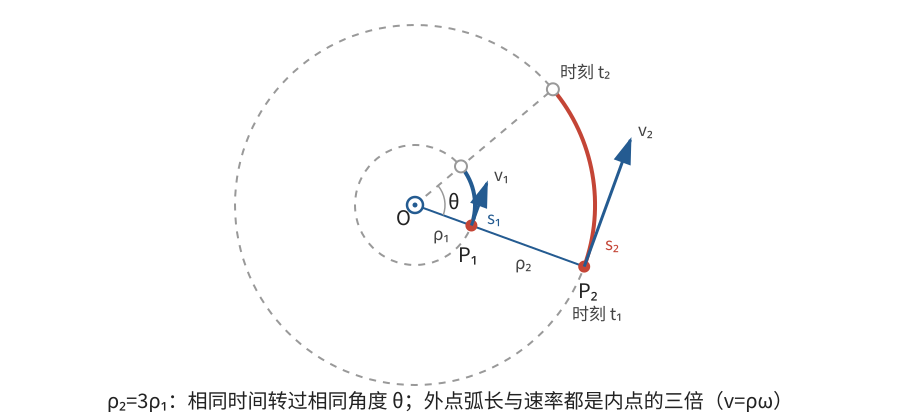
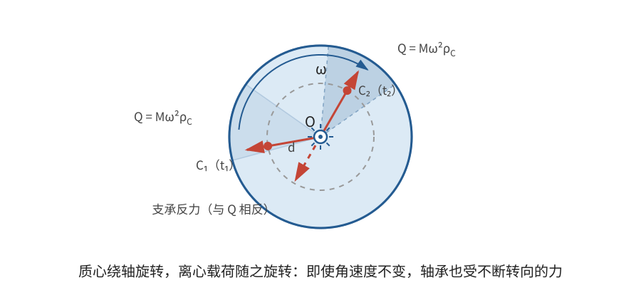

# 正文第2章：绕固定轴的无扰动旋转

*Concerning Rotational Motion about a Fixed Axis with no Disturbing Forces*

> **选编说明**：本章依据欧拉原著正文第2章重写，保留固定轴旋转与角速度的定义、无扰动时匀速旋转的定理，以及轴和物体内部所受阻力的主要讨论。用现代矢量合并重复的支承力计算；略去旧单位换算和同一杠杆分配的多次展开，但保留一般刚体完全不扰动轴的条件。

## 本章导入：匀速转动时，轴承为什么还会受力？

使一只轮子绕固定轴旋转。如果支承足够理想，不再施加驱动力，轮子仍能继续转动。可是，轴不动、角速度不变，并不等于轴不受力：轮子若偏心，轴承就会受到不断改变方向的载荷。

本章依次回答三个问题：

1. 怎样用一个共同的量描述刚体上各点的旋转？
2. 为什么无扰动的固定轴旋转会保持匀速？
3. 维持圆周运动所需的力怎样传给轴和物体内部？什么条件下轴完全不受旋转载荷？

---

## 1. 固定轴旋转与角速度

### 1.1 每个点都在各自的圆周上运动

欧拉把**旋转运动（rotational motion）**定义为刚体绕一条与其固连的直线运动，这条直线称为**旋转轴（axis of rotation）**。若刚体上有两个点被固定，通过这两点的直线上的所有点都保持不动，刚体余下的运动就是绕该轴的旋转。

取固定轴为 $z$ 轴。刚体上一点 $P$ 到轴的垂直距离记为 $\rho_P$，其轴向坐标记为 $z_P$。旋转时，$\rho_P$ 和 $z_P$ 都不变，$P$ 只能在垂直于轴的平面内作圆周运动。

设整个刚体从初始位置转过角 $\theta(t)$，点 $P$ 的初始方位角为 $\varphi_P$，则

$$
x_P=\rho_P\cos(\theta+\varphi_P),\qquad
y_P=\rho_P\sin(\theta+\varphi_P),\qquad
z_P=\text{常量}。
$$

刚体上各点的 $\varphi_P$ 不同，但同一时刻的转角增量 $\theta$ 相同。因此，只要知道轴的位置和轴外一点的位置，整个刚体的取向也就确定了。

### 1.2 各点共享同一个角速度

**角速度（angular speed）**描述整个刚体转角的瞬时变化率。用带正负号的转角表示两种相反转向，定义

$$
\boxed{\omega=\frac{d\theta}{dt}}。
$$

$\omega$ 的正负表示转向，$|\omega|$ 表示快慢。欧拉还把角速度解释为离轴单位距离的点的速率；这与上式一致，因为圆弧长等于半径乘弧度角。

对位置坐标求导，得到

$$
\dot x_P=-\rho_P\omega\sin(\theta+\varphi_P),\qquad
\dot y_P=\rho_P\omega\cos(\theta+\varphi_P)。
$$

所以点 $P$ 的速率为

$$
\boxed{v_P=\sqrt{\dot x_P^2+\dot y_P^2}=\rho_P|\omega|}，
$$

速度方向沿该点圆周的切线。各点的角速度相同，速率却与到轴的距离成正比；轴上的点满足 $\rho_P=0$，因而保持不动。

**例：同一轮子上的两点。** 若轮子以 $3\,\mathrm{rad/s}$ 转动，距轴 $0.10\,\mathrm m$ 和 $0.30\,\mathrm m$ 的两点，速率分别为 $0.30\,\mathrm{m/s}$ 和 $0.90\,\mathrm{m/s}$。它们在相同时间内转过相同角度，但外点走过的弧长是内点的三倍。

> **批注**：欧拉在本章使用的是所有点共享的转动快慢和两种转向，并没有把角速度写成现代矢量。现代记法可用沿轴的角速度矢量统一表示转向，并用叉积（cross product）写出各点速度；这是后来形成的简洁表达，不应倒算为本章已经使用的工具。有限转动的合成也比这里绕同一固定轴的转角相加复杂，后面才需要处理。

---

## 2. 无扰动时为什么保持匀速旋转？

**定理**：刚体一旦绕固定轴开始旋转，若不受外界原因扰动，就会以恒定角速度继续旋转。这里允许理想支承提供保持轴不动所需的约束力，但不允许另有改变转动状态的作用。

欧拉用“假想细线”说明这一点。把刚体分成许多质量微元，并设想每个微元各自用一根细线连到固定轴。每个微元到轴的距离不变，获得相应切向速度后，便能各自作匀速圆周运动；细线提供指向轴的约束力，但不改变其速率。

即使暂时解除微元之间除这些细线以外的联结，它们仍能在同一角速度下运动，彼此距离保持不变。因此，恢复刚体内部的联结并不会妨碍这种运动，整个刚体可以继续匀速旋转。这是**惯性原理（principle of inertia）**在固定轴旋转中的推广。

若初始角为 $\theta_0$，恒定角速度为 $\omega$，则

$$
\boxed{\theta(t)=\theta_0+\omega t}。
$$

经过时间 $t$ 转过的角为 $\omega t$，一周所需时间为

$$
\boxed{T=\frac{2\pi}{|\omega|}}\qquad(\omega\ne0)。
$$

这里“无扰动”不是“任何力都不存在”。固定轴的支承力可以维持圆周运动，却不改变绕轴的转动快慢；下一章才会研究力矩怎样产生和改变转动。

> **批注**：本章定理不能扩大成“任意刚体只要没有外力矩，角速度矢量就不变”。本章的轴被固定，所有点始终绕同一条轴运动；若转轴本身可以改变方向，角动量与角速度的关系会更复杂。把固定轴情形直接推广到自由转动，会掩盖后面主轴和自由旋转问题真正的困难。

---

## 3. 圆周运动所需的力怎样传到轴上？

### 3.1 微元需要向心力，轴受到反作用

角速度恒定只表示速率不变，并不表示速度矢量不变。距轴为 $\rho$ 的质量微元 $dm$ 作匀速圆周运动时，由前面得到的 $v=\rho|\omega|$，其加速度大小为

$$
a=\frac{v^2}{\rho}
=\frac{(\rho|\omega|)^2}{\rho}
=\omega^2\rho，
$$

方向指向轴。因此，它所需的**向心力（centripetal force）**为

$$
d\mathbf F_{\mathrm{向}}=-\omega^2\boldsymbol\rho\,dm,
$$

其中 $\boldsymbol\rho$ 是从轴向微元的垂直矢量，$|\boldsymbol\rho|=\rho$。这份向内的合力由物体内部联结及支承共同提供。

欧拉用**离心力（centrifugal force）**描述微元拉紧假想细线、进而向外拉动轴的作用。就相互作用而言，微元受到向内的约束作用，约束和轴则受到微元向外的反作用。不能把这两个方向相反的作用误当成同时加在微元上的两份力。

对同一微元，旋转载荷的大小满足

$$
|d\mathbf F_{\mathrm{向}}|=\omega^2\rho\,dm。
$$

它与质量、到轴距离以及角速度平方成正比。角速度加倍，所需向心力及相应的旋转载荷都变为四倍。

> **批注**：现代力学还在随物体旋转的非惯性参考系中使用虚拟离心力，以解释微元为何在该参考系中看似保持静止。这与欧拉在这里讨论的“微元向外拉约束”不是完全相同的表述层次。本章只需抓住惯性系中的事实：速度方向不断改变，所以必须有向心加速度。

### 3.2 垂直于薄板的轴：总载荷由质心决定

先考虑位于 $xy$ 平面内的薄板，固定轴垂直于薄板并穿过点 $O$。每个微元对轴的外拉作用都位于同一平面，方向沿各自的 $\boldsymbol\rho$。把全部微元对轴的作用相加，得到轴所受合力

$$
\mathbf Q=\omega^2\int\boldsymbol\rho\,dm。
$$

设薄板总质量为 $M$，质心相对轴的横向位置为

$$
\boldsymbol\rho_C=\frac1M\int\boldsymbol\rho\,dm,
$$

便有

$$
\boxed{\mathbf Q=M\omega^2\boldsymbol\rho_C}。
$$

因此，就轴所受合力而言，整个薄板等同于全部质量集中在质心、并以相同角速度绕轴旋转的一个质点。$\mathbf Q$ 的方向由轴指向质心，并随薄板一起转动；支承对刚体的合力则与它相反。

若轴通过质心，$\boldsymbol\rho_C=\mathbf 0$，于是

$$
\boxed{\mathbf Q=\mathbf 0}。
$$

这解释了为什么通过质心的轴不会因薄板匀速旋转而受到横向合力。若质心离轴距离为 $d$，轴受合力大小就是 $M\omega^2d$；质心离轴越远，载荷越大。

---

## 4. 一般刚体何时没有旋转载荷？

薄板结论还不能直接推广到任意三维刚体。即使各微元对轴的作用合力为零，它们也可能形成**力偶（couple）**：一对大小相等、方向相反且作用线不重合的力，其合力为零，合力矩却不为零。这种力系会使两处支承受到大小相等、方向相反的力。因此，“轴通过质心”只是必要条件之一。

取固定轴为 $z$ 轴，微元位置写成

$$
\mathbf r=(x,y,z),\qquad \boldsymbol\rho=(x,y,0)。
$$

微元对轴的外拉作用为 $d\mathbf Q=\omega^2(x,y,0)\,dm$。这份力实际作用在微元于轴上的垂足 $N=(0,0,z)$；由于 $\overrightarrow{ON}$ 与 $\mathbf r$ 只差一个沿 $d\mathbf Q$ 方向的矢量，用 $\overrightarrow{ON}$ 或 $\mathbf r$ 取矩会得到相同结果。对原点 $O$ 取矩时，$x$ 分量是 $y\,dQ_z-z\,dQ_y$，$y$ 分量是 $z\,dQ_x-x\,dQ_z$，而这里 $dQ_z=0$。因此，全部作用的合力和合力矩分别为

$$
\mathbf Q
=\omega^2\left(\int x\,dm,\ \int y\,dm,\ 0\right),
$$

$$
\mathbf K
=\int\mathbf r\times d\mathbf Q
=\omega^2\left(-\int zy\,dm,\ \int zx\,dm,\ 0\right)。
$$

这里的 $\mathbf r\times d\mathbf Q$ 是现代力矩记号；上面的分量展开对应欧拉对两个横向方向分别取矩的计算。要使旋转完全不扰动轴，必须同时有 $\mathbf Q=\mathbf0$ 和 $\mathbf K=\mathbf0$，即

$$
\boxed{
\int x\,dm=0,\qquad
\int y\,dm=0,\qquad
\int zx\,dm=0,\qquad
\int zy\,dm=0。
}
$$

前两个条件表示轴通过质心；后两个条件进一步限制质量沿轴向与横向的联合分布。例如，两个质量同为 $m$ 的微元分别位于 $(a,0,h)$ 和 $(-a,0,-h)$，则质心在轴上，却有

$$
\int zx\,dm=mah+(-h)(-a)m=2mah\ne0。
$$

两个微元的向外作用合力为零，却在不同高度形成力偶。四个条件都满足时，各微元的旋转作用才既无合力，也无合力矩，刚体可以在没有附加支承力的情况下绕该轴自由匀速旋转。

对垂直薄板的轴，所有微元都有 $z=0$，后两个积分自动为零，所以一般条件恰好退化为上一节的“轴通过质心”。对一般刚体，支承点之间距离越大，提供同样反向力矩所需的支承力通常越小；但仅靠一个支承点通常不能约束住所有方向的力和力矩。

> **批注**：现代把这类问题归入**动平衡（dynamic balancing）**。前两个积分对应静平衡，后两个积分对应旋转时由质量分布产生的力偶平衡；满足这些条件的轴与后面将定义的主轴密切相关。欧拉在这里直接给出了四积分条件，主轴的系统理论则是后续章节的内容。工程上校正轮胎和转子的动平衡，正是在调整这些质量矩，而不是简单地把总质心移到轴上就结束。

---

## 5. 物体内部为什么也要承受旋转载荷？

轴不受力，并不代表物体内部不受力。每个微元仍需向心力才能维持圆周运动，这些力最终由微元之间的联结传递。

欧拉采用一个静止等效方法来分析内部作用：想象给每个微元施加大小为 $\omega^2\rho\,dm$、方向背离轴的力，再加上与实际支承相应的平衡力。这个静止力系对物体联结的作用，可以用来考察旋转时内部需要维持的约束。

因此，角速度加倍时，不仅轴承载荷变为四倍，维持刚体形状所需的内部作用也按同样比例增大。外缘微元需要与物体其余部分牢固联结；靠近轴的部分还可能要传递更外侧许多微元累积的作用。至于材料是否足够强、内部应力怎样分布，还取决于具体结构和材料，不能只由本章的运动学公式决定。

> **批注**：这种“把实际加速度换成一组反向假想力，再按静止平衡分析”的做法，与后来的达朗贝尔原理有清楚联系。但静止等效力系用于求内部作用时，必须保留各微元上的分布，不能随意换成只在总体上等效的一对力；总体等效与内部受力等效不是一回事。

---

## 本章小结

1. 固定轴旋转中，轴外各点在垂直于轴的平面内作圆周运动，整个刚体共享角速度 $\omega=\dot\theta$，各点速率为 $v=\rho|\omega|$。
2. 无外界扰动时，固定轴旋转保持恒定角速度，$\theta=\theta_0+\omega t$；支承力存在并不与“无扰动”矛盾。
3. 匀速圆周运动仍需要向心力。微元的旋转载荷与 $dm$、$\rho$ 和 $\omega^2$ 成正比，并可通过内部联结和支承传递。
4. 垂直薄板的轴所受合力为 $M\omega^2\boldsymbol\rho_C$；轴通过质心时合力为零。
5. 一般刚体完全无旋转轴载，还要求 $\int x\,dm=\int y\,dm=0$ 和 $\int zx\,dm=\int zy\,dm=0$；仅轴过质心并不充分。
6. 匀速旋转也会使物体内部承受联结作用，载荷随角速度平方变化。

下一章将给固定轴刚体施加外力，研究转动最初怎样产生，并由此引入力矩和转动惯量。

---

## 底本与现代参考

1. 欧拉原著正文第2章；Ian Bruce 英译见本地 [`english_translation/tmvol1ch2tr.txt`](english_translation/tmvol1ch2tr.txt)，原书图版及公式见同目录 PDF。英译总目录：[17th Century Maths](https://www.17centurymaths.com/contents/mechanica3.html)。
2. H. Goldstein, C. Poole and J. Safko, *Classical Mechanics*, 3rd ed., 第5章：固定轴转动、质心与主轴的现代表述。
3. OpenStax, *University Physics Volume 1*, [§6.2 Uniform Circular Motion](https://openstax.org/books/university-physics-volume-1/pages/6-2-uniform-circular-motion)：匀速圆周运动的向心加速度与向心力。

[上一章：正文第1章——刚体的平移运动](欧拉刚体运动理论_正文_第1章.md)

[下一章：正文第3章——旋转运动的产生](欧拉刚体运动理论_正文_第3章.md)
