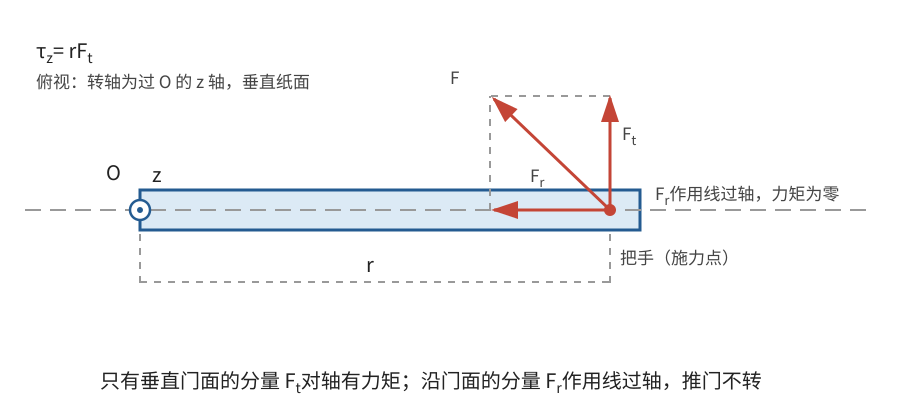
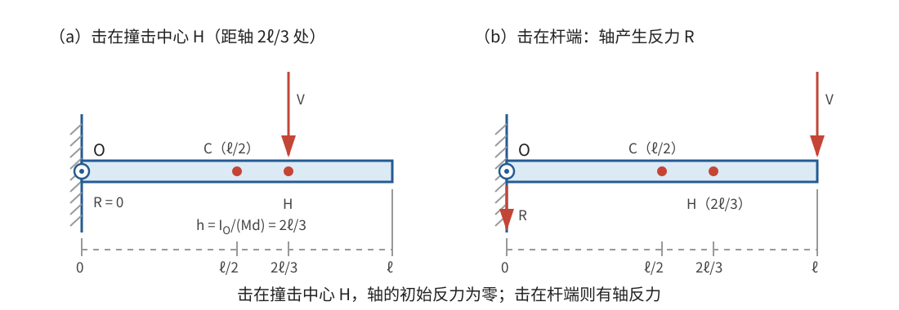

# 正文第3章：旋转运动的产生

*Concerning the Generation of Rotational Motion*

> **选编说明**：本章依据欧拉原著正文第3章重写，保留从静止产生转动的元素力、力矩与转动惯量、轴承载荷的静止等效分析、平板上不扰动轴的受力点以及内部联结力。欧拉本章只研究运动的最初瞬间；下文用现代质量—力单位和微分记号统一表述，省去旧重力单位换算及重复的支承力分配。底本个别公式中的因子 $2$ 经英译者改动，本文不沿用其旧记号，而从 $d\theta=\tfrac12\alpha\,dt^2$ 独立推导。

## 本章导入：同样大小的力，为什么转动效果不同？

用同样大小的力推门，沿门面推与垂直门面推，效果不同；在门轴附近推与在门把手处推，效果也不同。力不仅要说明大小和方向，还要说明作用点。

本章要回答：

1. 从静止开始转动时，刚体各微元分别需要多大的合力？
2. 外力怎样通过“对轴的矩”决定角加速度？
3. 为什么相同的转动效果可以伴随不同的轴承载荷？
4. 有没有一种施力方式，能使物体开始转动而轴完全不受力？

---

## 1. 从静止开始：各微元需要什么力？

### 1.1 最初瞬间的转角与角速度

设刚体可绕固定轴无摩擦转动，初始时静止。记在最初瞬间绕轴的角加速度为 $\alpha$，并约定正负号表示转向。在足够短的时间 $dt$ 内，把 $\alpha$ 看作常量，则获得的角速度和转角分别为

$$
\boxed{d\omega=\alpha\,dt},\qquad
\boxed{d\theta=\frac12\alpha\,dt^2}。
$$

第二个式子与质点从静止作匀加速运动时 $ds=\tfrac12a\,dt^2$ 完全同理。转角在最初瞬间是时间的二阶小量，而角速度是一阶小量。这正是欧拉分析初始运动时反复使用的两个关系。

距轴为 $r$ 的质量微元 $dm$，其切向速度增量和切向位移为

$$
dv=r\,d\omega=r\alpha\,dt,
$$

$$
ds=r\,d\theta=\frac12r\alpha\,dt^2。
$$

所以它的切向加速度为 $a_t=r\alpha$。初始角速度为零，向心加速度 $\omega^2r$ 在这一瞬间也为零；开始转动以后，向心加速度才需要另外计入。

### 1.2 元素力按“质量 × 距轴距离”分配

欧拉把分别作用于各微元、恰好产生实际运动所需的力称为**元素力（elementary forces）**。对从静止开始的转动，微元 $dm$ 的元素力沿该点圆周的切线，大小为

$$
\boxed{dT=r\alpha\,dm}。
$$

若用切向单位矢量 $\hat{\mathbf e}_t$ 表示既定转向，则

$$
d\mathbf T=r\alpha\,\hat{\mathbf e}_t\,dm。
$$

同样的角加速度下，元素力与微元质量成正比，也与它到轴的距离成正比。外侧微元需要更大的切向合力，因为它在相同时间内要走过更长的圆弧。

如果实际外力恰好按这种方式分布在每个微元上，各微元无需依靠内部联结再协调运动，也不需要轴额外提供力来维持这种运动。这是欧拉构造的基准情形。一般外力通常只作用于少数位置，下一步就是比较“实际外力”与“产生同一运动所需的元素力分布”。

> **批注**：元素力仍是“各微元产生实际加速度所需的合力”，不是额外施加在真实外力之上的一组新力，也不等于内部联结力。它的作用是把一个复杂的刚体问题拆成两步：先找出实际运动要求每个微元得到什么合力，再研究实际外力、支承力和内部作用怎样提供这些合力。

---

## 2. 力矩、转动惯量与角加速度

### 2.1 只有对轴的矩参与产生转动

取固定轴为 $z$ 轴。力 $\mathbf F=(F_x,F_y,F_z)$ 的作用点位置为 $\mathbf r=(x,y,z)$。现代记法中，该力对 $z$ 轴的**力矩（moment of force）**为

$$
\boxed{\tau_z=xF_y-yF_x}。
$$

它的正负表示使刚体绕轴转向哪一侧。若把力在垂直于轴的平面内分解为径向分量和切向分量，径向分量的作用线通过轴，不产生对轴力矩；只有切向分量 $F_t$ 有贡献，因此也可写成

$$
\boxed{\tau_z=rF_t}，
$$

其中 $F_t$ 已带转向正负，$r$ 是作用点到轴的垂直距离。

这组矢量公式是现代重述。欧拉在本章通过力臂和静力学中的矩来求和，并未使用现代叉积符号。对轴力矩只决定绕该轴的转动效果，不单独决定轴受到多大的推力或弯折作用。

若力的作用线与轴共面，它对轴的力矩为零；特别地，平行于轴的力不改变绕轴的角速度，却仍可能使轴承受拉压或弯曲。任意斜力都可以分成平行于轴的分量和位于轴的法平面内的分量，分别考察其作用。

### 2.2 从元素力求和到转动方程

先计算基准元素力分布对轴的总力矩。微元的元素力大小为 $r\alpha\,dm$，力臂为 $r$，所以它的矩为

$$
r\,dT=r^2\alpha\,dm。
$$

把全部微元相加，得到

$$
\tau_{\mathrm{元素},z}
=\int r\,dT
=\alpha\int r^2\,dm。
$$

其中出现的积分只取决于质量相对于转轴的分布。欧拉把它命名为**转动惯量（moment of inertia）**：

$$
\boxed{I=\int r^2\,dm}。
$$

对离散质点系，写成 $I=\sum_i m_i r_i^2$。这里的 $r$ 始终是质量微元到指定转轴的垂直距离，而不是到某个原点的空间距离。

实际外力若要与元素力分布产生相同的绕轴运动，就必须提供相同的对轴力矩。理想固定轴支承对该轴的力矩为零，因此外力总力矩 $\tau_z$ 满足

$$
\boxed{\tau_z=I\alpha}。
$$

这就是固定轴旋转的初始运动方程：

$$
\boxed{\alpha=\frac{\tau_z}{I}}。
$$

它说明：对轴力矩越大，角加速度越大；在相同力矩下，转动惯量越大，角加速度越小。转动惯量不是总质量的另一种叫法，质量离轴越远，它在 $I$ 中的贡献按距离平方增加。

在固定轴和刚体条件保持不变时，$I$ 是常量，现代形式也可写成

$$
\boxed{\tau_z(t)=I\dot\omega(t)}。
$$

欧拉本章着重讨论从静止开始的瞬时效应；若力矩随时间变化，怎样积分求后续运动，是下一章继续研究的问题。

> **批注**：上述推导没有假设“每一对内力到轴的距离都相同”。欧拉的方法是先写出实际角加速度所要求的全部微元合力，再比较它们与实际外力的对轴矩；理想支承不改变对轴矩。这样避开了对内部联结细节的无依据简化。若改用现代质点角动量定理，也能得到固定轴的同一公式，但那是另一条现代表述路线。

### 2.3 一个可算通的例子

一根质量可忽略的轻杆长 $2a$，两端各有质量 $m$ 的小球，转轴通过杆中点、垂直于杆且支承光滑。两小球到轴的距离都是 $a$，所以

$$
I=ma^2+ma^2=2ma^2。
$$

在杆的一端沿切向施加力 $F$，力臂为 $a$，对轴力矩为 $Fa$，于是

$$
\alpha=\frac{Fa}{2ma^2}=\frac{F}{2ma}。
$$

若从静止开始且力矩保持不变，经过短时间 $t$，

$$
\omega=\frac{F}{2ma}t,\qquad
\theta=\frac{F}{4ma}t^2。
$$

若把同样的力改施在距轴 $a/2$ 处，力矩减半，角加速度也减半。力的总大小没有改变，改变的是作用点及力矩。

---

## 3. 产生同样的转动，轴为什么可以受不同的力？

### 3.1 用静止等效力系求支承作用

对轴力矩只包含产生绕轴转动所需的信息。两个力系即使 $\tau_z$ 相同，合力和对其他方向的力矩也可以不同，因此轴承载荷不必相同。

欧拉仍采用“实际运动—元素力—静止等效”的比较方法。设刚体实际受到若干外力 $\mathbf F_j$，支承对刚体的合力为 $\mathbf R$，而产生实际初始角加速度所需的元素力为 $d\mathbf T$。在刚体上另加一组与元素力大小相等、方向相反的力 $-d\mathbf T$，就把实际初始运动转化为形式上的静止平衡：

$$
\sum_j\mathbf F_j+\mathbf R-\int d\mathbf T=\mathbf0。
$$

所以支承对刚体的合力为

$$
\boxed{\mathbf R=\int d\mathbf T-\sum_j\mathbf F_j}，
$$

刚体对轴和支承的总作用则与它相反。对两个支承点分别分配力时，还必须同时满足力矩平衡，不能只看合力。

这个公式揭示了两类载荷：

- 实际外力直接传给轴的部分；
- 为协调各微元加速度而出现的修正项。

若实际外力本身已经等于完整的元素力分布，则 $\sum_j\mathbf F_j=\int d\mathbf T$，支承合力为零。若只在某一点施力，即使它的对轴力矩能产生同样的 $\alpha$，通常仍需支承提供额外作用。

> **批注**：这里把动力学问题改写为静止平衡，是欧拉贯穿本章的技巧，与达朗贝尔原理中的惯性力方法相通。反向元素力是静止等效分析中的辅助力，不应与刚体上另外真实存在的一组外力混淆。求支承合力时可以使用总体等效；求内部各处的受力时，则必须保留作用点和分布。

### 3.2 平板上的特殊受力点：轴可以完全不受力

考虑一块位于平面内的刚体薄板，固定轴垂直于薄板并穿过 $O$。设质心 $C$ 距轴为 $d>0$，取 $OC$ 为 $x$ 方向。在射线 $OC$ 上选一点 $H$，令 $OH=h$，并在 $H$ 施加垂直于 $OH$、位于薄板平面内的力 $\mathbf V$。记力的大小为 $V$，薄板对轴 $O$ 的转动惯量为 $I_O$。

该力对轴的力矩为 $Vh$，所以初始角加速度为

$$
\alpha=\frac{Vh}{I_O}。
$$

在最初瞬间，质心的切向加速度为 $\alpha d$，全部元素力的合力等于总质量 $M$ 乘质心加速度，即方向与 $\mathbf V$ 相同、大小为 $M\alpha d$。由上节的支承力公式，支承对薄板的力与 $\mathbf V$ 共线，其沿 $\mathbf V$ 方向的带符号分量为

$$
R=M\alpha d-V
=V\left(\frac{Mhd}{I_O}-1\right)。
$$

$R<0$ 表示支承力与 $\mathbf V$ 反向。

要使轴完全不受力，必须有 $R=0$，于是

$$
\boxed{h=\frac{I_O}{Md}}。
$$

当作用力通过这一特殊点 $H$ 且垂直于 $OH$ 时，外力恰好同时提供质心所需的切向加速度和绕固定轴所需的角加速度，不再需要支承反力。此时质心的初始运动，也正如全部质量集中于质心并受到同一个力 $\mathbf V$。

欧拉指出，这个 $H$ 与物理摆中称为**振动中心（centre of oscillation）**的点相同。现代还把相对于给定转轴的这一位置称为**撞击中心（centre of percussion）**：在相应方向施力或受到冲击时，理想转轴不产生初始反作用力。

**例：均质细杆的一端为轴。** 若杆长为 $\ell$、质量为 $M$，轴过一端并垂直于杆，则 $d=\ell/2$。杆的线密度为 $M/\ell$，由本章定义直接积分：

$$
I_O=\int_0^\ell x^2\frac{M}{\ell}\,dx
=\frac{M\ell^2}{3},
\qquad
h=\frac{I_O}{Md}
=\frac{M\ell^2/3}{M(\ell/2)}
=\frac23\ell。
$$

因此，在距轴三分之二杆长处垂直击杆，轴的初始反作用力为零；在杆端击中则一般会有轴反力。这里由转动惯量定义直接计算，无需使用平行轴定理。

> **批注**：这一位置由所选转轴和质量分布决定；要实现零初始轴反力，力还必须通过 $H$ 并垂直于 $OH$。它不是物体脱离转轴后仍固定不变的“神奇点”。此外，零轴反力只针对这里讨论的初始、理想条件；后续运动会需要向心力，真实支承还可能有摩擦和弹性变形。

### 3.3 一般刚体的无轴载施力方式并不唯一

对三维刚体，欧拉进一步把外力移到轴上的不同法平面，并比较它们与反向元素力形成的平衡。结论不是“只有一种无轴载施力法”，而是可以有许多组力满足条件：它们既要给出相同的对轴力矩，又要使平移到轴上的合力和其余力矩彼此抵消。

反过来，只求出 $\tau_z=I\alpha$ 并不能说明轴承是否省力。完整设计还要检查支承两处的力、力矩和内部联结。欧拉也提醒，本章把轴抽象为一条不动直线，并设想无摩擦支承；真实轮轴有厚度，支承方式也复杂，不能不加检查地照搬线轴模型的全部计算。

---

## 4. 内部联结力：为什么不能再随意替换力系？

求内部联结所承受的作用时，欧拉要求保留三类力及其真实作用位置：

1. 实际作用在刚体上的外力；
2. 与各微元元素力大小相等、方向相反的静止等效力；
3. 实际支承为保持轴不动而施加的约束力。

这三类力共同构成静止等效力系，可用来考察刚体内部各部分需要怎样联结。与求整体轴载不同，此时不能把分散在各微元上的反向元素力随意替换成另一组总体等效力，因为替换后虽然整体运动方程相同，内部各部分的受力却可能完全改变。

若内部联结不足以维持各点之间的固定距离，物体就会变形，刚体模型随之失效。至于具体材料和结构能承受多大载荷，不属于本章的运动方程所能回答的范围。

---

## 本章小结

1. 从静止开始的短时间里，$d\omega=\alpha\,dt$，$d\theta=\tfrac12\alpha\,dt^2$；距轴为 $r$ 的微元具有切向加速度 $r\alpha$。
2. 元素力是各微元产生实际运动所需的合力，初始转动时 $dT=r\alpha\,dm$。
3. 对轴力矩由力、作用点和方向共同决定；现代分量式为 $\tau_z=xF_y-yF_x$。
4. 转动惯量 $I=\int r^2dm$ 描述质量相对于指定轴的分布，固定轴初始转动满足 $\tau_z=I\alpha$。
5. 相同力矩可以伴随不同轴承载荷。支承作用要由实际外力、反向元素力和支承力共同构成的静止等效力系求解。
6. 对距质心为 $d$ 的平板转轴，在 $h=I_O/(Md)$ 处沿规定方向施力，可使初始轴反力为零；该点与振动中心、撞击中心相联系。
7. 研究内部联结时必须保留力的实际分布，不能只保持总体等效。

下一章将研究已经绕固定轴转动的刚体，考察外力力矩怎样扰动既有转动，怎样按时间或转角积分求后续运动，以及轴和内部结构承受怎样的载荷。

---

## 底本与现代参考

1. 欧拉原著正文第3章；Ian Bruce 英译见本地 [`english_translation/tmvol1ch3tr.txt`](english_translation/tmvol1ch3tr.txt)，原书图版及公式见同目录 PDF。英译总目录：[17th Century Maths](https://www.17centurymaths.com/contents/mechanica3.html)。
2. H. Goldstein, C. Poole and J. Safko, *Classical Mechanics*, 3rd ed., 第5章：固定轴转动、力矩和转动惯量的现代表述。
3. OpenStax, *University Physics Volume 1*, [第10章：固定轴旋转](https://openstax.org/books/university-physics-volume-1/pages/10-introduction)：角加速度、转动惯量与固定轴转动方程。

[上一章：正文第2章——绕固定轴的无扰动旋转](欧拉刚体运动理论_正文_第2章.md)

[下一章：正文第4章——旋转运动的扰动](欧拉刚体运动理论_正文_第4章.md)
