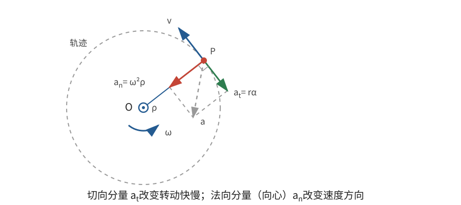

# 正文第4章：旋转运动的扰动

*Concerning the Disturbance of Rotational Motion Arising from Forces of any Kind*

> **选编说明**：本章依据欧拉原著正文第4章重写，保留已有转动在任意力作用下的瞬时改变、对轴力矩的积分、轴和内部结构所受阻力的主要思路。用现代质量—力单位、矢量和微分记号重述，省略旧单位换算及重复的支承力分配；不把物理摆、阻尼振子等后续或现代专题混入本章。

## 本章导入：力很大，角速度为什么可以不变？

一只轮子已经绕固定轴旋转。轴承可以对它施加很大的力，但如果这些力对转轴没有力矩，轮子的角速度仍不改变。反过来，一个不大的切向力，只要力臂足够长，也能逐渐改变转动。

本章要回答：

1. 已有角速度时，产生角加速度需要怎样的元素力？
2. 任意外力的力矩怎样决定角速度随时间或随转角的变化？
3. 加速或减速时，轴和刚体内部除原有旋转载荷外还要承受什么？

---

## 1. 从已有转动到角加速度

### 1.1 元素力仍由角加速度决定

设刚体正以有向角速度 $\omega$ 绕固定轴旋转，距轴为 $r$ 的质量微元 $dm$ 具有切向速度 $r\omega$。若角速度在时间 $dt$ 内改变 $d\omega$，该微元的切向速度改变为

$$
r\,d\omega。
$$

记角加速度为 $\alpha=\dot\omega$，则 $d\omega=\alpha\,dt$。为了产生这一改变，微元所需的切向**元素力（elementary force）**仍是

$$
\boxed{dT_t=r\alpha\,dm}。
$$

它与第3章从静止产生转动时形式相同，因为刚体上各微元到固定轴的距离不变。区别在于：现在微元本来就有速度，还需要维持圆周运动的向心合力。

在取定的正转向上，用 $\hat{\mathbf e}_t$ 表示切向单位矢量，用 $\boldsymbol\rho$ 表示从轴指向微元的垂直矢量，则微元的实际加速度为

$$
\mathbf a=r\alpha\,\hat{\mathbf e}_t-\omega^2\boldsymbol\rho,
$$

所需总元素力为

$$
\boxed{d\mathbf T
=dm\left(r\alpha\,\hat{\mathbf e}_t-\omega^2\boldsymbol\rho\right)}。
$$

底本此处所称“元素力”专指上述切向项 $dT_t$，离心作用随后另列；本文把切向和向心两部分合并称为“总元素力” $d\mathbf T$，是现代记号的统一，并非底本术语范围的扩大。

第一项改变转动快慢，第二项改变速度方向。切向元素力与当前 $\omega$ 的大小无关；同样的角加速度，在转得快或转得慢时都需要同样的切向力分配。

> **批注**：欧拉特别强调，元素力只是产生实际加速度所需的合力。如果各微元恰好分别受到这样的力，它们无需内部联结再协调切向加速。可是，已有旋转所要求的向心作用仍然存在，不能因讨论角加速度而把 $\omega^2$ 项丢掉。

### 1.2 对轴力矩决定转动怎样改变

把切向元素力对固定轴取矩，并定义**转动惯量（moment of inertia）**为 $I=\int r^2dm$，得到

$$
\int r\,dT_t
=\alpha\int r^2dm
=I\alpha。
$$

任意实际外力若产生同样的角加速度，就必须提供同样的对轴力矩。理想支承对固定轴的力矩为零，因此

$$
\boxed{\tau_z=I\dot\omega=I\alpha}，
$$

其中 $\tau_z$ 是全部外力对固定轴的总**力矩（moment of force）**，正负号按既定转向计算。

力矩与角速度同向时，转动速率增大；力矩与角速度反向时，转动速率减小。若 $\tau_z=0$，则 $\dot\omega=0$，刚体保持匀速旋转，即使外力和支承力本身并不为零。

---

## 2. 从瞬时方程求后续运动

### 2.1 按时间积分

固定轴和刚体不变时，$I$ 是常量。若每一时刻的对轴力矩 $\tau_z(t)$ 已知，则

$$
\dot\omega(t)=\frac{\tau_z(t)}{I}。
$$

从时刻 $0$ 到 $t$ 积分，得到

$$
\boxed{\omega(t)=\omega(0)+\frac1I\int_0^t\tau_z(s)\,ds}。
$$

再积分一次便得到转角：

$$
\boxed{\theta(t)=\theta(0)+\int_0^t\omega(s)\,ds}。
$$

这就是欧拉所说的：若任意时刻的力及其力矩已知，借助所得公式并积分，就能确定整个旋转运动。真正困难往往不在写出 $\tau_z=I\dot\omega$，而在求出力矩并处理积分。

**例：恒定外力矩。** 若 $\tau_z=\tau_0$ 为常量，初始角和角速度分别为 $\theta_0,\omega_0$，则

$$
\omega=\omega_0+\frac{\tau_0}{I}t,
\qquad
\theta=\theta_0+\omega_0t+\frac{\tau_0}{2I}t^2。
$$

$\tau_0$ 与 $\omega_0$ 异号时，转动速率先减至零，随后沿反方向增大；公式本身已经包含这一过程，不需要把“减速”另写成一套质量或转动惯量变号的公式。

### 2.2 改按转角积分：力矩的功

若力矩更容易写成转角 $\theta$ 的函数，可以利用

$$
\dot\omega=\frac{d\omega}{d\theta}\frac{d\theta}{dt}
=\omega\frac{d\omega}{d\theta}。
$$

于是 $\tau_z=I\dot\omega$ 变为

$$
\boxed{\tau_z\,d\theta=I\omega\,d\omega}。
$$

从状态 $1$ 到状态 $2$ 积分：

$$
\boxed{
\int_{\theta_1}^{\theta_2}\tau_z\,d\theta
=\frac12I\omega_2^2-\frac12I\omega_1^2
}。
$$

左边的 $\tau_z\,d\theta$ 是力矩在角位移上做的**功（work）**，右边是旋转动能的改变。这个关系与质点运动中 $F\,dx=mv\,dv$ 完全对应，可用于不知道时间、但知道力矩随转角变化的问题。

> **批注**：本章底本已经包含把角速度增量改写成角速度平方增量的步骤，因此功—能形式在这里出现是合适的。按转角求导通常在 $\omega\ne0$、转角随时间单调变化的区间内使用；经过转向点时，可以按时间直接处理或分段积分，最终功—能关系仍然成立。左侧 $\int\tau_z\,d\theta$ 已经是全部外力所做的总功：非保守力若包含在 $\tau_z$ 中就已计入，理想固定支承不做功；保守力若改用势能表示，也不能再重复计算其力矩功。

---

## 3. 轴承受的三类作用

### 3.1 用总元素力统一写出支承作用

改变角速度时，轴的受力不能仅由 $\tau_z$ 判断。欧拉把轴承受的作用分成三类：

1. 实际外力的直接传递；
2. 与切向元素力大小相等、方向相反的静止等效力；
3. 已有旋转产生的离心作用。

现代写法可以把后两类合并到总元素力中。设刚体实际受到外力 $\mathbf F_j$，支承对刚体的合力为 $\mathbf R$。在实际外力、支承力之外，再加入与各微元总元素力相反的 $-d\mathbf T$，便得到形式上的静止平衡：

$$
\sum_j\mathbf F_j+\mathbf R-\int d\mathbf T=\mathbf0。
$$

因此

$$
\boxed{\mathbf R=\int d\mathbf T-\sum_j\mathbf F_j}，
$$

其中

$$
\int d\mathbf T
=\alpha\int r\hat{\mathbf e}_t\,dm
-\omega^2\int\boldsymbol\rho\,dm。
$$

支承对刚体的作用由切向加速和向心加速共同决定，刚体对轴和支承的作用则与 $\mathbf R$ 相反。把总力分配到两个支承点时，还必须同时满足合力矩平衡。

离心部分含有 $\omega^2$，所以在同一瞬时，无论力矩正在使正向转动加快还是减慢，这部分载荷都相同。角速度改变以后，$\omega^2$ 随之改变，轴的离心载荷才会进一步变化；在最初的微分瞬间，可以直接使用当前角速度计算。

### 3.2 力矩相同，轴载仍可不同

两个力系只要对轴力矩相同，就产生相同的 $\dot\omega$；但它们的合力、对其他方向的力矩和作用点可以不同，所以 $\mathbf R$ 及两个支承点各自的力不必相同。

这说明旋转方程和支承计算回答的是不同问题：

- $\tau_z=I\dot\omega$ 决定角速度怎样变；
- 总元素力与实际外力的比较决定轴怎样受力。

只研究转动快慢时，可以把许多力系视为等效；研究轴承强度时，不能仅凭“力矩相同”就认为轴载相同。

---

## 4. 内部结构需要维持哪些约束？

分析刚体内部的联结时，欧拉采用与轴载相同的静止等效方法，但要求保留各力的真实分布和作用点：

1. 实际外力仍作用于原来的位置；
2. 每个微元加上反向切向元素力 $-r\alpha\hat{\mathbf e}_t\,dm$；
3. 每个微元加上背离轴的离心等效力 $\omega^2\boldsymbol\rho\,dm$；
4. 加入实际支承为保持固定轴而提供的约束力。

这四类力共同构成静止等效力系，用来考察内部各部分需要多大的联结作用。切向项随 $\alpha$ 变化，径向项随 $\omega^2$ 变化；即使角加速度为零，后一项也不会消失。

求内部应力时，不能把分散在各微元上的力随意换成只在总体上等效的少数力。总体运动相同，并不保证物体每一处受力相同。若联结不足以保持各点距离不变，物体就会变形，刚体模型也随之失效。

> **批注**：到这里，固定轴问题所需的几类质量积分已经自然分开：质心位置决定一次质量矩，转动快慢的改变只含 $I=\int r^2dm$，轴载还涉及其他一次和二次质量矩。欧拉因此把下一章专门用于转动惯量的系统研究。现代工程中的转子强度与动平衡设计，也必须同时区分运动方程、支承载荷和内部应力，不能只计算一个转动惯量就结束。

---

## 本章小结

1. 已有转动中，微元加速度包含切向项 $r\alpha$ 和向心项 $-\omega^2\boldsymbol\rho$；切向元素力仍为 $r\alpha\,dm$。
2. 任意外力对固定轴的总力矩满足 $\tau_z=I\dot\omega$；零力矩意味着角速度不变，不意味着力或轴载为零。
3. 已知力矩随时间变化时，依次积分可得 $\omega(t)$ 和 $\theta(t)$；恒力矩情形回到匀角加速度公式。
4. 力矩随转角已知时，$\int\tau_z\,d\theta=\Delta(\tfrac12I\omega^2)$，即力矩的功等于旋转动能改变。
5. 轴和内部结构承受实际外力、反向元素力、离心作用和支承约束的共同影响；力矩相同并不保证轴载相同。
6. 转动惯量决定角加速度，但完整的支承与内部分析还需要其他质量矩。

下一章将系统研究转动惯量：怎样在平行轴之间换算，怎样描述它随转轴方向的变化，以及为什么三条主轴能把这些计算大大简化。

---

## 底本与现代参考

1. 欧拉原著正文第4章；Ian Bruce 英译见本地 [`english_translation/tmvol1ch4tr.txt`](english_translation/tmvol1ch4tr.txt)，原书图版及公式见同目录 PDF。英译总目录：[17th Century Maths](https://www.17centurymaths.com/contents/mechanica3.html)。
2. H. Goldstein, C. Poole and J. Safko, *Classical Mechanics*, 3rd ed., 第5章：固定轴转动方程与旋转能量的现代表述。
3. OpenStax, *University Physics Volume 1*, [第10章：固定轴旋转](https://openstax.org/books/university-physics-volume-1/pages/10-introduction)：角加速度、力矩和旋转功—能关系。

[上一章：正文第3章——旋转运动的产生](欧拉刚体运动理论_正文_第3章.md)

[下一章：正文第5章——转动惯量与主轴](欧拉刚体运动理论_正文_第5章.md)
