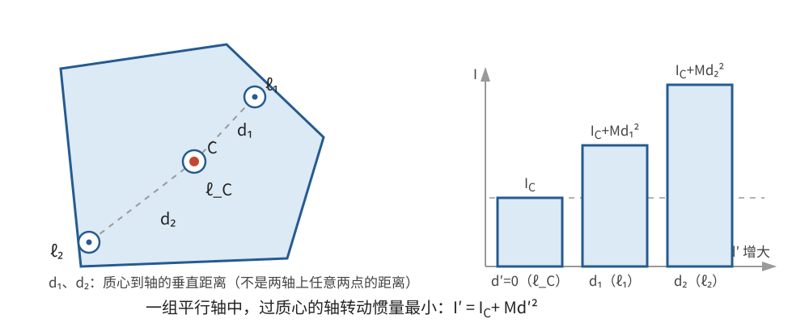
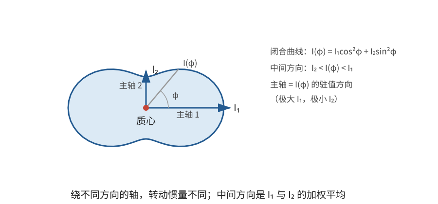

# 正文第5章：转动惯量与主轴

*Concerning the Moment of Inertia*

> **选编说明**：本章依据欧拉原著正文第5章重写，保留转动惯量的定义、平行轴换算、任意轴公式、主轴的存在与正交性，以及复合体的计算。用方向余弦和矢量展开代替重复的坐标旋转代数，略去三次方程的繁复系数和球面等值曲线的细节；现代矩阵和特征值解释只放在批注中。

## 本章导入：同一个物体，为什么换一根轴就更难转动？

同样一根杆，绕过中点且垂直于杆的轴旋转，与绕沿杆方向的轴旋转，转动惯量完全不同。即使两轴平行，只要位置改变，转动惯量也会改变。

本章依次回答：

1. 转动惯量为什么必须相对于指定轴来定义？
2. 平行轴之间怎样换算？为什么过质心的轴最小？
3. 轴的方向任意改变时，需要多少个量描述转动惯量？
4. 为什么总能找到三条互相垂直的主轴，使任意轴的计算只剩三项？
5. 已知各部分的转动惯量，怎样计算复合体？

---

## 1. 转动惯量必须相对于指定轴定义

### 1.1 定义与回转半径

物体相对于某轴的**转动惯量（moment of inertia）**，是各质量微元乘以其到该轴垂直距离平方后的总和：

$$
\boxed{I=\int r^2\,dm}。
$$

对离散质点系，写成 $I=\sum_i m_i r_i^2$。每一项都非负，所以在质量分布不变时，若质量微元离轴更远，转动惯量通常增大。在固定轴转动且相应 $I$ 不变时，它是角加速度公式 $\alpha=\tau/I$ 中取代平移质量地位的量。

若物体总质量为 $M$，总可以写成

$$
I=Mk^2,\qquad
\boxed{k=\sqrt{\frac IM}}。
$$

长度 $k$ 称为**回转半径（radius of gyration）**：若把全部质量集中在距轴为 $k$ 处，所得转动惯量与原物体相同。它不是质心到轴的距离，也不一定是物体上的某个实际半径。

同一物体相对不同轴有不同的 $I$ 和 $k$，所以只说“某物体的转动惯量”而不指明轴，是不完整的。

### 1.2 平行轴之间的一般换算

设原轴为 $\ell$，新轴 $\ell'$ 与它平行，两轴间沿垂直方向的位移矢量为 $\mathbf b$。微元相对原轴的横向位置为 $\boldsymbol\rho$，相对新轴就是 $\boldsymbol\rho-\mathbf b$，因此

$$
\begin{aligned}
I'
&=\int|\boldsymbol\rho-\mathbf b|^2\,dm\\
&=I-2\mathbf b\cdot\int\boldsymbol\rho\,dm+M b^2。
\end{aligned}
$$

设质心相对原轴的横向位置为 $\boldsymbol\rho_C$，则 $\int\boldsymbol\rho\,dm=M\boldsymbol\rho_C$。再记质心到原轴、新轴的距离分别为 $d,d'$，有

$$
d^2=|\boldsymbol\rho_C|^2,\qquad
d'^2=|\boldsymbol\rho_C-\mathbf b|^2。
$$

代入即得平行轴之间的一般关系

$$
\boxed{I'=I+M(d'^2-d^2)}。
$$

若原轴通过质心，则 $d=0$，公式化为熟悉的**平行轴定理（parallel axis theorem）**：

$$
\boxed{I'=I_C+Md'^2}，
$$

其中 $I_C$ 是绕过质心的平行轴的转动惯量。由于 $Md'^2\ge0$，在一组互相平行的轴中，过质心的轴对应最小转动惯量。

**例：细杆绕过端点的轴。** 均匀细杆长 $L$、质量 $M$，绕过质心且垂直于杆的轴，$I_C=ML^2/12$。把轴平移到杆的一端，$d'=L/2$，所以

$$
I'=\frac1{12}ML^2+M\left(\frac L2\right)^2
=\frac13ML^2。
$$

> **批注**：平行轴定理把任意轴的问题分成两部分：先研究过质心的轴，再补上平移修正。下面的方向问题因此只需在过质心的轴中讨论。一般公式中的 $d,d'$ 都是质心到轴的垂直距离，不是两轴上任意两点之间的距离。

---

## 2. 任意方向的轴：转动惯量是一个二次型

### 2.1 从“到轴距离”展开

以质心为原点，任取三条互相垂直的坐标轴。过原点的新轴由单位矢量

$$
\hat{\mathbf n}=(n_x,n_y,n_z),\qquad
n_x^2+n_y^2+n_z^2=1
$$

给出。位置为 $\mathbf r=(x,y,z)$ 的微元，在轴上的投影矢量为 $(\mathbf r\cdot\hat{\mathbf n})\hat{\mathbf n}$，所以它到轴的垂直距离平方为

$$
\rho^2
=|\mathbf r-(\mathbf r\cdot\hat{\mathbf n})\hat{\mathbf n}|^2
=\mathbf r^2-(\mathbf r\cdot\hat{\mathbf n})^2。
$$

这一步的几何意义是：把位置矢量分成沿轴和垂直于轴两部分，只保留后者。

沿用欧拉在整个物体上定义的六个积分

$$
A=\int x^2dm,\quad B=\int y^2dm,\quad C=\int z^2dm,
$$

$$
D=\int xy\,dm,\quad E=\int xz\,dm,\quad F=\int yz\,dm。
$$

展开并积分，得到任意轴的转动惯量

$$
\boxed{
\begin{aligned}
I(\hat{\mathbf n})={}&(B+C)n_x^2+(A+C)n_y^2+(A+B)n_z^2\\
&-2Dn_xn_y-2En_xn_z-2Fn_yn_z。
\end{aligned}
}
$$

特别地，三条坐标轴的转动惯量为

$$
\boxed{I_x=B+C,\qquad I_y=A+C,\qquad I_z=A+B}。
$$

$A,B,C$ 非负，而 $D,E,F$ 可正可负。后三个量称为**惯量积（products of inertia）**，反映质量分布相对坐标平面的偏斜程度。只要物体不全部位于一条理想直线上，对任意单位方向都有 $I(\hat{\mathbf n})>0$。

**二维例子。** 若质量都在 $xy$ 平面内，则 $C=E=F=0$。在平面内取 $n_x=\cos\varphi,n_y=\sin\varphi,n_z=0$，便有

$$
I(\varphi)=B\cos^2\varphi+A\sin^2\varphi-2D\sin\varphi\cos\varphi。
$$

若 $D=0$，坐标轴之间没有交叉项；若 $D\ne0$，转动惯量不仅由各坐标平方矩决定，还取决于轴相对坐标轴怎样倾斜。

> **批注**：现代把上述二次型写成 $I(\hat{\mathbf n})=\hat{\mathbf n}^{T}\mathbf I\hat{\mathbf n}$，其中
>
> $$
> \mathbf I=
> \begin{pmatrix}
> B+C&-D&-E\\
> -D&A+C&-F\\
> -E&-F&A+B
> \end{pmatrix}
> $$
>
> 称为**惯量张量（inertia tensor）**在此坐标系中的矩阵。六个独立分量正好对应欧拉使用的六个积分。欧拉本人没有用矩阵、矩阵转置或特征值术语；这些是现代重述工具，不是他在本章采用的形式。

---

## 3. 为什么存在三条互相垂直的主轴？

### 3.1 第一条驻值轴的存在与惯量积消失

现在寻找使 $I(\hat{\mathbf n})$ 对方向的微小改变取驻值的轴。“驻值”是指在一阶近似下既不增大也不减小；它可能是全局最大、全局最小，也可能是鞍型驻值。

$I(\hat{\mathbf n})$ 随单位方向连续变化，而所有单位方向组成封闭的单位球面，所以全局最大值一定存在。把取得这个最大值的轴选为 $x$ 轴，就得到了第一条驻值轴。这样，存在性不依赖于某个方向角参数是否出现奇点。

欧拉还用两个方向角表示转轴，分别令两个微分为零，并把候选方向化到一个三次方程。那条历史计算路线仍需把实根代回驻值条件；参数化奇异或方程退化为低次、恒等式时也要另行处理。这里改用全局最大值保证第一条轴存在，再接上欧拉的惯量积论证。

为了看清驻值条件，设候选轴为 $x$ 轴。在 $xy$ 平面内取

$$
\hat{\mathbf n}(\varphi)=(\cos\varphi,\sin\varphi,0),
$$

则

$$
I(\varphi)=I_x\cos^2\varphi+I_y\sin^2\varphi
-2D\sin\varphi\cos\varphi。
$$

在 $\varphi=0$ 处，$I'(0)=-2D$。若 $x$ 轴是驻值轴，就必须有 $D=0$。同样，在 $xz$ 平面内考察可得 $E=0$。反过来，$D=E=0$ 也充分：候选轴附近的微小方向改变只产生二阶及更高阶的转动惯量变化，一阶变化消失。

### 3.2 已知一条驻值轴，作出另外两条

若已知 $x$ 轴是一条驻值轴，便有 $D=E=0$。在垂直于它的 $yz$ 平面内，取

$$
\hat{\mathbf n}(\varphi)=(0,\cos\varphi,\sin\varphi)。
$$

此时

$$
I(\varphi)=(A+C)\cos^2\varphi+(A+B)\sin^2\varphi
-2F\sin\varphi\cos\varphi。
$$

求导并令其为零：

$$
I'(\varphi)=(B-C)\sin2\varphi-2F\cos2\varphi=0。
$$

分三种情形求解：

- 若 $B\ne C$，方向由
  $$
  \boxed{\tan2\varphi=\frac{2F}{B-C}}
  $$
  确定；其中 $F=0$ 时，$\varphi=0,\pi/2$ 等坐标轴方向就是解。
- 若 $B=C$ 而 $F\ne0$，原方程化为 $\cos2\varphi=0$，故
  $$
  \boxed{\varphi=\frac\pi4,\ \frac{3\pi}4\pmod\pi}。
  $$
- 若 $B=C$ 且 $F=0$，则 $I(\varphi)$ 在该平面内为常量，任取两条互相垂直的方向即可。

前两种情形中，若 $\varphi$ 是一个解，$\varphi+\pi/2$ 也是解。因此总能得到两条互相垂直的驻值轴，它们又都垂直于最初的 $x$ 轴。在 $yz$ 平面内旋转坐标轴不会改变 $x$ 轴，所以 $D=E=0$ 始终保持；再选取消去 $F$ 的方向，就有

$$
\boxed{D=E=F=0}。
$$

于是，每个刚体过质心都存在三条互相垂直的驻值轴。欧拉把它们定义为**主轴（principal axes）**，对应的转动惯量 $I_1,I_2,I_3$ 称为**主转动惯量（principal moments of inertia）**。若三者互异，可把它们排成 $I_{\max},I_{\mathrm{mid}},I_{\min}$；中间主值必定既非全局最大，也非全局最小，而是在完整方向球面上呈鞍点（saddle point）性质的驻值。若两个或三个主转动惯量相等，主轴方向就不再唯一。

> **批注**：现代线性代数把同一结果表述为：惯量矩阵是实对称矩阵，因而可正交对角化；主轴是特征向量方向，主转动惯量是特征值。这与欧拉的“求驻值方向并消去惯量积”相对应。现代术语还帮助澄清一个易错点：代数中的特征值不必分别是最大值和最小值，中间特征值同样属于主轴。

---

## 4. 主轴公式：任意轴只需三个数

在主轴坐标系中，$D=E=F=0$，任意轴公式立即化简。设新轴相对三条主轴的方向余弦为 $n_1,n_2,n_3$，则

$$
\boxed{I(\hat{\mathbf n})=I_1n_1^2+I_2n_2^2+I_3n_3^2}，
$$

并且

$$
n_1^2+n_2^2+n_3^2=1。
$$

所以，知道三条主转动惯量，就能求出通过质心的任意轴的转动惯量；若新轴不通过质心，再使用平行轴定理即可。

这个公式还把转动惯量写成三个主值的加权平均。若 $I_1\ge I_2\ge I_3$，则对任意方向都有

$$
\boxed{I_3\le I(\hat{\mathbf n})\le I_1}。
$$

当 $n_1^2$ 增大时，更多权重落在较大的主值上，转动惯量通常随之增大。若 $I_1=I_2=I_3$，则任意方向的转动惯量都相同，任意正交三轴都可作为主轴。

**例：两个主值构成的方向。** 若新轴位于第一、第二主轴所成平面内，与第一主轴夹角为 $\varphi$，则 $n_1=\cos\varphi,n_2=\sin\varphi,n_3=0$，所以

$$
I(\varphi)=I_1\cos^2\varphi+I_2\sin^2\varphi。
$$

当 $\varphi=0$ 时 $I=I_1$；当 $\varphi=\pi/2$ 时 $I=I_2$。中间方向不需要另算六积分。

> **批注**：欧拉还用球面几何讨论等转动惯量方向的轨迹。其核心已经包含在加权平均公式中：等值条件就是 $I_1n_1^2+I_2n_2^2+I_3n_3^2$ 等于常量。现代常用的惯量椭球是另一种几何表示，但不属于本章欧拉已经使用的工具，理解主轴公式并不需要先学习它。

---

## 5. 复合体的转动惯量

设物体由两部分组成，质量分别为 $M,N$。已知它们各自绕过自身质心、且彼此平行的轴的转动惯量为 $I_M,I_N$。两质心之间的距离为 $c$，质心连线与这些轴的夹角为 $\theta$，所以两质心沿垂直于轴方向的有效间距为

$$
c_\perp=c\sin\theta。
$$

整体质心位于两质心的连线上。它到第一、第二部分质心的距离分别为

$$
a=\frac{Nc}{M+N},\qquad b=\frac{Mc}{M+N}。
$$

对两部分分别使用平行轴定理，再相加，得到整体绕过整体质心的平行轴的转动惯量：

$$
\begin{aligned}
I
&=I_M+M a^2\sin^2\theta
 +I_N+N b^2\sin^2\theta\\
&=I_M+I_N
+\frac{MN}{M+N}c^2\sin^2\theta。
\end{aligned}
$$

即

$$
\boxed{I=I_M+I_N+\frac{MN}{M+N}c_\perp^2}。
$$

最后一项来自两部分质心不重合。它总非负，所以整体转动惯量不小于两部分各自绕过自身质心的平行轴的转动惯量之和；当 $c_\perp>0$ 时严格更大。更多部分可以逐次两两合并，也可以对每一部分直接使用平行轴定理后求和。

**例：两个相同质点。** 两个质量均为 $m$ 的质点相距 $c$，单点绕过自身质心的任何轴的转动惯量都为零。对垂直于质点连线、并通过整体质心的轴，$\theta=\pi/2$，所以

$$
I=\frac{m\cdot m}{2m}c^2=\frac12mc^2。
$$

这与直接计算 $m(c/2)^2+m(c/2)^2$ 完全一致。

---

## 本章小结

1. 转动惯量 $I=\int r^2dm$ 必须相对于指定轴定义；回转半径满足 $k=\sqrt{I/M}$。
2. 平行轴之间满足 $I'=I+M(d'^2-d^2)$；过质心的轴给出 $I'=I_C+Md'^2$，并在平行轴族中最小。
3. 对过质心的任意方向轴，转动惯量由三个坐标平方矩和三个惯量积组成的方向二次型决定。
4. 每个刚体都有过质心且互相垂直的三条主轴；在主轴坐标系中，三个惯量积全部消失。
5. 任意轴公式化简为 $I=I_1n_1^2+I_2n_2^2+I_3n_3^2$，三个主转动惯量足以描述所有过质心轴。
6. 复合体可逐部分使用平行轴定理；两部分的合并公式还包含质心分离产生的 $MNc_\perp^2/(M+N)$。

下一章将把这些方法用于均匀细线、薄板、旋转体、长方体和球壳，具体计算它们的主轴与主转动惯量。

---

## 底本与现代参考

1. 欧拉原著正文第5章；Ian Bruce 英译见本地 [`english_translation/tmvol1ch5tr.txt`](english_translation/tmvol1ch5tr.txt)，原书图版及公式见同目录 PDF。英译总目录：[17th Century Maths](https://www.17centurymaths.com/contents/mechanica3.html)。
2. H. Goldstein, C. Poole and J. Safko, *Classical Mechanics*, 3rd ed., 第5章：惯量张量、主轴与主转动惯量的现代表述。
3. OpenStax, *University Physics Volume 1*, [§10.5 Calculating Moments of Inertia](https://openstax.org/books/university-physics-volume-1/pages/10-5-calculating-moments-of-inertia)：转动惯量与平行轴定理的基础计算。

[上一章：正文第4章——旋转运动的扰动](欧拉刚体运动理论_正文_第4章.md)

[下一章：正文第6章——物体的转动惯量](欧拉刚体运动理论_正文_第6章.md)
