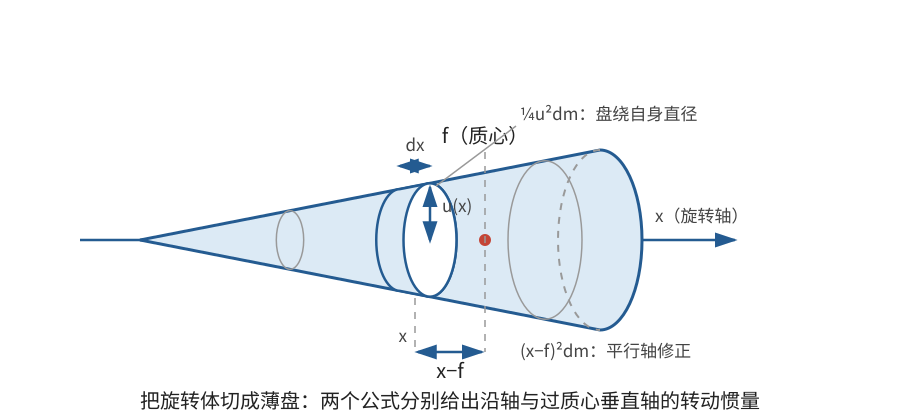

# 正文第6章：物体的转动惯量

*The Investigation of the Moment of Inertia for Homogeneous Bodies*

> **选编说明**：本章依据欧拉原著正文第6章重写，保留从均匀细线、薄板到旋转体、长方体和空心球的计算路线。重点展示对称性、切片、平行轴和组合相减怎样减少积分；省略同类积分的机械重复，保留细杆、圆环、矩形、圆盘、三角形、正多边形、圆柱、圆锥、球、旋转椭球、长方体和球壳的代表性结果。

## 本章导入：质量相同，转动惯量为什么不同？

质量相同的圆环和圆盘，半径也相同。圆环的质量全在边缘，圆盘的质量则分布在内部，所以它们绕过圆心的中心轴时，转动惯量分别为 $MR^2$ 和 $\tfrac12MR^2$。总质量相同，并不能保证转动效果相同。

本章的任务是把上一章的一般方法用于**均匀物体（homogeneous bodies）**：材料密度在整个物体中相同，因此质量计算可以转化为长度、面积和体积的几何计算。

---

## 1. 计算之前先使用对称性

### 1.1 密度、对称轴与惯量积

对均匀细线、薄板和立体，可分别引入线密度 $\lambda$、面密度 $\sigma$ 和体密度 $\rho$：

$$
dm=\lambda\,ds,\qquad dm=\sigma\,dA,\qquad dm=\rho\,dV。
$$

总质量分别为 $\lambda$ 乘长度、$\sigma$ 乘面积和 $\rho$ 乘体积。求 $I=\int r^2dm$ 时，剩下的主要是几何积分。

对称性可以先确定主轴，避免不必要的计算：

- 若物体关于某坐标平面对称，含该平面法向坐标一次方的惯量积会因奇函数成对抵消而为零；
- 若物体绕某轴旋转对称，该轴是主轴，过质心且垂直于它的任意两条正交轴都可作为另外两条主轴；
- 若几个主转动惯量相等，相应平面内的主轴方向不再唯一。

这里的“成对抵消”指质量分布和被积函数一起考察。例如关于 $yz$ 平面对称时，位置 $(x,y,z)$ 与 $(-x,y,z)$ 的质量相同，而 $xy$ 和 $xz$ 在两处变号，所以对应积分为零。

### 1.2 切片、平移与组合

均匀物体常用的计算步骤是：

1. 把物体切成细条、薄环或薄盘，先求一个切片的贡献；
2. 若转轴不通过切片质心，使用平行轴定理；
3. 对各切片积分；
4. 对组合体，可把各部分的贡献相加；对带空腔的物体，可从完整物体中减去被挖去部分。

薄板还有一条直接的关系。若薄板位于 $xy$ 平面，三轴交于同一点且 $z$ 轴垂直于板面，则微元到 $x,y,z$ 轴的距离平方分别为 $y^2,x^2,x^2+y^2$，因此

$$
\boxed{I_z=I_x+I_y}。
$$

这称为薄板的**垂直轴定理（perpendicular axis theorem）**。它只适用于位于一个平面内的薄板，不能推广为任意三维物体的一般公式。

---

## 2. 细线与薄板

### 2.1 均匀细杆

设细杆长 $L$、质量 $M$，质心在中点。沿杆方向取坐标 $x$，线密度 $\lambda=M/L$。对过中点且垂直于杆的轴，

$$
I=\int_{-L/2}^{L/2}x^2\frac ML\,dx
=\frac ML\left[\frac{x^3}{3}\right]_{-L/2}^{L/2}
=\boxed{\frac1{12}ML^2}。
$$

在理想细线模型中，杆上各点到沿杆轴的距离都为零，所以沿杆轴的转动惯量为零；真实细杆有有限横截面，该值只是近似。过中点且垂直于杆的任意两条正交轴具有相同转动惯量，方向可以任选。

若过中点的轴与杆成角 $\theta$，由主轴公式还可得到

$$
\boxed{I(\theta)=\frac1{12}ML^2\sin^2\theta}。
$$

$\theta=0$ 对应沿杆轴，$\theta=\pi/2$ 对应垂直杆的轴。

### 2.2 均匀细圆环

设圆环半径为 $R$、质量为 $M$，圆心为质心。每个微元到垂直于环面的中心轴的距离都是 $R$，所以

$$
\boxed{I_\perp=\int R^2dm=MR^2}。
$$

对平面内的一条直径，取圆环微元的角坐标为 $\varphi$，它到 $x$ 轴的距离为 $|R\sin\varphi|$，而 $dm=M\,d\varphi/(2\pi)$。于是

$$
\begin{aligned}
I_x
&=\frac{M}{2\pi}\int_0^{2\pi}R^2\sin^2\varphi\,d\varphi\\
&=\frac{MR^2}{2\pi}\cdot\pi
=\boxed{\frac12MR^2}。
\end{aligned}
$$

任意直径的结果都相同，并且 $I_\perp=I_x+I_y$。质量离轴越远，转动惯量越大；同质量、同半径的圆环比后面计算的圆盘更“难加速”。

### 2.3 矩形薄板与圆盘

**矩形薄板。** 设矩形边长为 $a,b$，质心在原点，$x$ 轴平行于边长 $a$。均匀分布给出 $\int y^2dm=Mb^2/12$，所以

$$
\boxed{I_x=\frac1{12}Mb^2,\qquad
I_y=\frac1{12}Ma^2}。
$$

对过质心且垂直于板面的轴，由垂直轴定理：

$$
\boxed{I_\perp=\frac1{12}M(a^2+b^2)}。
$$

若为正方形，边长为 $a$，则任意过中心的板内轴都有 $I=Ma^2/12$，法向轴有 $I_\perp=Ma^2/6$。

**均匀圆盘。** 设半径为 $R$，面密度 $\sigma=M/(\pi R^2)$。用极坐标面积元 $dA=r\,dr\,d\varphi$，先算一条直径，例如 $x$ 轴。微元到 $x$ 轴的距离为 $|r\sin\varphi|$，所以

$$
\begin{aligned}
I_x
&=\sigma\int_0^R\int_0^{2\pi}(r\sin\varphi)^2r\,d\varphi\,dr\\
&=\sigma\left(\int_0^Rr^3dr\right)
 \left(\int_0^{2\pi}\sin^2\varphi\,d\varphi\right)\\
&=\frac{M}{\pi R^2}\cdot\frac{R^4}{4}\cdot\pi
=\boxed{\frac14MR^2}。
\end{aligned}
$$

任意直径的结果相同，法向中心轴则为

$$
\boxed{I_\perp=I_x+I_y=\frac12MR^2}。
$$

这里使用极坐标，不必分别处理四个象限，也不会把负坐标区域的质量元误写成负值。

### 2.4 三角形与正多边形

对任意均匀三角形，若三边长为 $a,b,c$，对过质心且垂直于板面的轴，有

$$
\boxed{I_\perp=\frac{M}{36}(a^2+b^2+c^2)}。
$$

**现代证明：仿射坐标（affine coordinates）。** 设三个顶点的位置矢量为 $\mathbf r_1,\mathbf r_2,\mathbf r_3$，并以质心为原点，所以

$$
\mathbf r_1+\mathbf r_2+\mathbf r_3=\mathbf0。
$$

三角形内一点写成

$$
\mathbf r=\lambda_1\mathbf r_1+\lambda_2\mathbf r_2+\lambda_3\mathbf r_3,
\qquad
\lambda_i\ge0,\qquad \lambda_1+\lambda_2+\lambda_3=1。
$$

这些 $\lambda_i$ 就是仿射坐标，也称重心坐标。若三角形面积为 $A$，取 $\lambda_3=1-\lambda_1-\lambda_2$，则

$$
dA=2A\,d\lambda_1d\lambda_2,
\qquad
dm=2M\,d\lambda_1d\lambda_2,
$$

积分区域为 $\lambda_1,\lambda_2\ge0$、$\lambda_1+\lambda_2\le1$。直接积分可得

$$
\int_\triangle\lambda_i^2\,dm=\frac M6,
\qquad
\int_\triangle\lambda_i\lambda_j\,dm=\frac M{12}\quad(i\ne j)。
$$

例如第一式中 $i=1$ 时，

$$
2M\int_0^1\int_0^{1-\lambda_1}\lambda_1^2\,d\lambda_2d\lambda_1
=2M\int_0^1\lambda_1^2(1-\lambda_1)\,d\lambda_1
=\frac M6。
$$

因此

$$
\begin{aligned}
I_\perp
&=\int_\triangle|\lambda_1\mathbf r_1+\lambda_2\mathbf r_2+\lambda_3\mathbf r_3|^2\,dm\\
&=\frac M6\left(\sum_i|\mathbf r_i|^2+\sum_{i<j}\mathbf r_i\cdot\mathbf r_j\right)
=\frac M{12}\sum_i|\mathbf r_i|^2，
\end{aligned}
$$

最后一步使用了 $|\mathbf r_1+\mathbf r_2+\mathbf r_3|^2=0$，即

$$
\sum_{i<j}\mathbf r_i\cdot\mathbf r_j=-\frac12\sum_i|\mathbf r_i|^2。
$$

另一方面，三边长度平方之和为

$$
\sum_{i<j}|\mathbf r_i-\mathbf r_j|^2
=3\sum_i|\mathbf r_i|^2
=a^2+b^2+c^2。
$$

所以 $\sum_i|\mathbf r_i|^2=(a^2+b^2+c^2)/3$，代回即得上面的任意三角形公式。

对等边三角形，边长为 $a$，三条板内过质心轴的转动惯量相同，并由垂直轴定理得

$$
\boxed{I_\perp=\frac1{12}Ma^2,\qquad
I_{\mathrm{板内}}=\frac1{24}Ma^2}。
$$

下面由三角形公式完整推出正多边形的结果。把正 $n$ 边形中心 $O$ 与相邻顶点相连，分成 $n$ 个全等的中心三角形。令半圆心角为

$$
\theta=\frac\pi n。
$$

每个中心三角形的两条腰长都是 $R$，底边为 $2R\sin\theta$，质量为 $m=M/n$。由任意三角形公式，它绕过自身质心且垂直于板面的轴的转动惯量为

$$
I_{\mathrm{自质心}}
=\frac{m}{36}\left[2R^2+(2R\sin\theta)^2\right]
=\frac{mR^2}{18}(1+2\sin^2\theta)。
$$

该三角形质心在顶角平分线上，距多边形中心 $O$ 为

$$
d=\frac23R\cos\theta。
$$

把转轴从三角形质心平移到 $O$，平行轴定理给出

$$
\begin{aligned}
I_{\mathrm{单三角形},O}
&=I_{\mathrm{自质心}}+md^2\\
&=\frac{mR^2}{18}(1+2\sin^2\theta)
 +\frac49mR^2\cos^2\theta\\
&=\frac{mR^2}{6}(1+2\cos^2\theta)
=\frac{mR^2}{6}(2+\cos2\theta)。
\end{aligned}
$$

把 $n$ 个中心三角形相加，并用 $mn=M$、$\theta=\pi/n$，得到

$$
\boxed{
I_\perp=\frac16MR^2\left(2+\cos\frac{2\pi}{n}\right)
}。
$$

旋转对称性使板内过中心的任意轴都有相同转动惯量，其值为上式的一半：

$$
\boxed{
I_{\mathrm{板内}}=\frac1{12}MR^2\left(2+\cos\frac{2\pi}{n}\right)
}。
$$

令 $n\to\infty$，$\cos(2\pi/n)\to1$，两式分别趋于 $MR^2/2$ 和 $MR^2/4$，恰好回到圆盘。这一极限检查同时验证了正多边形公式和圆盘结果。

> **批注**：任意三角形的仿射坐标恒等式是现代证明，用来压缩欧拉的分区积分；正多边形则直接应用该结果和平行轴定理。它们都与本章的方法衔接，但不冒充欧拉原有的推导形式。

---

## 3. 旋转体：用薄盘切片

### 3.1 一般切片公式

设**旋转体（solid of revolution）**由曲线 $u(x)$ 绕 $x$ 轴旋转形成，$u(x)$ 是位置 $x$ 处的截面半径，物体范围为 $0\le x\le L$，体密度为 $\rho$。每个薄片是厚度 $dx$、半径 $u(x)$ 的圆盘，其质量为

$$
dm=\rho\pi u^2(x)\,dx。
$$

总质量和质心坐标分别为

$$
M=\rho\pi\int_0^Lu^2(x)\,dx,
\qquad
f=\frac{\int_0^Lx\,u^2(x)\,dx}{\int_0^Lu^2(x)\,dx}。
$$

对旋转轴，薄圆盘的转动惯量为 $\tfrac12u^2dm$，所以

$$
\boxed{
I_\parallel=\frac{\rho\pi}{2}\int_0^Lu^4(x)\,dx
}。
$$

对过整体质心且垂直于旋转轴的轴，薄盘自身对直径的转动惯量为 $\tfrac14u^2dm$，还要加上平行轴修正 $(x-f)^2dm$，因此

$$
\boxed{
I_\perp=\rho\pi\int_0^L
\left[(x-f)^2u^2(x)+\frac14u^4(x)\right]dx
}。
$$

这两个公式把许多旋转体的计算统一起来：第一项只管质量沿轴向怎样分布，第二项只管截面的径向扩展。

### 3.2 圆柱与圆锥

**均匀圆柱。** 若圆柱长 $L$、半径 $R$，则 $u(x)=R$、$f=L/2$。代入切片公式：

$$
\boxed{I_\parallel=\frac12MR^2},
$$

$$
\boxed{I_\perp=M\left(\frac{L^2}{12}+\frac{R^2}{4}\right)}。
$$

第二式中，$ML^2/12$ 来自质量沿长度方向的分布，$MR^2/4$ 来自各圆盘对直径的转动惯量。若 $L$ 很小，圆柱退化为薄圆盘的结果；若 $R$ 很小，则退化为细杆绕过中点的垂直轴的结果。

**均匀直圆锥。** 设高为 $H$、底面半径为 $R$，从顶点沿轴取 $x$，则

$$
u(x)=\frac{Rx}{H},\qquad f=\frac34H。
$$

直接代入可得

$$
\boxed{I_\parallel=\frac3{10}MR^2}。
$$

横向轴的两部分分别为

$$
\rho\pi\int_0^H(x-f)^2u^2(x)\,dx=\frac3{80}MH^2,
\qquad
\frac{\rho\pi}{4}\int_0^Hu^4(x)\,dx=\frac3{20}MR^2，
$$

所以

$$
\boxed{I_\perp=\frac3{80}M(H^2+4R^2)}。
$$

这里的 $I_\perp$ 绕过质心的横轴，不是绕底面圆心或顶点的横轴；换轴时仍需另用平行轴定理。

### 3.3 球与旋转椭球

**均匀球体。** 球绕过球心的任意轴都具有相同转动惯量。先计算 $\int r^2dm$。设半径为 $R$，用球壳体积元 $dV=4\pi r^2dr$：

$$
\int r^2dm
=\rho\int_0^Rr^2\cdot4\pi r^2dr
=4\pi\rho\frac{R^5}{5}
=\frac35MR^2。
$$

另一方面，三个坐标轴的转动惯量满足

$$
I_x+I_y+I_z=2\int(x^2+y^2+z^2)\,dm=2\int r^2dm。
$$

由于球对称性 $I_x=I_y=I_z=I$，所以

$$
3I=2\cdot\frac35MR^2,
\qquad
\boxed{I=\frac25MR^2}。
$$

**旋转椭球。** 若旋转轴方向的半轴为 $a$，另外两个相等的半轴为 $c$，把中心取为原点，则切片轮廓为

$$
-a\le x\le a,\qquad
u^2(x)=c^2\left(1-\frac{x^2}{a^2}\right),\qquad f=0。
$$

代入前面的统一薄盘公式，可得

$$
\boxed{I_\parallel=\frac25Mc^2,\qquad
I_\perp=\frac15M(a^2+c^2)}。
$$

当 $a=c=R$ 时，两式都化为球体的 $\tfrac25MR^2$。这也是检查旋转椭球结果的一个直接方法。

---

## 4. 长方体与空心球

### 4.1 长方体：逐坐标求二阶矩

设均匀长方体三边长为 $a,b,c$，质心在原点，$x,y,z$ 轴分别平行于这三边。由于 $y$ 在 $[-b/2,b/2]$ 上均匀分布，

$$
\int y^2dm=\frac1{12}Mb^2,
\qquad
\int z^2dm=\frac1{12}Mc^2。
$$

所以绕过质心且平行于边长 $a$ 的轴，

$$
\boxed{I_x=\frac1{12}M(b^2+c^2)}。
$$

同理，

$$
\boxed{
I_y=\frac1{12}M(a^2+c^2),\qquad
I_z=\frac1{12}M(a^2+b^2)
}。
$$

三个过中心且分别垂直于三组棱的对称平面保证惯量积为零，因此这三条坐标轴就是主轴。若长方体是边长为 $a$ 的立方体，则三个主转动惯量均为 $Ma^2/6$，于是过中心的任意轴都有

$$
\boxed{I=\frac16Ma^2}。
$$

### 4.2 空心球：完整球减去空腔

设同心球壳外半径为 $a$、内半径为 $b<a$，材料体密度 $\rho$ 均匀。先分别计算外半径为 $a$、内半径为 $b$ 的两个实心球，再把空腔的贡献减去。

由球体结果，体密度为 $\rho$、半径为 $a$ 的均匀实心球，其转动惯量可写为 $\tfrac{8\pi\rho}{15}a^5$，所以

$$
I=\frac{8\pi\rho}{15}(a^5-b^5)。
$$

球壳实际质量为

$$
M=\frac{4\pi\rho}{3}(a^3-b^3)。
$$

两式相除，得到球壳对任意过球心轴的转动惯量：

$$
\boxed{
I=\frac25M\frac{a^5-b^5}{a^3-b^3}
}。
$$

当 $b=0$ 时回到实心球的 $\tfrac25Ma^2$。当 $b\to a$ 时，用

$$
a^5-b^5\sim5a^4(a-b),\qquad
a^3-b^3\sim3a^2(a-b)，
$$

得到薄球壳极限

$$
\boxed{I\longrightarrow\frac23Ma^2}。
$$

薄球壳的系数大于实心球的 $2/5$，因为同样总质量下，球壳的质量全部集中在半径附近。

> **批注**：相减法要求“完整物体”和“挖去部分”按同一密度计算，最后再用空腔物体的实际总质量 $M$ 表示结果。若把两个实心球的质量直接代入 $2MR^2/5$ 后相减，却没有统一密度，就会得到错误答案。

---

## 本章小结

1. 均匀物体的转动惯量可转化为几何积分；对称性先确定主轴和惯量积是否为零，切片、平行轴和组合相减再完成计算。
2. 细杆和圆环显示质量到轴距离的决定作用；薄板满足 $I_z=I_x+I_y$，但此关系不适用于一般三维物体。
3. 矩形、圆盘、三角形和正多边形可沿同一套薄板方法计算；正多边形在边数趋于无穷时回到圆盘。
4. 旋转体可切成薄圆盘，分别处理轴向位移和截面径向扩展；圆柱、圆锥和旋转椭球都是这一方法的特例。
5. 球体可用三轴对称性求得 $I=2MR^2/5$；长方体逐坐标求二阶矩；空心球用完整球减空腔，薄壳极限为 $2Ma^2/3$。
6. 每个公式都必须连同转轴位置理解。离开指定轴比较系数，或把过质心的公式直接用于其他轴，都会造成错误。

下一章将研究重力作用下刚体绕固定轴的振荡，建立复摆的运动方程并讨论其周期。

---

## 底本与现代参考

1. 欧拉原著正文第6章；Ian Bruce 英译见本地 [`english_translation/tmvol1ch6tr.txt`](english_translation/tmvol1ch6tr.txt)，原书图版及公式见同目录 PDF。英译总目录：[17th Century Maths](https://www.17centurymaths.com/contents/mechanica3.html)。
2. OpenStax, *University Physics Volume 1*, [§10.5 Calculating Moments of Inertia](https://openstax.org/books/university-physics-volume-1/pages/10-5-calculating-moments-of-inertia)：常见均匀物体、平行轴定理和组合计算。
3. H. Goldstein, C. Poole and J. Safko, *Classical Mechanics*, 3rd ed., 第5章：主转动惯量与对称刚体的现代表述。

[上一章：正文第5章——转动惯量与主轴](欧拉刚体运动理论_正文_第5章.md)

[下一章：正文第7章——重物的振荡运动](欧拉刚体运动理论_正文_第7章.md)
