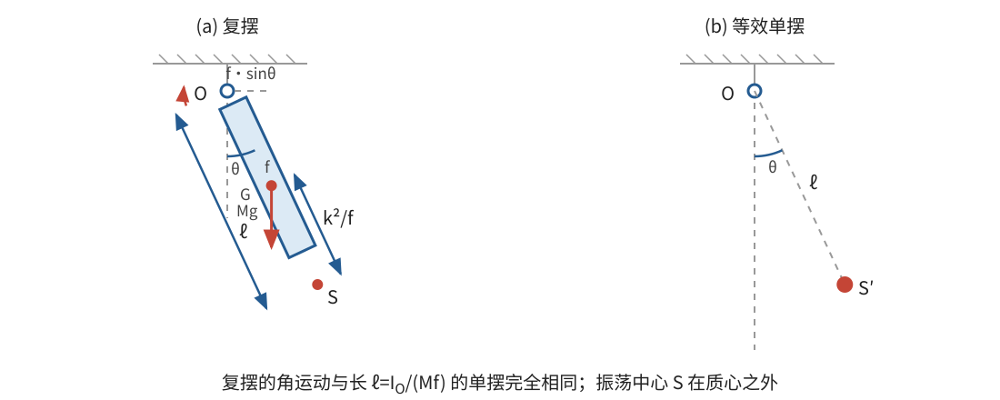

# 正文第7章：重物的振荡运动

*Concerning the Oscillatory Motion of Heavy Bodies*

> **选编说明**：本章依据欧拉原著正文第7章重写。保留重力矩、复摆与等时单摆、振荡中心、组合摆、轴承受力和倾斜转轴的主要思路；省略旧单位换算、两个球体怎样配置才振荡最快的反复求值，以及逐端点展开的轴承公式。统一改用现代单位与现代完整周期，核心公式均由转动方程重新推导。

## 本章导入：为什么不能把摆动的一切质量都看成集中在质心？

一根均匀细杆绕一端的水平轴摆动。若把同样多的质量全部集中在杆的质心，再用无质量轻杆连到同一根轴上，两种摆的运动会相同吗？

不会。重力合力虽然通过质心，但杆上各部分到转轴的距离不同：离轴较远的部分速度较大，也使杆更难改变转动状态。因此，决定平动的质心位置不足以决定摆动，还必须知道质量怎样分布。

欧拉在本章要解决的问题是：

1. 重力怎样改变绕固定水平轴的转动？
2. 能否用一个普通单摆，完全复制一个延展刚体的角运动？
3. 怎样由摆动实验反求转动惯量？
4. 转轴倾斜时，哪些结论需要改变？

---

## 1. 复摆的转动方程

### 1.1 描述摆动的几个量

一个具有延展的刚体绕固定水平轴转动，只受均匀重力作用，称为**复摆**（compound pendulum），也常称物理摆。取垂直于转轴并通过刚体质心 $G$ 的截面。设：

- $O$ 是转轴与该截面的交点；
- $f=OG>0$ 是质心到转轴的垂直距离；
- $M$ 是刚体总质量；
- $\theta$ 是有向线段 $OG$ 相对竖直向下方向转过的角度；
- $I_G$ 是刚体对通过 $G$、且与转轴平行的轴的**转动惯量**（moment of inertia）；
- $I_O$ 是对实际固定转轴的转动惯量。

重力作用在每个质量微元上。由于各微元所受重力大小与质量成正比、方向彼此平行，其合力为 $M\mathbf g$，作用线通过质心。重力对转轴的力臂为 $f\sin\theta$，力矩使 $\theta$ 减小，所以

$$
\tau_O=-Mgf\sin\theta。
$$

这里 $g$ 是重力加速度，不再采用原书把力、质量和下落距离混合表示的旧量度。

### 1.2 从质心轴换算到实际转轴

在刚体上取质量微元 $dm$，用 $\boldsymbol\rho$ 表示它相对于 $G$、且垂直于转轴的位移。它到 $O$ 的相应位移为 $\boldsymbol\rho+\mathbf f$，其中 $|\mathbf f|=f$。于是

$$
\begin{aligned}
I_O
&=\int |\boldsymbol\rho+\mathbf f|^2\,dm\\
&=I_G+Mf^2+2\mathbf f\cdot\int\boldsymbol\rho\,dm。
\end{aligned}
$$

质心的定义给出 $\int\boldsymbol\rho\,dm=\mathbf0$，故

$$
\boxed{I_O=I_G+Mf^2}。
$$

这就是本问题中的**平行轴定理**（parallel-axis theorem）。把重力矩和转动惯量代入 $I_O\ddot\theta=\tau_O$，得到

$$
\boxed{\ddot\theta=-\frac{Mgf}{I_O}\sin\theta}
$$

或写成

$$
\boxed{\ddot\theta=-\frac{gf}{f^2+k^2}\sin\theta},
\qquad k^2=\frac{I_G}{M}。
$$

$k$ 称为对质心轴的**回转半径**（radius of gyration）；它只是把 $I_G$ 写成 $Mk^2$ 的简便记号。

若转轴通过质心，则 $f=0$，重力对轴的力矩为零。此时上式应直接回到 $I_G\ddot\theta=0$：刚体保持静止或以恒定角速度转动，而不是进行复摆运动。

> **批注**：质心定理与转动方程回答不同问题。重力合力通过质心，所以质心像一个受重力和轴承力作用的质点那样运动；但重力对固定轴仍可能有力矩，刚体内部的质量分布也通过 $I_O$ 影响角加速度。把全部质量直接集中在 $G$，会丢掉 $I_G$，因此通常得到错误的摆动。

---

## 2. 等时单摆与振荡中心

### 2.1 用比较两个方程找到等效长度

考虑长度为 $\ell$ 的普通**单摆**（simple pendulum）：摆锤通过质量忽略的刚性轻杆连接到固定水平轴，全部质量 $m$ 集中在摆锤上。刚性轻杆保证摆长始终为 $\ell$，因此这个模型后来也能用于讨论越过最高点和整圈转动。此时质心到轴的距离就是 $\ell$，对轴的转动惯量是 $m\ell^2$，所以

$$
\ddot\theta=-\frac{g}{\ell}\sin\theta。
$$

如果复摆与这个单摆从相同角度、以相同角速度出发，并且此后每一时刻的角运动都相同，欧拉就称后者为复摆的**等时单摆**（simple isochronous pendulum）。两个方程完全相同，当且仅当

$$
\frac{g}{\ell}=\frac{Mgf}{I_O}。
$$

因此等效摆长为

$$
\boxed{\ell=\frac{I_O}{Mf}
=\frac{f^2+k^2}{f}
=f+\frac{k^2}{f}}。
$$

这里的“等时”是两个装置在相同初始角状态下同步，不是说任意振幅下的周期都与振幅无关。

在竖直向下的 $OG$ 延长线上取点 $S$，使 $OS=\ell$。欧拉把 $S$ 称为**振荡中心**（centre of oscillation）：若只比较上述重力摆动的角运动，复摆就像全部质量集中在 $S$ 的单摆。由 $\ell>f$ 可知 $S$ 比质心更远离转轴，并且

$$
\boxed{GS=\ell-f=\frac{k^2}{f}=\frac{I_G}{Mf}}。
$$

> **批注**：振荡中心不是第二个质心，也不表示刚体在所有动力学问题中都能用位于 $S$ 的质点替代。这里的等效只针对“绕同一固定轴、只受均匀重力、比较角运动”这一情形。例如，轴承受力还取决于真正的质心加速度，不能改从 $S$ 计算。

### 2.2 改变悬挂轴时，等效摆长何时最短？

对同一刚体选取一组相对刚体方向不变、彼此平行的转轴，使 $k$ 保持不变，只改变转轴到质心的距离 $f>0$。因为

$$
f+\frac{k^2}{f}-2k
=\left(\sqrt f-\frac{k}{\sqrt f}\right)^2\geq0,
$$

所以

$$
\ell\geq2k，
$$

等号在 $f=k$ 时成立。转轴太靠近质心时，重力矩很小；转轴太远时，$I_O$ 中的 $Mf^2$ 又占主导。两种情况都会使等效摆长变长。

当 $f\to0$ 时，公式给出 $\ell\to\infty$。这并不表示实际出现了无限慢的振荡，而是表示重力恢复力矩趋于零，已经不存在通常的复摆运动。

---

## 3. 大角度运动：一次积分就能判断摆动还是整圈转动

小角度近似并不是复摆方程成立的前提。先保留完整的 $\sin\theta$，将

$$
I_O\ddot\theta=-Mgf\sin\theta
$$

两边乘以 $\dot\theta$：

$$
\frac{d}{dt}\left(\frac12I_O\dot\theta^2\right)
=\frac{d}{dt}(Mgf\cos\theta)。
$$

所以

$$
\boxed{\frac12I_O\dot\theta^2-Mgf\cos\theta=E}
$$

在运动过程中保持不变。这里把重力势能写成 $U=-Mgf\cos\theta$，于是 $E=T+U$；最低点 $\theta=0$ 是势能最低点。这个能量形式是对欧拉原积分式的现代重述。

若初始角度和角速度分别为 $\theta_0,\omega_0$，则

$$
\boxed{\dot\theta^2
=\omega_0^2+\frac{2Mgf}{I_O}(\cos\theta-\cos\theta_0)}。
$$

右侧必须非负。按能量可分为四种情形：

- $E=-Mgf$：物体静止在最低点，不发生往复摆动；
- $-Mgf<E<Mgf$：物体不能到达最高点 $\theta=\pi$，会在满足
  $$
  \cos\theta_*=\frac{E}{Mgf}
  $$
  的转角处反向，形成非退化的往复摆动；
- $E>Mgf$：到达最高点时仍有剩余动能，可以越过最高点并继续整圈转动；
- $E=Mgf$：这是临界情形。若物体不是一开始就静止在最高点，它只能以最高点为极限，角速度趋于零，而不能在有限时间内到达。

临界情形的时间行为可以直接看出。令 $\varphi=\pi-\theta$，$\Omega=\sqrt{Mgf/I_O}$。在最高点附近，$\sin\theta\approx\varphi$，运动方程化为 $\ddot\varphi=\Omega^2\varphi$。其中随时间趋于零的解满足 $\varphi\propto e^{-\Omega t}$，所以趋近最高点需要无限长时间。最高点本身也是一个不稳定平衡位置。

**例：从最低点启动。** 若 $\theta_0=0$、初角速度为 $\omega_0$，能够越过最高点的条件为

$$
\frac12I_O\omega_0^2>2Mgf
\quad\Longleftrightarrow\quad
\omega_0^2>\frac{4Mgf}{I_O}。
$$

等效单摆也有相同的临界条件，因为两者的 $I_O/(Mf)$ 都等于 $\ell$。

---

## 4. 小角摆动与转动惯量的实验测量

当 $|\theta|$ 很小时，$\sin\theta\approx\theta$，复摆方程近似为

$$
\ddot\theta=-\frac{Mgf}{I_O}\theta。
$$

令

$$
\Omega=\sqrt{\frac{Mgf}{I_O}}=\sqrt{\frac{g}{\ell}}，
$$

这就是**简谐运动**（simple harmonic motion），其一般解可以写成

$$
\theta(t)=A\cos(\Omega t)+B\sin(\Omega t)，
$$

其中 $A,B$ 由初始角度和角速度决定。现代所说的完整往返周期为

$$
\boxed{T=2\pi\sqrt{\frac{\ell}{g}}
=2\pi\sqrt{\frac{I_O}{Mgf}}}。
$$

原书采用的时间量度与今天的完整周期定义不同，不能直接照抄其数值系数。

欧拉由此提出一个实用方法：测出 $f$ 和小角摆动周期 $T$，先算

$$
\ell=g\left(\frac{T}{2\pi}\right)^2，
$$

再由 $\ell=f+I_G/(Mf)$ 得

$$
\boxed{I_G=Mf(\ell-f)
=Mf\left[g\left(\frac{T}{2\pi}\right)^2-f\right]}。
$$

这使难以直接积分的质量分布，可以通过长度和时间的测量转化为转动惯量。实验需满足转轴摩擦和空气阻力足够小、振幅足够小，并且 $f>0$。换用几根彼此平行的转轴重复测量，可以检验结果是否一致。

> **批注**：这里体现了理论模型的双向用途：已知质量分布时，$I_O$ 预测周期；已知周期时，周期反推 $I_G$。现代引子：这种“由响应反推参数”的思想也出现在振动测量和系统辨识中，但那些后续理论不属于欧拉本章的论证。

---

## 5. 两个具体计算

### 5.1 均匀球体挂在轻线上

设均匀球体质量为 $M$、半径为 $b$，球心 $G$ 到悬挂轴的距离为 $f$，线的质量忽略。对通过球心且平行于悬挂轴的轴，

$$
I_G=\frac25Mb^2。
$$

因此

$$
\boxed{\ell=f+\frac{2b^2}{5f}}，
\qquad
GS=\frac{2b^2}{5f}。
$$

只有当 $b/f$ 很小时，才可以把球近似为全部质量集中在球心的单摆。若转轴允许穿过球体内部，理论上最短等效摆长出现在

$$
f=\sqrt{\frac25}\,b<b，
$$

此时 $\ell_{\min}=2\sqrt{2/5}\,b$。这个最优位置在球内，不能用普通的球外轻线悬挂实现。

若限定轻线连接在球面上或球外，则 $f\geq b$。在这个实际可行域内，$\ell=f+2b^2/(5f)$ 随 $f$ 增大而增大，所以最小值在球面悬挂 $f=b$ 处取得：

$$
\boxed{\ell_{\min,\,\text{球外}}=b+\frac{2b}{5}=\frac75b}。
$$

### 5.2 由多个部分组成的摆

设第 $i$ 个部分的质量为 $m_i$，其质心相对 $O$ 的平面位移为 $\mathbf d_i$，对自身平行质心轴的转动惯量为 $I_{G,i}$。整个刚体对 $O$ 轴的转动惯量可以直接相加：

$$
I_O=\sum_i\left(I_{G,i}+m_i|\mathbf d_i|^2\right)。
$$

整体质心的位置满足

$$
M\mathbf d=\sum_i m_i\mathbf d_i,
\qquad M=\sum_i m_i,
\qquad f=|\mathbf d|。
$$

所以组合摆的等效摆长仍可写成

$$
\boxed{\ell=\frac{\sum_i(I_{G,i}+m_i|\mathbf d_i|^2)}
{\left|\sum_i m_i\mathbf d_i\right|}}。
$$

若各部分质心都在从 $O$ 出发的同一条射线上，$d_i=|\mathbf d_i|$，分母就简化为 $\sum_i m_i d_i$。

这个公式提醒我们：一个部分对整体的影响不只由它的质量决定，还由它的位置和自身转动惯量决定。即使杆比球轻很多，也不能不加检查就忽略杆；欧拉的数值例子正是为了说明这一点。

---

## 6. 轴承受力与倾斜转轴

### 6.1 轴承受力不能只看静平衡

复摆运动时，质心沿圆周运动。令 $\hat{\mathbf e}_r$ 沿 $OG$ 指向质心，$\hat{\mathbf e}_t$ 沿 $\theta$ 增大的切线方向，则

$$
\mathbf a_G=f\ddot\theta\,\hat{\mathbf e}_t
-f\dot\theta^2\,\hat{\mathbf e}_r。
$$

若所有轴承对刚体的合力为 $\mathbf N$，质心运动定理给出

$$
\boxed{\mathbf N=M\mathbf a_G-M\mathbf g}。
$$

其中既有维持质心圆周运动的向心部分，也有与角加速度有关的切向部分。欧拉进一步把总轴承受力分配到两个支承点；一般情况下，这种分配还涉及质量相对转轴的偏心分布。由于那些计算重复且不改变本章主线，这里只保留上述合力判据。

### 6.2 转轴不水平时，只有重力的垂直分量产生恢复力矩

设固定转轴与竖直方向的夹角为 $\eta$，其中 $0<\eta\leq\pi/2$。把重力分解为平行于轴和垂直于轴的两部分，大小分别为 $Mg\cos\eta$ 与 $Mg\sin\eta$。平行分量对转轴没有力矩，真正驱动摆动的是垂直分量。

此时质心在垂直于转轴的平面内运动，不能直接沿用第1节相对于空间竖直方向的角坐标。将竖直向下方向正交投影到这个平面，投影所指就是质心的稳定平衡方向。本节重新规定：$\theta$ 是 $OG$ 在该平面内相对于这个平衡投影方向的有向角，$\theta=0$ 对应稳定平衡。

因此，只要把水平轴方程中的 $g$ 换成 $g\sin\eta$，就有

$$
\boxed{I_O\ddot\theta=-Mf g\sin\eta\,\sin\theta}。
$$

与水平轴、重力加速度为 $g$ 的单摆相比，等效长度变为

$$
\ell_\eta=\frac{I_O}{Mf\sin\eta}，
$$

小角完整周期为

$$
\boxed{T_\eta=2\pi\sqrt{\frac{I_O}{Mfg\sin\eta}}}。
$$

$\eta=\pi/2$ 时回到水平轴情形；$\eta=0$ 时转轴竖直，重力对轴没有恢复力矩，不能再用有限周期的复摆公式描述。

---

## 本章小结

1. 复摆的角运动由重力矩和实际转轴的转动惯量共同决定：$I_O\ddot\theta=-Mgf\sin\theta$。
2. 平行轴关系 $I_O=I_G+Mf^2$ 把质量分布的影响带入方程；仅知道质心位置并不够。
3. 等时单摆的长度为 $\ell=I_O/(Mf)=f+k^2/f$，振荡中心位于质心之外，且 $GS=I_G/(Mf)$。
4. 保留 $\sin\theta$ 的方程可通过能量积分判断往复摆动与整圈转动；小角近似才给出简谐运动和周期 $2\pi\sqrt{\ell/g}$。
5. 测量小角周期可以反求 $I_G$；组合摆则把各部分的转动惯量相加，再除以整体的重力矩系数。
6. 倾斜转轴只利用重力垂直于轴的分量；轴竖直时，重力不再提供绕轴的恢复力矩。

下一章撤去外加的固定轴约束，转而寻找不需要外力保持位置的转轴。复摆中始终存在的轴承受力，将成为理解“自由轴”的对照。

---

## 底本与现代参考

1. 欧拉原著正文第7章；Ian Bruce 英译见本地 [`english_translation/tmvol1ch7tr.txt`](english_translation/tmvol1ch7tr.txt)，原书图版及公式见同目录 PDF。
2. L. D. Landau and E. M. Lifshitz, *Mechanics*, 3rd ed.：固定轴转动、物理摆与能量的现代表述。
3. H. Goldstein, C. Poole and J. Safko, *Classical Mechanics*, 3rd ed.：刚体转动、平行轴定理与约束力的现代对照。

[上一章：正文第6章——物体的转动惯量](欧拉刚体运动理论_正文_第6章.md)

[下一章：正文第8章——自由轴与刚体绕自由轴的运动](欧拉刚体运动理论_正文_第8章.md)
