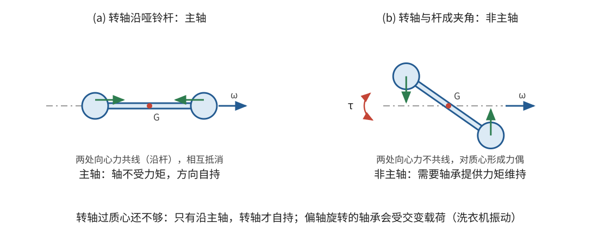
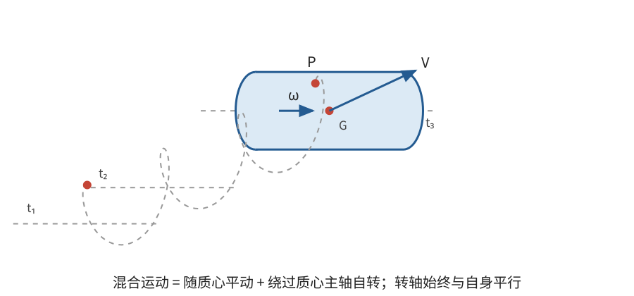

# 正文第8章：自由轴与刚体绕自由轴的运动

*Concerning Free Axes, and the Motion of Rigid Bodies about Such Axes*

> **选编说明**：本章依据欧拉原著正文第8章重写。保留自由轴的条件、自由轴与主轴的关系、改变转速而不扰动转轴的力、混合运动及其受力条件；把分散在多个问题中的力系归并为两类，用现代矢量式核对。原书旧单位下的角速度增量公式统一改写为 $I\dot\omega=\tau$，不保留重复的历史量度换算。

## 本章导入：为什么有的转轴必须用力扶住？

让刚体绕一根穿过质心的轴转动。若轴的位置固定不变，轴承是否一定不用承受力？

不一定。质心不离开转轴，只能说明旋转没有直接把质心甩向一侧；各部分的向心加速度仍可能对转轴形成不平衡的力矩。洗衣机内衣物分布不均时的振动，就是这种不平衡的日常例子。

欧拉因此要寻找一种特殊的轴：刚体绕它旋转时，不需要外界提供力或力矩来维持轴的位置。他称这种轴为**自由轴**（free axis）。

---

## 1. 自由轴的两个条件

### 1.1 先消除合力，再消除合力矩

取转轴为 $x$ 轴，质量微元 $dm$ 的坐标记为 $(x,y,z)$。刚体以角速度 $\omega$ 绕 $x$ 轴转动，角加速度为 $\alpha=\dot\omega$。该微元的加速度可分解为切向与向心两部分：

$$
\mathbf a=\boldsymbol\alpha\times\mathbf r
+\boldsymbol\omega\times(\boldsymbol\omega\times\mathbf r)。
$$

其中 $\mathbf r=(x,y,z)$，$\boldsymbol\omega=(\omega,0,0)$，$\boldsymbol\alpha=(\alpha,0,0)$。

若转轴不因运动而受到合力，各部分所需合力在垂直于轴的方向必须相互抵消。对全部微元求和，向心项和切向项都含有 $\int y\,dm$ 与 $\int z\,dm$，故首先要求

$$
\int y\,dm=0,\qquad \int z\,dm=0。
$$

按照质心定义，这就是说：**转轴必须通过质心 $G$。**

但合力为零仍不够。对转轴上一点取矩，垂直于转轴的力矩分量含有

$$
\int xy\,dm,\qquad \int xz\,dm。
$$

即使转轴通过质心，这两个量也可能不为零。要消除因运动产生的不平衡力矩，还必须满足

$$
\boxed{\int xy\,dm=0,\qquad \int xz\,dm=0}。
$$

所以，自由轴的条件有两层：

1. 轴通过质心；
2. 对该轴的两个相应惯量积为零。

第二组条件正是**主轴**（principal axes）的条件。因此，按本章所讨论的理想刚体和惯性运动，**自由轴就是过质心的主轴**。

> **批注**：这里容易把“质心在轴上”误认为全部条件。质心在轴上只保证匀速旋转时质心不需要向心力，并不保证各部分所需的向心力对轴的力矩彼此抵消。欧拉先令两个合力消失，再令两个力矩消失，正是为了避免这个遗漏。

### 1.2 用角动量作现代核对

用现代语言，刚体对质心的**角动量**（angular momentum）可写成

$$
\mathbf L_G=\mathbf I_G\boldsymbol\omega，
$$

其中 $\mathbf I_G$ 是质心惯量张量，$\boldsymbol\omega$ 是角速度矢量。这个紧凑记号是现代重述，不是欧拉原书的写法。

若 $\boldsymbol\omega=\omega\hat{\mathbf n}$ 沿主轴，则

$$
\mathbf L_G=I_n\omega\hat{\mathbf n}，
$$

其中 $I_n$ 是对该主轴的转动惯量。角动量与角速度同方向；没有其他力矩时，两者都可以保持不变。若 $\hat{\mathbf n}$ 不是主轴，$\mathbf L_G$ 一般还有垂直于 $\hat{\mathbf n}$ 的分量。要让转轴仍在空间保持同方向，就需要约束力矩不断改变这部分角动量。

这也解释了为什么主轴条件会出现在自由轴问题中，而不只是出现在求最大、最小转动惯量的计算中。

### 1.3 自由轴的数目与退化情形

设三个**主转动惯量**（principal moments of inertia）按 $I_1\leq I_2\leq I_3$ 排列：

- 若三者互不相同，恰有三条不同的自由轴方向；
- 若恰有两个相等，例如 $I_1=I_2$，则与第三条主轴垂直的整个平面内，任一过质心的方向都可取作自由轴；
- 若三者全部相等，则过质心的任意轴都是自由轴。均匀球体是直观例子，均匀立方体对质心也具有相同的三个主转动惯量。

> **批注**：**自由转动不等于抗扰动稳定。** 中间主轴也是自由轴：完全无扰动时，刚体可以持续绕它旋转；但三个主转动惯量互不相同时，对中间主轴的小扰动会增长。自由轴回答“精确运动时是否需要约束力”，稳定性回答“略有偏差后会怎样”，不能混为一谈。这个稳定性结论是现代延伸，不是本章自由轴定义的一部分。

---

## 2. 什么力能改变转速而不扰动自由轴？

设刚体已经绕自由轴旋转。若希望轴仍保持静止，所加外力必须满足两个要求：质心不因合力而加速，外力矩也不把角动量推离原来的轴线。

### 2.1 一对大小相等、方向相反的力

欧拉给出的基本构造是：在垂直于自由轴的同一平面内，施加一对大小相等、方向相反的力。两力合力为零，但作用点不同，可以形成**力偶**（couple）。

若两力为 $\mathbf F$ 与 $-\mathbf F$，作用点相对质心的位置分别为 $\mathbf r_1,\mathbf r_2$，则

$$
\mathbf F_{\mathrm{合}}=\mathbf F-\mathbf F=\mathbf0，
$$

$$
\boldsymbol\tau_G
=\mathbf r_1\times\mathbf F+\mathbf r_2\times(-\mathbf F)
=(\mathbf r_1-\mathbf r_2)\times\mathbf F。
$$

由于 $\mathbf r_1-\mathbf r_2$ 和 $\mathbf F$ 都在垂直于转轴的平面内，力偶矩沿转轴方向。它只改变绕该轴的转速，不改变质心速度，也不把转轴推向其他方向。

若对轴的转动惯量为 $I_n$，力偶矩的有向分量为 $\tau_n$，则

$$
\boxed{I_n\dot\omega=\tau_n}。
$$

$\tau_n$ 与 $\omega$ 同号时加速，反号时减速。这就是原书角速度增量公式在现代单位下的形式。

反过来，任取一个位于上述平面内的力，只要同时在轴上施加一个等大反向的力，也能构成同样的构造。轴上的那个力对轴没有力矩，转速的变化由另一个力的力矩决定。

### 2.2 通过质心的力起什么作用？

若一个力的等效作用线通过质心，它对质心的力矩为零。在已经保持主轴方向不变的混合运动中，它只改变质心的平动，不改变转动：

$$
M\frac{d\mathbf V}{dt}=\mathbf F，
\qquad
\boldsymbol\tau_G=\mathbf0。
$$

因此，“通过质心的力”和“力偶矩沿自由轴的力偶”分别提供了改变平动与改变转动的两种基本方式。但任意方向、任意作用线的力并不都属于这两类；它们还可能使转轴偏转。

---

## 3. 匀速平动为什么可以叠加到转动上？

### 3.1 给所有点加上同一个速度

设刚体绕过质心的主轴转动，点 $P$ 的位置写成

$$
\mathbf r_P=\mathbf R+\boldsymbol\rho_P，
$$

其中 $\mathbf R$ 是质心位置，$\boldsymbol\rho_P$ 随刚体转动。若给整个刚体再添加匀速直线运动

$$
\mathbf R(t)=\mathbf R_0+\mathbf Vt，
$$

则各点速度都增加同一个 $\mathbf V$，而加速度不变。原来维持相对转动所需的力不变，匀速参考方向中的相对运动也不变。

这就是欧拉所证的结论：刚体绕静止轴能够完成的转动，也可以在轴作匀速直线平移时同样完成。平移方向不必与转轴平行；关键是转轴在空间始终与自身平行，而平移速度恒定。

> **批注**：这里的论证与惯性参考系的思想相通：在以恒定速度 $\mathbf V$ 平移的参考系中，各点只少了共同速度 $\mathbf V$，相对加速度没有改变。欧拉采用的是直接给各微元速度加上同一常量的办法，而不是现代参考系术语。

### 3.2 混合运动的定义与自由持续

欧拉把平动与绕主轴转动的这种组合称为**混合运动**（mixed motion）：刚体一方面随质心平动，另一方面绕一条过质心的主轴转动，而该轴始终保持与自身平行。

若此后不受任何外力，则

$$
\boxed{\mathbf R(t)=\mathbf R_0+\mathbf Vt},
\qquad
\boxed{\theta(t)=\theta_0+\omega t}，
$$

其中 $\mathbf R_0$ 和 $\theta_0$ 是初始质心位置与初始转角，$\mathbf V$ 和 $\omega$ 都是常量。刚体上点 $P$ 的速度可写为

$$
\mathbf v_P=\mathbf V+\boldsymbol\omega\times\boldsymbol\rho_P。
$$

因此，要描述某一时刻的这种运动，需要知道：

- 质心速度的大小和方向；
- 转轴相对刚体及空间的方向；
- 角速度的大小和转向。

这种混合运动不是“所有点都作平移”，因为除转轴方向外，刚体上的其他连线会改变方向；它也不是“绕空间中一条静止轴旋转”，因为转轴随质心一起平移。

---

## 4. 哪些力仍能保持混合运动？

欧拉接着把受力情形限制在不会使主轴偏转的力系。这些力可以归并为下列两类。

### 4.1 第一类：力系的等效作用线通过质心

这一类力系的等效作用线始终通过质心，因而对质心的合力矩为零；不要求其中每个力分别通过质心。它们只改变质心运动，不改变角速度的大小和方向。质心按

$$
M\frac{d\mathbf V}{dt}=\sum_i\mathbf F_i
$$

运动。均匀重力场就是重要例子：各微元所受重力并不都通过总质心，但整个重力系的等效作用线通过质心。质心可以沿抛物线运动，而理想刚体绕主轴的转动不受扰动。此时平动不再是直线匀速，但转轴仍可保持平行。

### 4.2 第二类：作用线位于过质心且垂直于转轴的平面

设转轴单位方向为 $\hat{\mathbf n}$，考虑平面 $\Pi$：它通过质心并与 $\hat{\mathbf n}$ 垂直。若一个力的作用线位于 $\Pi$ 内，那么作用点相对质心的位移 $\mathbf r$ 和力 $\mathbf F$ 都在 $\Pi$ 内，所以

$$
\boldsymbol\tau_G=\mathbf r\times\mathbf F
\parallel\hat{\mathbf n}。
$$

把每个这样的力平移到质心来计算平动，同时保留它产生的力偶矩，就得到

$$
\boxed{M\frac{d\mathbf V}{dt}=\sum_i\mathbf F_i},
\qquad
\boxed{I_n\dot\omega=\sum_i\tau_{i,n}}。
$$

平动与转动可以分别计算，再合成。取初始时刻的 $\Pi$ 为空间固定平面。若初始质心速度也位于 $\Pi$ 内，并且所有力始终位于这个固定平面，质心就会一直在 $\Pi$ 内运动，该平面也就不需要随质心另行平移；若初速度有沿转轴的分量，则还会叠加该方向的匀速运动。

### 4.3 两类力同时存在

两类力同时作用时，上述两个方程仍然成立：

- 求质心运动时，把所有力按原方向移到质心求合力；
- 求绕主轴的转动时，只保留各力对质心力矩沿该轴的分量；
- 分别求出平动和转动后，再合成各点运动。

**这一结论有明确的适用条件。** 若外力矩有垂直于当前角动量的分量，转轴一般不再保持与自身平行，就不能继续使用这里的一维转动方程。欧拉在本章末尾也明确把一般任意力作用留到后面处理。

> **批注**：现代力学中，任何瞬时刚体运动都可以写成“质心平动＋绕质心的转动”，但“可以分解”不等于“两部分总是独立”。本章的独立计算依赖主轴条件和特殊力系。现代引子：一般情形需要在角动量方程中保留方向变化，正是后续自由转动与欧拉转动方程要处理的问题。

---

## 本章小结

1. 自由轴要求转轴通过质心，并消除相应惯量积；在本章条件下，自由轴就是过质心的主轴。
2. 绕主轴旋转时，角动量与角速度平行；无外力、外力矩时，轴的方向和转速都能保持。
3. 垂直于自由轴的平面内，一对等大反向的力可形成沿轴力偶，只改变转速；通过质心的力只改变平动。
4. 给绕主轴的转动叠加任意方向的匀速质心平动，不改变相对转动，由此形成混合运动。
5. 混合运动只在特定力系下保持：作用线通过质心的力，以及位于过质心、垂直于转轴平面内的力，可以分别用于计算平动和绕轴转动。
6. 自由轴的存在与绕该轴转动的稳定性是不同问题；一般力导致的转轴变化需要更完整的角动量方程。

下一章从静止刚体出发，研究力刚开始作用时怎样产生平动与转动，并确定最初瞬时转轴的方向。

---

## 底本与现代参考

1. 欧拉原著正文第8章；Ian Bruce 英译见本地 [`english_translation/tmvol1ch8tr.txt`](english_translation/tmvol1ch8tr.txt)，原书图版及公式见同目录 PDF。
2. L. D. Landau and E. M. Lifshitz, *Mechanics*, 3rd ed.：角动量、惯量张量与自由转动的现代表述。
3. H. Goldstein, C. Poole and J. Safko, *Classical Mechanics*, 3rd ed.：主轴、力系简化与刚体一般运动的现代对照。

[上一章：正文第7章——重物的振荡运动](欧拉刚体运动理论_正文_第7章.md)

[下一章：正文第9章——刚体运动的初始产生](欧拉刚体运动理论_正文_第9章.md)
