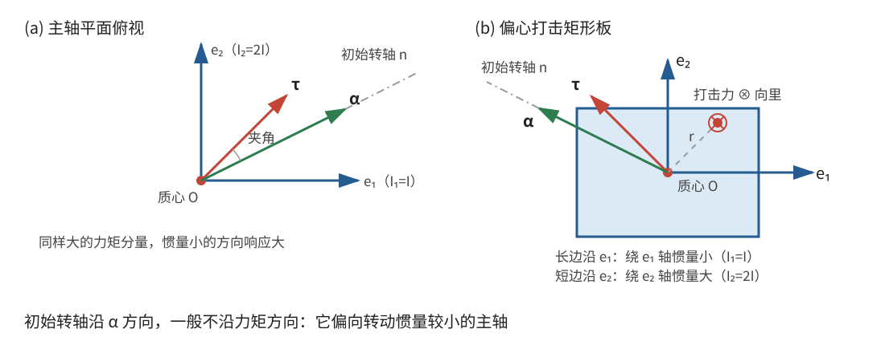
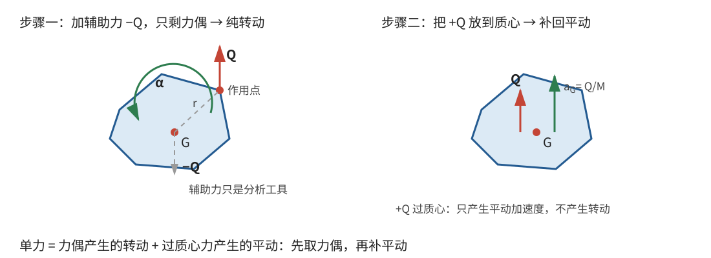

# 正文第9章：刚体运动的初始产生

*Concerning the Initial Generation of Motion in Rigid Bodies*

> **选编说明**：本章依据欧拉原著正文第9章重写。保留力系化为两个力、静止刚体的初始转轴、欧拉关于活力的历史说法、主轴坐标中的解以及平动与转动的合成。原书冗长的球面几何和逐坐标展开改用矢量、主轴分量重述；这些现代记号用于核对和缩短论证，不表示欧拉已经使用矩阵或矢量叉积。底本所称“最小活力”与现代复核结果的差异也在本章明确标出。

## 本章导入：击打一端的物体，会绕力矩的方向转动吗？

一个自由刚体起初静止。现在在偏离质心的位置施加一个力，质心会开始平动，刚体也会开始转动。转动轴是否就沿外力矩方向？

一般不是。质量分布沿不同方向的“转动难易程度”不同：同样的力矩分量，在转动惯量较小的方向会产生较大的角加速度。因此，**初始角加速度一般不与外力矩平行**。

本章依次回答三个问题：怎样简化作用力系？怎样确定初始转动轴？欧拉关于初始“活力”的历史说法在现代重述中应怎样核验？

---

## 1. 从力系到初始平动和转动

### 1.1 两个初始运动方程

设刚体总质量为 $M$，质心为 $G$，位置为 $\mathbf R$。第 $i$ 个外力 $\mathbf F_i$ 的作用点相对质心的位置为 $\mathbf r_i$。定义合力和对质心的合力矩：

$$
\mathbf F=\sum_i\mathbf F_i,
\qquad
\boldsymbol\tau_G=\sum_i\mathbf r_i\times\mathbf F_i。
$$

质心的初始加速度由合力决定：

$$
\boxed{M\mathbf a_G=\mathbf F}。
$$

刚体初始静止，所以初始角速度和角动量都为零。若 $\mathbf I_G$ 表示质心**惯量张量**（inertia tensor），$\boldsymbol\alpha$ 表示初始角加速度，则转动方程在这一瞬间化为

$$
\boxed{\mathbf I_G\boldsymbol\alpha=\boldsymbol\tau_G}。
$$

对通常三维刚体，$\mathbf I_G$ 可逆，因此

$$
\boxed{\boldsymbol\alpha=\mathbf I_G^{-1}\boldsymbol\tau_G}。
$$

这里的第二式是现代重述。它与原书逐步写出的坐标条件等价，但更清楚地显示：力矩先被惯量张量“按方向重新分配”，才得到角加速度。

在随后的极短时间内，若力在这段时间内连续，

$$
\mathbf V_G=\mathbf a_Gt+O(t^2),
\qquad
\boldsymbol\omega=\boldsymbol\alpha t+O(t^2)。
$$

所以刚体上相对质心位置为 $\boldsymbol\rho$ 的点，其速度为

$$
\boxed{\mathbf v_P
=\mathbf a_Gt+(\boldsymbol\alpha t)\times\boldsymbol\rho+O(t^2)}。
$$

这就是初始平动和初始转动的合成。记号 $O(t^2)$ 表示相对 $t$ 更高阶的修正项，在只保留初始时刻的主导运动时忽略。

> **批注**：$\mathbf I_G\boldsymbol\alpha=\boldsymbol\tau_G$ 的简洁形式依赖“从静止开始”。若刚体已经有角速度，角动量本身不为零，角动量方向的变化也不能忽略，不能直接沿用这个式子计算全部角加速度。本章结论首先是瞬时结论，并不保证刚体以后始终绕同一空间轴转动。

### 1.2 减去一个通过质心的力所产生的效果

通过质心的力对 $\boldsymbol\tau_G$ 没有贡献，只对 $\mathbf F$ 有贡献。因此，若已知两个力共同作用的效果，其中一个力通过质心，就可以从总平动中减去这个力的贡献，得到另一个力单独作用的效果；转动部分不受这次相减影响。

这就是欧拉下一条准备性定理的实质。它使“先求纯转动，再补回质心平动”的做法成立。

### 1.3 任意力系为什么能化为两个力？

欧拉证明：无论有多少力，都能化为两个等效力，其中一个通过质心。这里的“等效”是合力和对质心的合力矩都相同，因而产生相同的初始运动。

用现代记号可以直接核验。若 $\boldsymbol\tau_G=\mathbf0$，只需令第二个力为零，把合力 $\mathbf F$ 放在质心即可。若 $\boldsymbol\tau_G\neq\mathbf0$，任取一个与力矩垂直的非零力 $\mathbf Q$，即

$$
\mathbf Q\cdot\boldsymbol\tau_G=0。
$$

令它的作用线通过点

$$
\mathbf s=\frac{\mathbf Q\times\boldsymbol\tau_G}{|\mathbf Q|^2}，
$$

这里 $\mathbf s$ 是该点相对质心的位移。由矢量三重积，

$$
\mathbf s\times\mathbf Q
=\boldsymbol\tau_G。
$$

再在质心施加

$$
\mathbf S=\mathbf F-\mathbf Q。
$$

于是两力的合力为 $\mathbf S+\mathbf Q=\mathbf F$，对质心的合力矩为 $\mathbf s\times\mathbf Q=\boldsymbol\tau_G$。由于 $\mathbf Q$ 的选择并不唯一，这种二力表示有无穷多种。

> **批注**：不能把这条定理误读成“先把全部合力放到质心，再任意添加一个力”。那样会再次改变合力。现代静力学中也常把力系写成“质心处的合力＋一个力偶”；欧拉这里选择的是“质心处的一个力＋另一个力”，两种表示都保持合力与合力矩，但形式不同。

---

## 2. 初始转动轴的方向

### 2.1 转动轴沿角加速度，而不是必沿力矩

只要 $\boldsymbol\alpha\neq\mathbf0$，初始转动部分的方向就由

$$
\boxed{\hat{\mathbf n}=\frac{\boldsymbol\alpha}{|\boldsymbol\alpha|}}
$$

确定，转轴通过质心。更确切地说，这是**相对于质心的初始转动轴**：若质心同时加速，轴上的物质点仍有平动速度，并非空间中一条所有点都瞬时静止的轴。

在主轴坐标系中，设三个主转动惯量为 $I_1,I_2,I_3$，力矩分量为 $\tau_1,\tau_2,\tau_3$，则

$$
\boxed{
\alpha_1=\frac{\tau_1}{I_1},
\qquad
\alpha_2=\frac{\tau_2}{I_2},
\qquad
\alpha_3=\frac{\tau_3}{I_3}}。
$$

因此，只有主轴方向或某些特殊力矩方向，才有 $\boldsymbol\alpha\parallel\boldsymbol\tau_G$。一般情况下两者不平行。

**一个可算通的例子。** 取 $I_1=I$、$I_2=2I$，并令力矩只有前两个分量：

$$
\boldsymbol\tau_G=(\tau,\tau,0)。
$$

则

$$
\boldsymbol\alpha
=\left(\frac{\tau}{I},\frac{\tau}{2I},0\right)。
$$

力矩的两个分量相等，角加速度的第一个分量却是第二个的两倍。初始轴因此更靠近转动惯量较小的第一条主轴。

欧拉先研究怎样配置两个力来产生指定轴，再处理给定力的正问题，并讨论过初始轴位于某个特殊平面内的限制。用上面的矢量关系，这些坐标条件可统一理解为 $\boldsymbol\tau_G=\mathbf I_G\boldsymbol\alpha$，无须把力矩方向预先当作转轴方向。

### 2.2 单个力作用时怎样补回平动？

若只有一个力 $\mathbf Q$ 作用在质心之外，可以暂时在质心添加 $-\mathbf Q$。两力合力为零，先求出纯转动部分；随后再把 $+\mathbf Q$ 放到质心，补回平动。

若 $\mathbf r$ 是该力作用点相对质心的位置，这和直接计算

$$
\mathbf a_G=\frac{\mathbf Q}{M},
\qquad
\mathbf I_G\boldsymbol\alpha=\mathbf r\times\mathbf Q
$$

完全相同。辅助力只是分析工具，不是外界额外施加的第三组真实作用。

---

## 3. 欧拉“最小活力”说法与现代复核

### 3.1 比较不同假想转轴所获得的活力

欧拉把各质量微元的“质量乘以速度平方”之和称为**活力**（vis viva，英译亦称 living force）。用现代动能 $T$ 表示，活力就是 $2T$。

取过质心的任一候选单位方向 $\hat{\mathbf n}$，并设 $\boldsymbol\tau_G\neq\mathbf0$。若假想初始转动绕此轴发生，记

$$
I_n=\hat{\mathbf n}^{T}\mathbf I_G\hat{\mathbf n},
\qquad
\tau_n=\boldsymbol\tau_G\cdot\hat{\mathbf n}。
$$

这些候选运动不是同一个自由刚体能够同时采取的运动，而相当于分别加入理想固定轴约束；约束力对候选轴的力矩为零，所以初始时刻仍有 $I_n\dot\omega_n=\tau_n$。若力连续，从静止经过短的时间 $t$，

$$
\omega_n=\frac{\tau_n(0)}{I_n}t+O(t^2)。
$$

于是候选运动的初始转动活力为

$$
\boxed{2T_n
=\frac{(\boldsymbol\tau_G\cdot\hat{\mathbf n})^2}
{\hat{\mathbf n}^{T}\mathbf I_G\hat{\mathbf n}}\,t^2+O(t^3)}，
$$

其中力矩和惯量取初始值。若 $\tau_n/I_n$ 在这段时间内保持不变，才可以去掉误差项而写成严格等式。

为比较初始时刻的 $t^2$ 主导项，记

$$
\mathcal A_n=\frac{(\boldsymbol\tau_G\cdot\hat{\mathbf n})^2}{I_n}。
$$

力矩投影和转动惯量都随候选轴改变，不能只比较 $I_n$ 的大小。欧拉把与实际初始转轴有关的结论称为“最小活力定理”；但按上述候选运动的定义，仍需用不等式检验 $\mathcal A_n$ 究竟取最大值还是最小值。

### 3.2 在主轴坐标中验算极值方向

设候选方向在主轴坐标中的分量为 $(n_1,n_2,n_3)$，满足 $n_1^2+n_2^2+n_3^2=1$。构造两组数

$$
a_i=\frac{\tau_i}{\sqrt{I_i}},
\qquad
b_i=\sqrt{I_i}\,n_i。
$$

点积不等式 $(\sum_i a_ib_i)^2\leq(\sum_i a_i^2)(\sum_i b_i^2)$ 给出

$$
(\tau_1n_1+\tau_2n_2+\tau_3n_3)^2
\leq
\left(\frac{\tau_1^2}{I_1}+\frac{\tau_2^2}{I_2}+\frac{\tau_3^2}{I_3}\right)
(I_1n_1^2+I_2n_2^2+I_3n_3^2)。
$$

因此对每一个候选方向，

$$
\boxed{\mathcal A_n\leq
\boldsymbol\tau_G^{T}\mathbf I_G^{-1}\boldsymbol\tau_G}。
$$

等号成立的条件是两组数成比例：

$$
\sqrt{I_i}\,n_i\propto\frac{\tau_i}{\sqrt{I_i}}
\quad\Longleftrightarrow\quad
n_i\propto\frac{\tau_i}{I_i}=\alpha_i。
$$

这恰好就是 $\hat{\mathbf n}\parallel\boldsymbol\alpha$。所以，**实际初始转轴使候选活力的 $t^2$ 系数取得全局最大值**。相反，任取 $\hat{\mathbf n}\perp\boldsymbol\tau_G$ 都有 $\mathcal A_n=0$，这才是全局最小值，而且对应的候选轴并不唯一。

实际初始转动动能在同一近似下为

$$
T=\frac12t^2\boldsymbol\alpha^T\mathbf I_G\boldsymbol\alpha
+O(t^3)
=\frac12t^2\boldsymbol\tau_G\cdot\boldsymbol\alpha
+O(t^3)，
$$

与活力 $2T$ 的上述最大 $t^2$ 系数一致。这里比较的是绕质心的初始转动动能，不包括质心平动动能。

> **批注**：英文底本在这里使用“minimum”这一历史表述，但按本节明确写出的候选运动和现代不等式，得到的是实际轴上的最大值。两者存在实质差异，不能把“最小值”继续写成已经验证的现代结论；欧拉原始论证是否另用了不同的比较条件，历史来源待考。本节比较同一外力系、同一短时内的假想约束运动，也不能直接等同于后来最小作用量原理对整段真实运动路径的要求。

---

## 4. 主轴坐标中的一个完整例子

设力作用线与两条主轴所在的 $xy$ 平面交于 $V$，质心为原点，且

$$
\mathbf r=h(\cos\varphi,\sin\varphi,0),
\qquad h=|\mathbf r|。
$$

力在三个主轴方向的分量为 $(P,Q,R)$。由 $\boldsymbol\tau_G=\mathbf r\times\mathbf F$ 得

$$
\boldsymbol\tau_G
=h\left(R\sin\varphi,\,-R\cos\varphi,\,Q\cos\varphi-P\sin\varphi\right)。
$$

所以初始角加速度分量直接为

$$
\boxed{
\begin{aligned}
\alpha_1&=\frac{hR\sin\varphi}{I_1},\\
\alpha_2&=-\frac{hR\cos\varphi}{I_2},\\
\alpha_3&=\frac{h(Q\cos\varphi-P\sin\varphi)}{I_3}。
\end{aligned}}
$$

其方向就是所求初始轴。为对照欧拉的原公式，令

$$
a^2=\frac{I_1}{M},
\qquad b^2=\frac{I_2}{M},
\qquad c^2=\frac{I_3}{M}，
$$

并按他的取向把轴方向写成

$$
\hat{\mathbf n}
=(\cos\varphi'\cos\psi,\,-\sin\varphi'\cos\psi,\,\sin\psi)。
$$

其中 $\varphi'$ 是初始轴在 $xy$ 平面内的投影相对 $+x$ 轴的夹角，正向朝 $-y$ 方向；$\psi$ 是初始轴相对该平面的倾角，正向朝 $+z$ 方向。

比较 $\hat{\mathbf n}$ 与 $\boldsymbol\alpha$ 的分量比，在 $R\neq0$ 及相关分母不为零时得到

$$
\boxed{\tan\varphi'
=\frac{I_1\cos\varphi}{I_2\sin\varphi}
=\frac{a^2\cos\varphi}{b^2\sin\varphi}}
$$

以及

$$
\boxed{\tan\psi
=\frac{I_1(Q\cos\varphi-P\sin\varphi)\cos\varphi'}
{I_3R\sin\varphi}
=\frac{a^2(Q\cos\varphi-P\sin\varphi)\cos\varphi'}
{c^2R\sin\varphi}}。
$$

第一式正是欧拉所得的重要简化：**初始轴在 $xy$ 平面内的投影方向，只由作用点位置和主转动惯量决定，与力在该点取什么方向无关。** 但完整的空间方向仍通过第二式依赖于力的分量。若 $R=0$ 或 $\boldsymbol\tau_G=\mathbf0$，应直接使用前面的分量式处理，不能机械套用有零分母的角度公式。

---

## 5. 任意力系产生的完整初始运动

现在把各步合并：

1. 计算原力系的合力 $\mathbf F$ 和对质心的合力矩 $\boldsymbol\tau_G$；需要时，也可先化为质心处的 $\mathbf S$ 与另一个力 $\mathbf Q$。
2. 由 $\mathbf a_G=\mathbf F/M$ 求质心初始加速度。
3. 由 $\mathbf I_G\boldsymbol\alpha=\boldsymbol\tau_G$ 求初始角加速度及其轴向。
4. 用 $\mathbf v_P=\mathbf a_Gt+(\boldsymbol\alpha t)\times\boldsymbol\rho+O(t^2)$ 合成各点的初始速度。

由此出现三种情形：

- **纯平动的初始状态**：$\boldsymbol\tau_G=\mathbf0$，所以 $\boldsymbol\alpha=\mathbf0$；
- **质心起初不加速的纯转动**：$\mathbf F=\mathbf0$，所以 $\mathbf a_G=\mathbf0$，而 $\boldsymbol\tau_G\neq\mathbf0$；在二力表示中，这就是 $\mathbf S=-\mathbf Q$；
- **平动与转动同时产生**：合力和合力矩都不为零。

若刚体本来就在转动，虽然力的瞬时效果仍可分开分析，但已有角速度会使转轴变化成为新的核心困难。下一章将转向这种瞬时转轴变化及更一般的旋转方程。

---

## 本章小结

1. 任意力系对初始运动的作用由合力 $\mathbf F$ 和对质心的合力矩 $\boldsymbol\tau_G$ 完全确定，也可等效化为两个力，其中一个通过质心。
2. 从静止开始时，$M\mathbf a_G=\mathbf F$，$\mathbf I_G\boldsymbol\alpha=\boldsymbol\tau_G$；初始转动轴沿 $\boldsymbol\alpha$，一般不与力矩平行。
3. 主轴坐标中 $\alpha_i=\tau_i/I_i$，说明不同方向的质量分布怎样改变初始转轴。
4. 欧拉所说的活力为 $2T$。现代验算表明，候选轴的 $(\boldsymbol\tau_G\cdot\hat{\mathbf n})^2/I_n$ 是初始活力的 $t^2$ 系数，并在实际初始轴方向取得最大值；底本“最小”的历史表述与此存在差异，不能混作同一结论。
5. 单个力或多力产生的运动都可分解为质心平动与绕质心的初始转动，但已有转动后的持续运动不能直接沿用静止初始公式。

---

## 底本与现代参考

1. 欧拉原著正文第9章；Ian Bruce 英译见本地 [`english_translation/tmvol1ch9tr.txt`](english_translation/tmvol1ch9tr.txt)，原书图版及公式见同目录 PDF。
2. L. D. Landau and E. M. Lifshitz, *Mechanics*, 3rd ed.：惯量张量、角动量方程与刚体转动的现代表述。
3. H. Goldstein, C. Poole and J. Safko, *Classical Mechanics*, 3rd ed.：力系、主轴坐标与刚体运动方程的现代对照。

[上一章：正文第8章——自由轴与刚体绕自由轴的运动](欧拉刚体运动理论_正文_第8章.md)

[下一章：正文第10章——力引起的瞬时转轴变化](欧拉刚体运动理论_正文_第10章.md)
