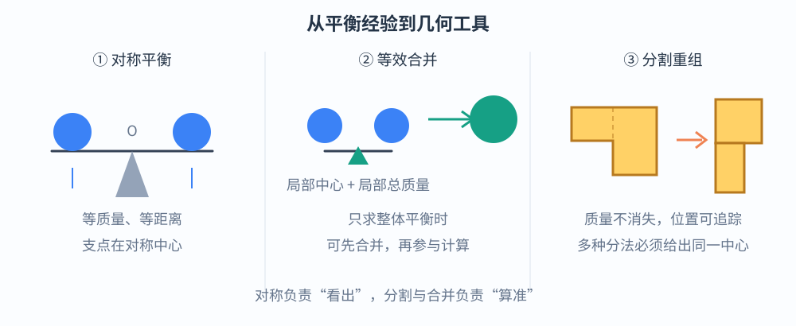
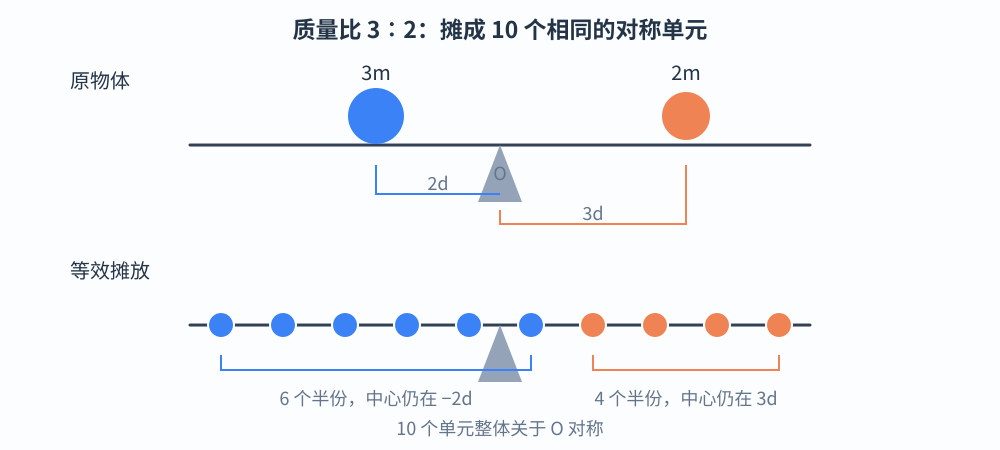
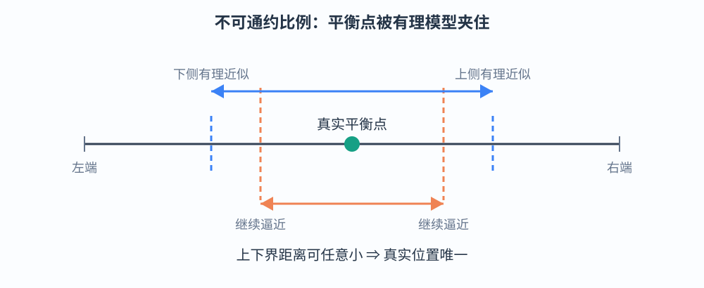
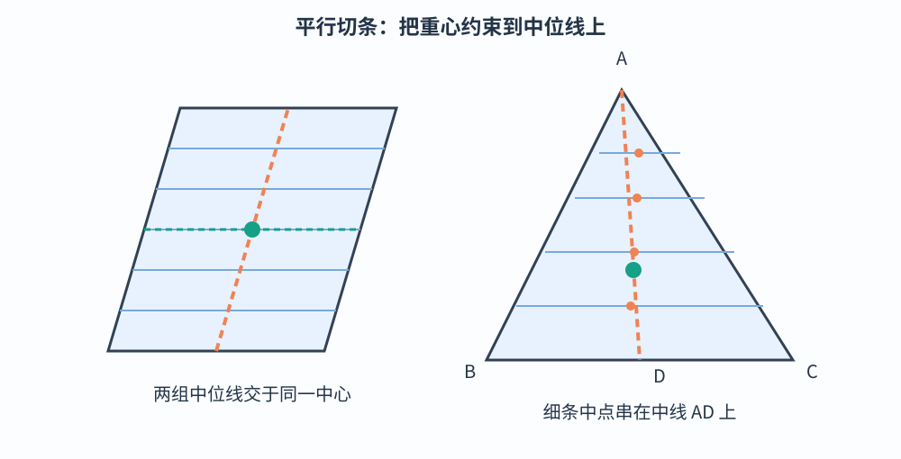
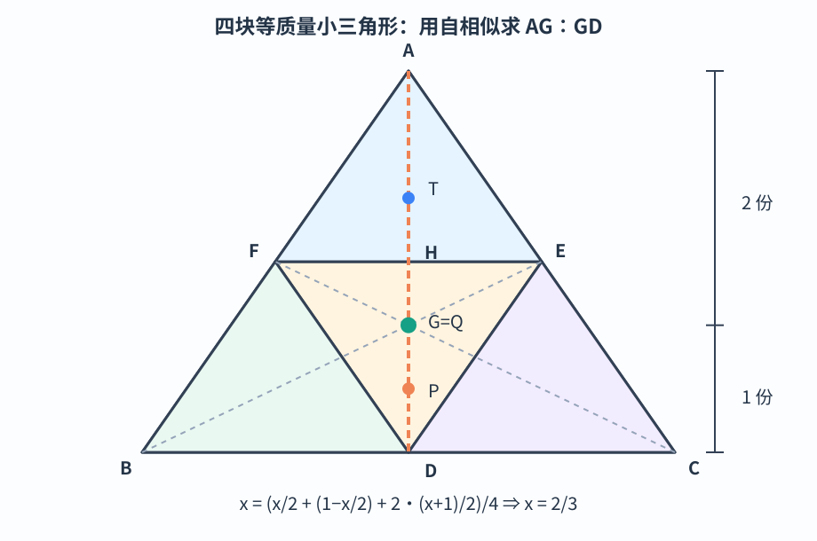
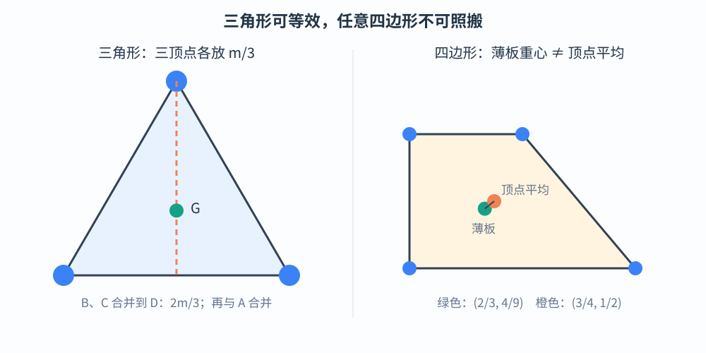
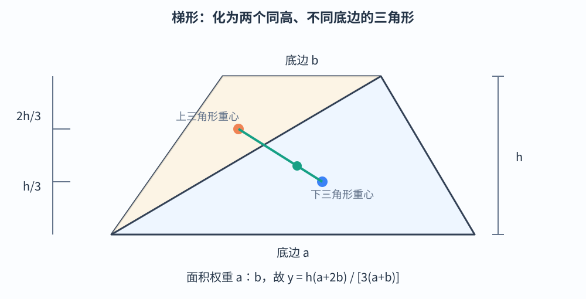
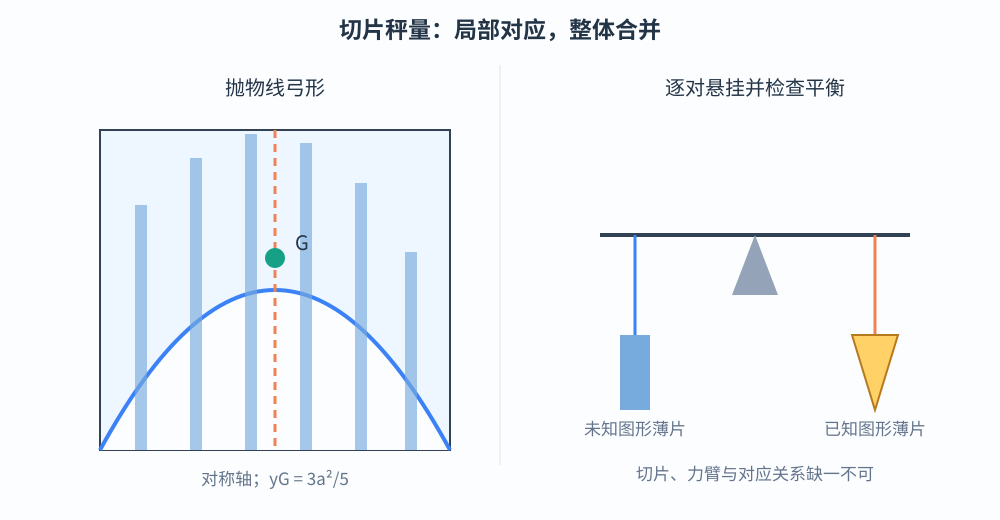
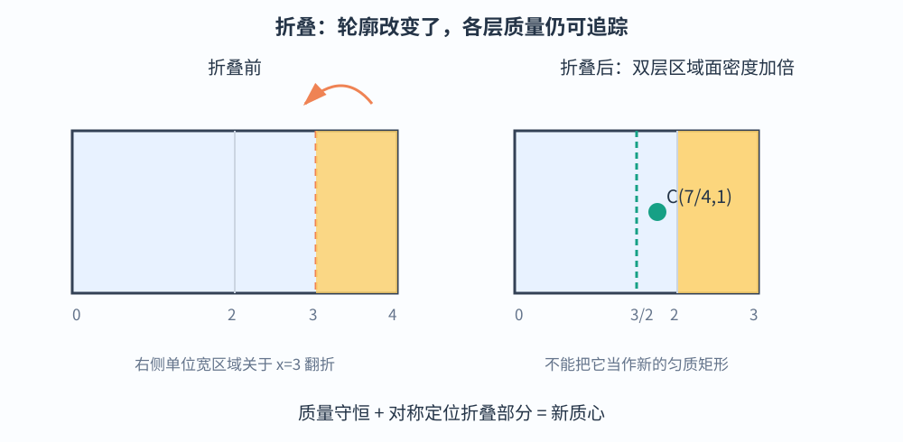
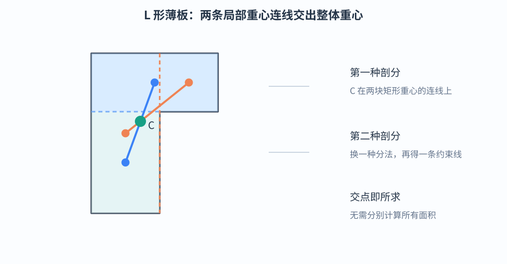

# 第 1 章　从平衡经验到几何重心

> 本章不用积分，也不把力矩公式当作出发点。我们先从对称、分割与合并推出杠杆定律，再用同样的思想寻找平行四边形、三角形和梯形的重心。每个关键结论之后，再用今天的力学语言作一次简短复盘。

## 1.1　从平衡经验抽象出的七条工作约定

### 1.1.1　为什么几何图形也有“平衡点”

把一块厚薄均匀的薄板放在水平面上，在它的下面找一个支撑点。若支撑点位置合适，薄板可以保持水平平衡。这个位置不只与板有多重有关，还与质量怎样分布有关。

研究这个问题时，我们先作三项理想化：薄板质量均匀分布；杠杆和支架足够刚硬；支点摩擦、空气阻力等因素忽略。于是，实际问题转化为一个纯粹的几何问题：**怎样分割、合并一个图形，才能看出它的平衡中心？**

### 1.1.2　七条工作约定

以下七条不是需要死记的公式，而是本章反复使用的推理工具。它们都可以由后来的牛顿力学重新解释。

1. **对称平衡**：若质量分布关于某点或某轴对称，则相应对称中心就是平衡中心。两个相等重物放在支点两侧等距处，是最基本的例子。
2. **等效替换**：若只关心整体的平衡，可以把一个已经明确平衡中心的子系统，替换成位于该中心、总质量相同的质点。
3. **分割不改总量**：切开物体不会改变每部分的质量，也不会让质量凭空移动。求整体中心时，可以先分别处理各部分。
4. **重组保持等效**：若一次重组保持各子系统的质量和平衡中心不变，就不改变整体的平衡性质。
5. **平衡可叠加**：把两组各自平衡的系统装在同一刚体上，若它们的共同支点相同，合起来仍以该点为平衡点。
6. **平衡点唯一**：对位于同一直线上的给定质量分布，水平平衡支点不会同时有两个不同位置。把支点向一侧移动，原先较轻的一侧不可能因此变得更占优势。
7. **连续逼近**：若一系列质量分布的平衡中心可以任意接近某点，那么极限分布的平衡中心就是该点。不可通约比例和无限细切分都要靠这一条完成最后一步。

> **注意**　“等效替换”在这里只针对静力平衡。到了碰撞、转动动能等问题中，一个质点通常不能代替整个物体。

---

## 1.2　杠杆定律：把不对称变成对称

### 1.2.1　问题与结论

在轻杆两端分别放置质量为 \(m_1,m_2\) 的物体。设支点到两物体的距离分别为 \(l_1,l_2\)。杠杆定律说，平衡条件为

\[
m_1l_1=m_2l_2.
\]

本节不把这个式子当定义，而用等质量单元的对称排列把它推出来。

### 1.2.2　可通约情形：一个 \(3:2\) 的例子

设 \(m_1:m_2=3:2\)，并把左侧物体放在支点左边 \(2d\) 处，右侧物体放在支点右边 \(3d\) 处。

把原来的每一份质量再平分为两份：

- 左侧质量 \(3m\) 变成 \(6\) 个质量为 \(m/2\) 的单元；
- 右侧质量 \(2m\) 变成 \(4\) 个质量为 \(m/2\) 的单元。

把它们放在一条等间距点列上，使左边 \(6\) 个单元的中心仍在 \(-2d\)，右边 \(4\) 个单元的中心仍在 \(3d\)。具体位置可以取

\[
-\frac92d,-\frac72d,\ldots,\frac12d
\quad\text{与}\quad
\frac32d,\frac52d,\frac72d,\frac92d.
\]

左组的首尾平均值为 \(-2d\)，右组的首尾平均值为 \(3d\)，所以两组各自的平衡中心没有移动。更重要的是，这 \(10\) 个完全相同的单元现在关于支点 \(O\) 对称，因此整体必在 \(O\) 处平衡。

### 1.2.3　一般证明

设

\[
m_1:m_2=p:q,
\]

其中 \(p,q\) 为正整数。取

\[
l_1=qd,\qquad l_2=pd.
\]

把左右两物体分别分成 \(2p,2q\) 个相同的小单元。由于

\[
\frac{m_1}{2p}=\frac{m_2}{2q},
\]

这些小单元确实具有相同质量。再将全部 \(2p+2q\) 个单元放在以 \(O\) 为中心的等间距点列上。第 \(k\) 个位置写成

\[
x_k=\left(-p-q+\frac12+k\right)d,
\qquad k=0,1,\ldots,2p+2q-1.
\]

前 \(2p\) 个单元的平均位置为 \(-qd\)，后 \(2q\) 个单元的平均位置为 \(pd\)。所以这种摊放只把各组质量关于原来的位置对称展开，并没有改变各组的等效中心。与此同时，完整点列关于 \(O\) 对称，故 \(O\) 是平衡点。

于是

\[
\frac{m_1}{m_2}=\frac pq=\frac{l_2}{l_1},
\]

即 \(m_1l_1=m_2l_2\)。反过来，对给定的两个物体，直线上的平衡点唯一，所以只有满足这个比例时才能平衡。

### 1.2.4　不可通约情形：用有理比例夹逼

若质量比不是整数比，不能真的把两物体分成有限个完全相同的单元。这时不能只说“无限细分后仍然成立”，而要说明误差为什么能任意小。

设左、右物体到支点的总长度 \(l_1+l_2=L\) 固定。有理质量比的情形已经给出

\[
l_1=\frac{m_2}{m_1+m_2}L.
\]

对一般质量比，可以用两列有理数从下方和上方逼近 \(m_1/m_2\)。每得到一个有理近似，就得到一个已经证明成立的杠杆模型；由“支点向哪侧移动，哪侧力臂就变长”的单调性，真实平衡点被夹在相邻两个有理模型的平衡点之间。

当有理近似的误差任意小时，上下两个平衡点的距离也任意小，而它们共同逼近上式给出的位置。因此，真实平衡点只能是

\[
l_1=\frac{m_2}{m_1+m_2}L,
\qquad
l_2=\frac{m_1}{m_1+m_2}L.
\]

这就把杠杆定律推广到了任意正质量。

> **用今天的话说**　以支点为转轴，左右重力的力矩分别为 \(m_1gl_1\) 与 \(m_2gl_2\)。平衡要求合力矩为零，所以 \(m_1gl_1=m_2gl_2\)，约去 \(g\) 就是杠杆定律。几何证明揭示了它背后的对称性；力矩语言则把同一结论压缩成了一条计算规则。

---

## 1.3　平行四边形与三角形：切条、递降与等效

### 1.3.1　平行四边形：两组中位线交点

把平行四边形切成许多与一组对边平行的细条。每条足够细时都可看作一根匀质细杆，其中心位于该组对边中点的连线上。因此，无论各条长短如何，整体的平衡中心一定落在这条中位线上。

换另一组对边重复同样的切分，平衡中心又必须落在第二条中位线上。两条中位线只交于一点，即平行四边形对角线的交点，所以这就是它的重心。

这里的“细条可看作细杆”是极限语言：有限宽度时，条带边缘会带来小误差；让最大条宽趋于零，各条中心与相应中位线的偏差也趋于零，故整体重心的极限位置不变。

### 1.3.2　三角形：为什么重心在中线上

在三角形 \(ABC\) 中，作平行于 \(BC\) 的许多细条。每条细条的两端分别位于 \(AB,AC\) 上，足够细时可看成一根细杆，其中点位于顶点 \(A\) 与 \(BC\) 中点 \(D\) 的连线上。

所以整个三角形的重心必在中线 \(AD\) 上。换一条边切分，重心也在另外两条中线上。三条中线因此交于同一点 \(G\)。

这一步只确定了“在中线上”，还没有确定 \(AG:GD\)。下面的自相似剖分将比例也求出来。

### 1.3.3　四块全等三角形：完整推出 \(2:1\)

设 \(D,E,F\) 分别是 \(BC,CA,AB\) 的中点。连接 \(D,E,F\)，原三角形被分成四块全等的小三角形，所以每块质量都是总质量的四分之一。

令

\[
x=\frac{AG}{AD}.
\]

我们只需用 \(x\) 表示四块小三角形的重心位置。

- 顶部三角形 \(AFE\) 与原三角形以 \(A\) 为中心、比例为 \(1/2\) 相似，所以它的重心 \(T\) 满足 \(AT/AD=x/2\)。
- 中央三角形 \(DFE\) 也与原三角形相似，只是方向倒转。设 \(H\) 为 \(FE\) 的中点，则 \(AH=AD/2\)，其重心 \(Q\) 在 \(DH\) 上，并且 \(DQ/DH=x\)。因此它在中线 \(AD\) 上对应的位置为 \(1-x/2\)。
- 下方两个三角形 \(BDF,CDE\) 的重心分别记为 \(G_B,G_C\)。由比例为 \(1/2\) 的相似关系，
  \[
  \overrightarrow{BG_B}=\frac12\overrightarrow{BG},
  \qquad
  \overrightarrow{CG_C}=\frac12\overrightarrow{CG}.
  \]
  两块质量相等，可以合并为位于其共同重心 \(P\) 的一块。由 \(D\) 是 \(BC\) 中点可得 \(P\) 是 \(GD\) 的中点，所以它对应的位置为 \((x+1)/2\)。

四块质量相等，整体重心就是四个局部重心的加权平均，其中下方两块合起来占两份权重。因此

\[
x=\frac{\dfrac x2+\left(1-\dfrac x2\right)+2\cdot\dfrac{x+1}{2}}4
=\frac{x+2}{4}.
\]

解得 \(x=2/3\)，即

\[
\boxed{AG:GD=2:1}.
\]

这不是把四块拼图“看上去差不多”当作证明。相似关系给出了局部重心的位置，等面积给出了相同权重，最后的加权合并才锁定比例。

### 1.3.4　三角形薄板与三个顶点质点等效

在三角形三个顶点各放一个质量为 \(m/3\) 的质点。先把 \(B,C\) 两点的质点合并，得到位于 \(D\) 的质量 \(2m/3\)；再与位于 \(A\) 的质量 \(m/3\) 合并。

根据杠杆反比关系，合成重心 \(G\) 满足

\[
AG:GD=\frac{2m}{3}:\frac m3=2:1.
\]

它恰好也是三角形薄板的重心。因此，在只求重心时，

\[
\boxed{\text{匀质三角形薄板}\iff\text{三个顶点各放总质量的 }1/3}.
\]

这个等效来自三角形的仿射性质，不能随意推广到任意多边形。例如顶点为

\[
(0,0),\ (2,0),\ (1,1),\ (0,1)
\]

的匀质梯形，其薄板重心为 \((2/3,4/9)\)，而四顶点等质量质点的重心为 \((3/4,1/2)\)，二者并不相同。

> **用今天的话说**　若顶点位置矢量为 \(\vec a,\vec b,\vec c\)，三角形重心就是
> \[
> \vec g=\frac{\vec a+\vec b+\vec c}{3}.
> \]
> 这里的三个顶点具有相同权重；任意四边形则不能只靠“四个顶点平均”解决。

---

## 1.4　梯形与抛物线弓形：从合并到切片秤量

### 1.4.1　梯形：两个三角形就够了

设梯形两底长度分别为 \(a,b\)，高为 \(h\)，其中长度为 \(a\) 的底边在下。沿一条对角线切分，可得两个三角形：一个以 \(a\) 为底，另一个以 \(b\) 为底。它们的高都为 \(h\)，面积分别正比于 \(a,b\)。

下三角形的重心距下底 \(h/3\)；上三角形的重心距上底 \(h/3\)，即距下底 \(2h/3\)。把两块分别等效为位于各自重心的质点，设梯形重心距下底为 \(y\)，由杠杆合并得

\[
y=\frac{a\cdot\dfrac h3+b\cdot\dfrac{2h}{3}}{a+b}
=\boxed{\frac{h(a+2b)}{3(a+b)}}.
\]

若只求重心的确切位置，还需把两个三角形的重心连成一条线；整体重心必在这条连线上，再由上式确定高度。不要误认为任意梯形的重心都在两腰中点连线上。

### 1.4.2　切片秤量：把几何体移到杠杆上

阿基米德式机械法的核心思想是：把未知图形与已知图形切成许多对应薄片，再将薄片成对挂到杠杆两端。如果每一对薄片都能平衡，那么整体也能平衡。

这种方法有两个关键：

1. 切片不是只为计算面积，而是为了建立一一对应；
2. 切片的质量、悬挂位置和力臂必须同时匹配，不能只比较长短。

> **选读：抛物线弓形的面积与重心，完整离散推导**
>
> 考虑抛物线 \(y=x^2\) 与水平弦 \(y=a^2\) 围成的弓形，即
> \[
> -a\le x\le a,\qquad x^2\le y\le a^2.
> \]
> 它关于 \(y\) 轴对称，所以重心横坐标为零。下面只需求面积和高度。
>
> 把区间 \([0,a]\) 等分为 \(n\) 份，取
> \[
> x_i=\frac{ia}{n},\qquad \Delta x=\frac an,\qquad i=1,2,\ldots,n.
> \]
> 第 \(i\) 个竖直细条的高度为 \(a^2-x_i^2\)。用矩形近似细条，再连同左半部分一起求和，面积近似为
> \[
> S_n=2\sum_{i=1}^n(a^2-x_i^2)\Delta x
> =2a^3\left(1-\frac1{n^3}\sum_{i=1}^n i^2\right).
> \]
> 利用
> \[
> \sum_{i=1}^n i^2=\frac{n(n+1)(2n+1)}6,
> \]
> 可得 \(S_n\to4a^3/3\)。矩形近似造成的边缘误差随最大条宽趋于零而趋于零，因此
> \[
> \boxed{S=\frac43a^3}.
> \]
> 也就是说，弓形面积是宽 \(2a\)、高 \(a^2\) 的外接矩形面积的 \(2/3\)。
>
> 第 \(i\) 个细条的中心高度为 \((a^2+x_i^2)/2\)。各条面积乘以中心高度并求和，得到
> \[
> M_n=2\sum_{i=1}^n(a^2-x_i^2)\frac{a^2+x_i^2}{2}\Delta x
> =a^5\left(1-\frac1{n^5}\sum_{i=1}^n i^4\right).
> \]
> 再由
> \[
> \sum_{i=1}^n i^4
> =\frac{n(n+1)(2n+1)(3n^2+3n-1)}{30}
> \]
> 可知 \(M_n\to4a^5/5\)。所以重心高度
> \[
> y_C=\frac{M}{S}
> =\frac{4a^5/5}{4a^3/3}
> =\boxed{\frac35a^2}.
> \]
> 重心因此位于从抛物线顶点到水平弦的 \(3/5\) 处，或者说距弦 \(2a^2/5\)。这里虽然没有写积分号，但“有限求和—边缘误差消失—取极限”的链条是完整的。

---

## 1.5　竞赛母题精讲与练习

### 例题 1.1　折叠纸片：折过来的质量去了哪里

一张密度为 \(\sigma\) 的匀质矩形纸片，占据 \(0\le x\le4,0\le y\le2\)。把 \(3\le x\le4\) 的部分沿直线 \(x=3\) 向左翻折。求折叠后纸片的重心。

**解**　折叠不会改变任何部分的质量，但会改变它的位置。将纸片分成三块：

| 部分 | 质量 | 折叠后的重心横坐标 |
|---|---:|---:|
| \(0\le x\le2\) | \(4\sigma\) | \(1\) |
| \(2\le x\le3\) | \(2\sigma\) | \(5/2\) |
| 原 \(3\le x\le4\) | \(2\sigma\) | 原 \(7/2\) 关于 \(x=3\) 对称，变为 \(5/2\) |

折叠部分与原位置的点满足 \(x'=6-x\)。三块在竖直方向都没有变化，重心纵坐标仍为 \(1\)。所以

\[
x_C=\frac{4\sigma\cdot1+2\sigma\cdot\frac52+2\sigma\cdot\frac52}{8\sigma}
=\frac74.
\]

\[
\boxed{(x_C,y_C)=\left(\frac74,1\right)}.
\]

**易错点**　折叠后的外轮廓只是一个矩形，但不能把它当成新的匀质矩形。折叠区域有两层纸，面密度加倍；求重心必须追踪原来的质量。

### 例题 1.2　L 形薄板：两种剖分交出一个点

一块匀质 L 形薄板可以按水平方向切成两个矩形，也可以按竖直方向切成另外两个矩形。不作面积计算，怎样确定它的重心？

**解**　第一种剖分中，整体重心必在两个矩形重心的连线上；第二种剖分中，它又必在另外两个矩形重心的连线上。两条连线不平行，所以交点就是整体重心。

这个方法利用的不是“两条中线必过重心”的模糊经验，而是**两体合并后，重心必在两体重心连线上**。若两条线恰好重合，只能说明这种剖分没有提供两个独立约束，需要换分法或再补一个条件。

### 练习 1.1

一匀质梯形的下底为 \(6\)，上底为 \(2\)，高为 \(3\)。求重心距下底的高度。

**提示**　直接使用梯形双三角形结论，注意 \(a=6,b=2\)。

**答案**　\(\displaystyle y=\frac{3(6+2\times2)}{3(6+2)}=\frac54\)。

### 练习 1.2

在三角形 \(ABC\) 中，\(D\) 为 \(BC\) 的中点，点 \(P\) 在中线 \(AD\) 上且 \(AP:PD=1:2\)。把三角形薄板等效为三个顶点等质量质点后，不重新求重心，判断 \(P\) 与重心 \(G\) 的关系。

**提示**　比较 \(AP/AD\) 与 \(AG/AD\)。

**答案**　\(AG:GD=2:1\)，故 \(AG/AD=2/3\)；而 \(AP/AD=1/3\)。因此 \(P\) 是 \(AG\) 的中点，\(AP=PG\)。

---

## 本章小结

- 杠杆定律可以由等质量单元的对称排列推出，力矩公式是它在现代力学中的压缩表达。
- 对称切条负责确定重心所在的直线，分割合并负责确定具体比例。
- 三角形薄板的重心是三条中线的三等分点，并可等效为三个顶点的等质量质点。
- 梯形可化为两个三角形；抛物线弓形展示了切片、有限求和与极限如何连接。
- 折叠、拼接问题的核心始终是：**质量有没有移动，各部分的质量和重心分别变成了什么。**
