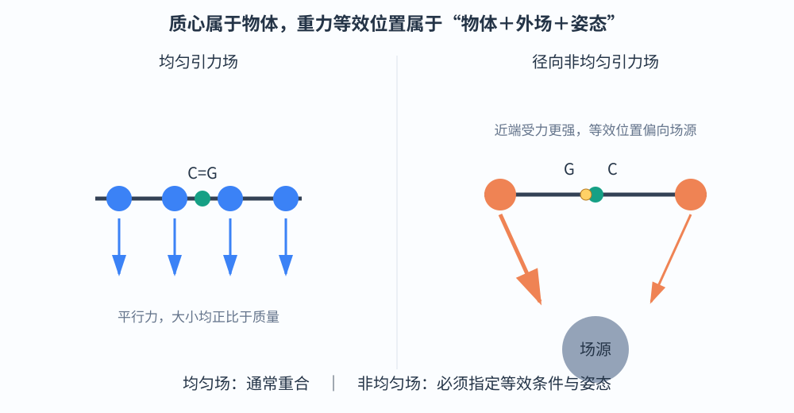
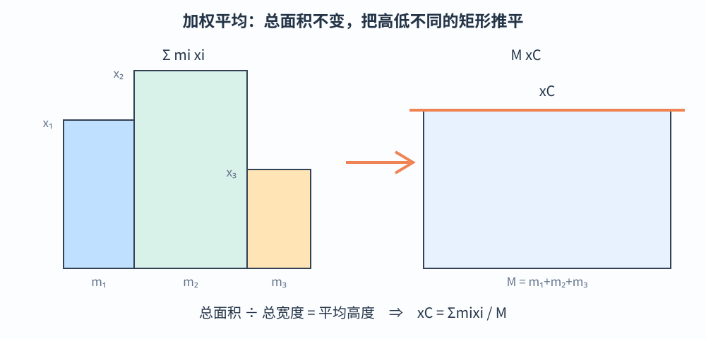
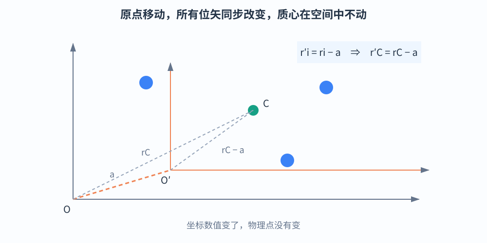
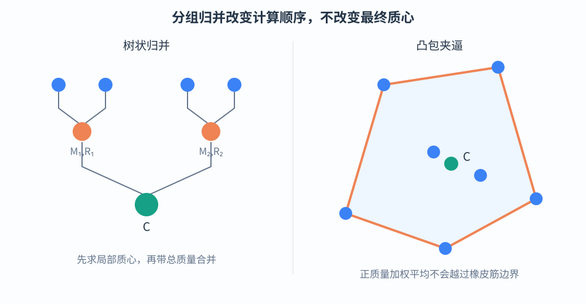
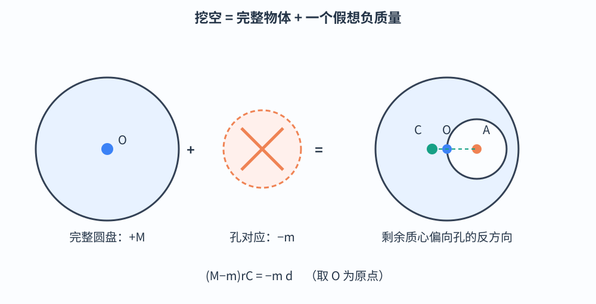
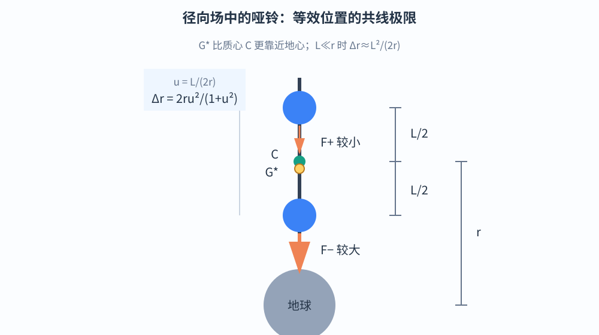
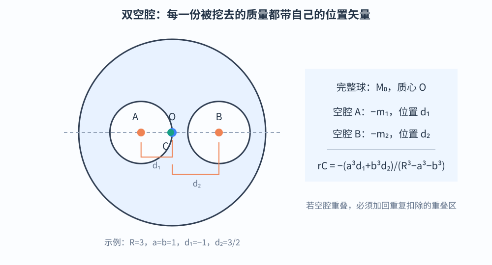

# 第 2 章　从重力等效到质量分布

> 第一章的平衡中心依赖重力。本章把它改写为一个与引力场无关的几何对象——质心，并建立质心公式及其结构性质。全章只使用向量、求和号与微元，不使用积分号。

## 2.1　重心与质心：何时相同，何时必须分开

### 2.1.1　两个定义回答不同问题

**重心**首先是一个力学概念：在指定外引力场和指定姿态下，重力对物体的作用能否等效为一个合力，这个合力对转动的效果相当于作用在哪里？

**质心**则是一个质量分布概念：不考虑任何外力，物体各部分的位置按质量作加权平均，得到的中心在哪里？

所以：

- 重心与引力场有关，也可能与物体在场中的姿态有关；
- 质心只由物体本身的质量分布决定，在深空中依然存在。

在均匀引力场中，各处重力加速度均为同一个 \(\vec g\)，重力是一组同向、大小正比于质量的平行力。沿任意与重力垂直的方向使用杠杆定律，都得到同一个加权平均位置。因此通常意义下

\[
\boxed{\text{均匀引力场中，重心与质心重合。}}
\]

### 2.1.2　非均匀场为什么不能照搬

若引力场随位置变化，各微元受到的重力不再具有相同大小，方向也未必平行。靠近场源的部分可能受到明显更强的引力，重力的等效作用位置就会偏向这一部分。

在径向场中，各微元引力还可能汇向场源。此时不能不加说明地假定“重力等价于固定作用在某一点的一个力”。本章所说的非均匀场重心，限定为：**在指定姿态、能够作静力等效时，重力合力作用线与物体相关直线的交点或等效作用位置。**它不一定是物体固有的固定点。

质心则没有这种歧义。下一节先把它完全从外场中剥离出来。

---

## 2.2　质心公式：质量加权的几何平均

### 2.2.1　离散质点系

设系统由 \(N\) 个质点组成，第 \(i\) 个质点的质量为 \(m_i\)，位置矢量为 \(\vec r_i\)，总质量为

\[
M=\sum_{i=1}^N m_i.
\]

质心位置定义为

\[
\boxed{\vec r_C=\frac{\sum_{i=1}^N m_i\vec r_i}{M}}.
\]

分量形式为

\[
x_C=\frac{\sum m_ix_i}{M},\qquad
y_C=\frac{\sum m_iy_i}{M},\qquad
z_C=\frac{\sum m_iz_i}{M}.
\]

对于连续物体，可把它切成许多小份。第 \(i\) 份质量为 \(\Delta m_i\)，其中心位置为 \(\vec r_i\)，于是

\[
\boxed{\vec r_C\approx\frac{\sum_i\vec r_i\,\Delta m_i}{\sum_i\Delta m_i}}.
\]

让各份的最大尺寸趋于零，近似误差也趋于零，就得到连续体的质心。这里不需要写积分号，但“分割越来越细、近似任意精确”的含义不能省略。

### 2.2.2　为什么是加权平均

两个质量相同的质点，质心在连线中点；质量不同，质心更靠近质量较大的质点。若质量分别为 \(m_1,m_2\)，则

\[
\vec r_C=\frac{m_1\vec r_1+m_2\vec r_2}{m_1+m_2}.
\]

它正好满足

\[
m_1(\vec r_C-\vec r_1)+m_2(\vec r_C-\vec r_2)=\vec0.
\]

也就是说，以质心为基准，左右两侧的“质量乘位置偏移”相互抵消。多个质点只是把这个抵消条件推广到更多方向。

在柱状图中，把 \(m_i\) 看成矩形宽度，把 \(x_i\) 看成矩形高度，则 \(\sum m_ix_i\) 是总面积。若保持总宽度 \(M\) 不变，把这些矩形“削峰填谷”为同一个高度，该高度就是

\[
x_C=\frac{\sum m_ix_i}{M}.
\]

### 2.2.3　唯一性与坐标原点无关性

总质量固定时，公式给出的加权平均只有一个结果，所以质心唯一。更重要的是，它不是某个坐标系里的特殊点，而是空间中的确定点。

把原点从 \(O\) 移到 \(O'\)，且

\[
\overrightarrow{OO'}=\vec a.
\]

每个质点相对新原点的位置矢量变为

\[
\vec r_i'=\vec r_i-\vec a.
\]

于是

\[
\vec r_C'
=\frac{\sum m_i(\vec r_i-\vec a)}{M}
=\frac{\sum m_i\vec r_i}{M}-\vec a
=\vec r_C-\vec a.
\]

这与质点位置矢量的变换完全相同，所以新旧坐标描述的是同一个空间点。

若坐标系发生旋转，旋转保持矢量加法和数乘关系，质心位置矢量也按同样方式旋转。因此，质心不依赖坐标轴方向。

> **解题提醒**　选原点只是为了简化计算，不能改变答案所指的物理位置。若换原点后质心在空间中的位置变了，通常是把“坐标数值变化”误当成了“物体中心移动”。

---

## 2.3　四项结构性质：把复杂系统拆开再装回去

### 2.3.1　性质一：分组归并

把系统任意分成若干组。第 \(k\) 组总质量为 \(M_k\)，质心位置为 \(\vec R_k\)，则

\[
\sum_{i\in k}m_i\vec r_i=M_k\vec R_k.
\]

把所有组加起来：

\[
\vec r_C
=\frac{\sum_kM_k\vec R_k}{\sum_kM_k}.
\]

所以每一组都可以先等效为位于其质心、质量为 \(M_k\) 的质点，再求总质心。分组顺序不会影响结果。

这就是质心的**结合律**。第一章的三角形顶点等效、梯形双三角形拆分，都是它的特例。

### 2.3.2　性质二：凸包夹逼

用一根想象中的橡皮筋套住所有质点，橡皮筋形成的最小凸区域称为这些点的**凸包**。凸包没有向内的凹陷；连接凸包内任意两点的线段仍完全在凸包内。

正质量质心是两个质点连线上的内分点。不断使用分组归并，每次合并都不会越出原有凸包，因此

\[
\boxed{\text{正质量系统的质心必在所有质量分布的闭凸包内。}}
\]

若至少有两个不同位置且所有质量都为正，质心会落在凸包的相对内部；若所有质量共线，它位于最两端之间的开线段内。只有一个质点时，质心当然就是该点。

凸包性质常用于快速排错：

- 三角形薄板的质心不可能在三角形外；
- 半圆盘的质心不可能比圆弧更靠外；
- 挖孔以后使用负质量，凸包结论不再直接适用。

### 2.3.3　性质三：线性叠加与负质量

若两个系统的质量与质心分别为 \((M_1,\vec R_1)\)、\((M_2,\vec R_2)\)，合并后

\[
\vec r_C=\frac{M_1\vec R_1+M_2\vec R_2}{M_1+M_2}.
\]

“挖空”可以反过来利用这条线性关系：把残缺物体看成完整物体叠加一个质量为负的假想物体。负质量不是实际存在的物质，只是一种使求和仍然成立的代数工具。

例如，完整圆盘质量为 \(M\)，质心为 \(O\)；挖去的小圆盘质量为 \(m\)，质心为 \(A\)。剩余质量为 \(M-m\)，其质心 \(C\) 满足

\[
(M-m)\vec r_C=M\vec 0-m\vec r_A.
\]

若取 \(O\) 为原点，\(\vec r_A=\vec d\)，则

\[
\boxed{\vec r_C=-\frac{m}{M-m}\vec d}.
\]

剩余质心位于孔心的反方向。此时“完整圆盘＋负质量小圆盘”的总质心位于两中心连线的外分点，而不是内分点。

### 2.3.4　性质四：相似缩放

把物体关于点 \(S\) 作比例为 \(k\) 的相似缩放，每个位置矢量都由

\[
\vec r_i-\vec s
\]

变为 \(k(\vec r_i-\vec s)\)。因此

\[
\vec r_C'-\vec s
=\frac{\sum m_i\,k(\vec r_i-\vec s)}M
=k(\vec r_C-\vec s).
\]

质心也按完全相同的方式缩放。均匀拉伸、旋转和平移也有相应的质心变换规律，这为后续利用圆求椭圆、利用正三角形研究任意三角形提供了基础。

---

## 2.4　竞赛母题精讲与练习

### 例题 2.1　径向引力场中的哑铃：等效位置的共线极限

两个质量均为 \(m\) 的小球由一根长为 \(L\) 的轻杆连接。哑铃近似沿地心向外放置，两球到地心的距离分别为

\[
r_-=r-\frac L2,\qquad r_+=r+\frac L2,
\]

其中 \(r\) 为质心到地心的距离，且 \(L<2r\)。设地球质量为 \(M_E\)，引力常量为 \(G\)。求重力等效作用位置趋于共线姿态时与质心的距离差，并给出 \(L\ll r\) 时的近似。

**解**　先说明一个容易忽略的细节：若两球与地心严格共线，两个引力及合力都沿同一直线，静力等效不能在杆上唯一选出一点。因此，我们先让轻杆相对径向保持微小但非零的倾角，取重力合力作用线与轻杆的交点，再令倾角趋于零。

两球受到指向地心的引力，大小分别为

\[
F_-=\frac{GM_Em}{(r-L/2)^2},
\qquad
F_+=\frac{GM_Em}{(r+L/2)^2}.
\]

下端球受力较大。在非共线姿态下，按两力大小对两球位置作加权平均，所得点既在轻杆上，也在合力的作用方向上，因此就是所取交点。其到地心距离在共线极限中为

\[
r_G^*=\frac{F_-r_-+F_+r_+}{F_-+F_+}.
\]

令 \(u=L/(2r)\)，代入得

\[
\frac{r_G^*}{r}
=\frac{(1-u)^{-1}+(1+u)^{-1}}
{(1-u)^{-2}+(1+u)^{-2}}
=\frac{1-u^2}{1+u^2}.
\]

所以

\[
\boxed{\Delta r=r-r_G^*=\frac{2ru^2}{1+u^2}}.
\]

这个极限位置比质心更靠近地心。当 \(u\ll1\) 时，分母 \(1+u^2\approx1\)，故

\[
\boxed{\Delta r\approx2ru^2=\frac{L^2}{2r}}.
\]

这里出现的是 \(L/r\) 的二阶小量：两球引力的一阶差异在平均时大部分抵消，剩余偏离由二阶项决定。

**与重力梯度力矩的联系**　若哑铃相对径向略转一个角度，近地端受力的增强和远地端受力的减弱不再关于质心完全对称，会产生使轻杆重新转向径向的恢复力矩。这就是重力梯度稳定的基本来源。此结论讨论的是力矩方向，不意味着所有姿态下都存在一个与姿态无关的固定重心。

### 例题 2.2　双空腔球体：两行矢量求质心

半径为 \(R\) 的匀质实心球内挖去两个互不重叠的小球腔。以原球心 \(O\) 为原点，两腔的球心位置矢量分别为 \(\vec d_1,\vec d_2\)，半径分别为 \(a,b\)。球体密度为 \(\rho\)。求剩余部分的质心。

**解**　完整球、两个被挖去小球的“质量”分别记为

\[
M_0=\rho\frac43\pi R^3,\qquad
m_1=\rho\frac43\pi a^3,\qquad
m_2=\rho\frac43\pi b^3.
\]

完整球质心在原点，因此完整球对分子没有贡献。把两个空腔视为负质量，直接得到

\[
\boxed{
\vec r_C=
\frac{-m_1\vec d_1-m_2\vec d_2}{M_0-m_1-m_2}
}.
\]

共同因子 \(\rho\frac43\pi\) 可以约去，也可写成

\[
\boxed{
\vec r_C=-\frac{a^3\vec d_1+b^3\vec d_2}{R^3-a^3-b^3}
}.
\]

**数值检验**　取 \(R=3,a=b=1\)，两腔心均在 \(x\) 轴上，坐标分别为 \(-1\) 与 \(3/2\)。它们互不重叠且都在原球内。于是

\[
x_C=-\frac{1\cdot(-1)+1\cdot(3/2)}{3^3-1-1}
=-\frac1{50},\qquad y_C=z_C=0.
\]

质心略向左偏：两腔质量虽相等，但右腔离球心更远，两个负质量矩没有完全抵消，合效果指向右侧。

> **选读：两个空腔重叠时为什么要加回一块**
>
> 若直接从完整球中减去空腔 \(A\) 和空腔 \(B\)，重叠区域 \(A\cap B\) 被减了两次，但实际只需挖去一次。因此要加回一份重叠区域。
>
> 设重叠区域的质量为 \(m_{AB}\)，质心为 \(\vec d_{AB}\)，则剩余质量和质心满足
> \[
> M=M_0-m_1-m_2+m_{AB},
> \]
> \[
> \boxed{
> \vec r_C=
> \frac{-m_1\vec d_1-m_2\vec d_2+m_{AB}\vec d_{AB}}
> {M_0-m_1-m_2+m_{AB}}
> }.
> \]
> 这就是容斥思想在质心中的形式。负质量法并不会失效，但必须让每一块区域最终恰好被计算一次。

### 练习 2.1

三个质点的质量和坐标分别为

\[
m:(0,0),\qquad 2m:(3,0),\qquad m:(0,6).
\]

求质心坐标。再把所有坐标写成相对新原点 \((1,1)\) 的形式，检查空间中的质心是否改变。

**提示**　先算总质量 \(4m\)；换原点后所有横、纵坐标都分别减 \(1\)。

**答案**　原坐标下

\[
x_C=\frac{2m\cdot3}{4m}=\frac32,
\qquad
y_C=\frac{m\cdot6}{4m}=\frac32.
\]

新坐标下三点为 \((-1,-1),(2,-1),(-1,5)\)，算得质心为 \((1/2,1/2)\)。它相对新原点加回 \((1,1)\)，仍是原空间中的 \((3/2,3/2)\)。

### 练习 2.2

半径为 \(R\) 的匀质圆盘中，挖去一个半径为 \(R/2\) 的小圆盘。小圆盘与原圆盘内切，两圆心相距 \(R/2\)。求剩余部分质心到原圆心的距离。

**提示**　完整圆盘与孔的质量比为 \(4:1\)，取孔心方向为正方向。

**答案**　设完整圆盘质量为 \(4m\)，孔对应质量为 \(m\)，剩余质量为 \(3m\)。以原圆心为原点，孔心坐标为 \(R/2\)，则

\[
x_C=-\frac{m(R/2)}{3m}=-\frac R6.
\]

所以剩余质心位于孔心反方向，距原圆心 \(\boxed{R/6}\)。

---

## 本章小结

- 质心是质量分布的固有属性；重心依赖外场，非均匀场中还可能依赖姿态。
- 质心公式是质量加权平均，具有唯一性和坐标原点无关性。
- 分组归并让复杂系统可以逐层化简；凸包性质负责检查正质量结果的合理范围。
- 负质量是处理挖空问题的代数工具；重叠空腔必须作容斥修正。
- 相似变换怎样移动物体，就怎样移动质心。
